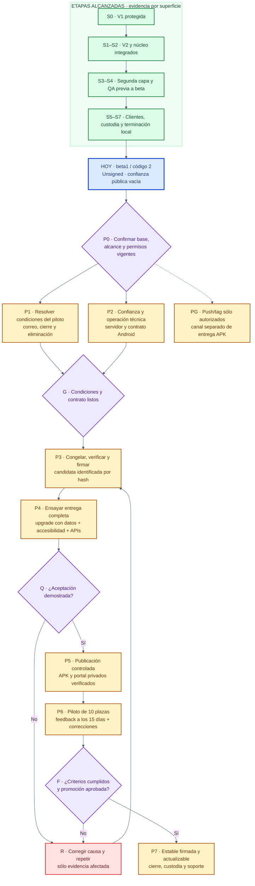

# MiGuardia 2.0 — auditoría integral y plan ejecutable de cierre

**Presentación visual revisada el 8/09:** [mapa por áreas, tarjetas y etapas numeradas](2026-09-08-mapa-visual-y-guia-de-cierre.md), con PNG y Mermaid del mismo diseño. Este informe conserva el detalle de auditoría y los inventarios.

**Adopción posterior:** Joaquín convirtió el orden del mapa en instrucción de MAIN. La [ruta activa](../ORQUESTACION_MAIN.md) gobierna ahora la orquestación; este informe permanece como evidencia fechada, no como plan de despacho alternativo.

**Fecha de corte:** 7 de septiembre de 2026, Argentina.
**Proyecto:** `C:\Users\Joaquin\Desktop\chatgptprojects\MiGuardia-2.0`.
**Rama auditada:** `codex/miguardia-2.0`.
**HEAD de entrada:** `54032d64dd8094f0e10be7e19ff352c30cae7711`.

> **Conclusión:** el núcleo funcional V2, su segunda capa y las últimas mejoras están integrados localmente. Existe una candidata `2.0.0-beta.1`, código `2`, todavía sin firma oficial ni confianza pública del servidor. El camino restante es cerrar la entrega y demostrarla: condiciones del piloto → confianza y servidor → candidata firmada → actualización instalada con datos preservados → publicación controlada → piloto → versión estable. No corresponde volver a construir los módulos terminados.

Este documento es una **auditoría fechada y una propuesta de ejecución**, no una segunda hoja de estado ni una autorización para ejecutar todos sus pasos. [STATUS](../STATUS.md) conserva el estado operativo y las autorizaciones. La solicitud que produjo este informe autoriza auditar y documentar; no inició firma, dispositivos, publicación ni otro bloque funcional. Una IA puede ejecutar el plan cuando MAIN retome el bloque correspondiente, comprobando las autorizaciones ya asentadas y resolviendo únicamente las decisiones materiales faltantes.

## 1. Alcance, evidencia y límites

### 1.1 Qué significan los estados

| Etiqueta | Significado exacto |
|---|---|
| **VERIFICADO EN ESTA AUDITORÍA** | Observado ahora en Git, código, documentos o registros disponibles. No significa haber ejecutado nuevamente la aplicación. |
| **EJECUCIÓN HISTÓRICA DOCUMENTADA** | Existe evidencia fechada de una prueba o acción; sólo cubre sus insumos, artefacto y superficie. |
| **INFERIDO** | Conclusión razonable con una limitación identificada. |
| **PROPUESTO** | Paso o criterio de organización que todavía no se ejecutó o aprobó como producto. |
| **PENDIENTE** | Falta decisión, implementación de entrega o evidencia necesaria para aceptar el resultado. |

Un commit demuestra contenido integrado; un push demuestra actualización de una referencia; ninguno demuestra instalación, firma, publicación de una APK o uso correcto en un teléfono. No se calcula un porcentaje global: sumar botones, commits o pruebas ocultaría las puertas de entrega todavía abiertas.

### 1.2 Cobertura del pedido «cada chat, commit y push»

- **Git:** inventario de los 133 commits alcanzables mediante todas las referencias locales; mensajes, fechas, archivos/estadísticas y revisión de diffs de las transiciones relevantes. Hay 132 commits en HEAD, 47 hasta V1 y 85 posteriores. Dos versiones anteriores de commits modificados con amend siguen recuperables mediante reflog: 135 objetos de commit al incluirlos. No se afirma revisión línea por línea de todos los parches históricos ni de todos los binarios.
- **Pushes:** 33 actualizaciones `update by push` conservadas en reflogs locales: 24 de `main`, 3 de `codex/main-3` y 6 de `codex/miguardia-2.0`. Una consulta de referencias al remoto confirmó su posición actual sin fetch ni modificación de referencias. Git no conserva un registro universal de cada intento, autor o evento remoto; los pushes expirados o realizados desde otros equipos pueden faltar.
- **Chats:** inventario de 505 sesiones locales candidatas por carpeta: 65 principales y 440 subagentes, nueve archivadas. Contienen 40.321 mensajes usuario/asistente y 99.904.759 caracteres, incluidos contextos repetidos. Se revisaron títulos/extractos de cierre de las 65 principales, mensajes sustantivos completos de tres conversaciones recientes y el episodio final de MAIN, además de sus autorizaciones. No se leyó semánticamente todo el corpus ni cada resultado de herramienta. Una sesión trata otro producto y se excluyó de las conclusiones. El anexo B identifica cobertura, excepciones y lectura pendiente; el pedido literal de leer cada chat completo queda **parcialmente cubierto**.
- **Producto:** lectura transversal de planificación, mapa, contratos y evidencia; contraste de arquitectura, persistencia, variantes beta, manifiesto, versión y herramientas de entrega. No es una certificación de ausencia de defectos ni una auditoría línea por línea de los 839 archivos rastreados.
- **Pruebas:** se inspeccionaron registros locales conservados y se ejecutó el control documental. No se repitieron Gradle, instrumentación ni QA física para una entrega exclusivamente documental.
- **Fuera de la observación actual:** chats eliminados o de fuentes no expuestas, historial de eventos del servidor completo, estado en vivo de producción web, pagos, dispositivos, claves privadas y contraseñas. Las publicaciones web históricas se citan como antecedentes, no como verificación pública actual.

**Resultado de Puerta 0:** checkout inicialmente limpio, sin cambios staged ni nuevos; nueve worktrees preservados. `origin` apunta a `https://github.com/blackat-systems/MiGuardia.git`. El remoto consultado conserva `codex/miguardia-2.0` en `924fd46`; HEAD está **24 adelante / 0 atrás**. `main` y el destino del tag anotado `v1.0.0` permanecen en `82db6fd8eb2c511205968894dc9857a96b16ed20`. Los worktrees históricos no son entradas para recuperar o integrar código automáticamente.

## 2. Etapas alcanzadas y estado actual

Los identificadores **S0–S7** siguientes agrupan capacidades para comprender el proyecto. No son números de chats ni sustituyen los nombres de los bloques originales.

| Etapa | Resultado alcanzado | Evidencia y límite |
|---|---|---|
| **S0 — Base V1 e historia protegida** | Fundación Android, calendario, horas, fotos, avisos y sistema visual; referencia V1 preservada. | `82db6fd`; [cierre V1](../releases/MIGUARDIA_1.0.0.md). V1 es antecedente; sus datos y reglas no se adoptan en V2. |
| **S1 — Contratos V2 y persistencia propia** | Cuatro sectores, una configuración laboral, reglas por fecha e instantáneas; runtime V2 exclusivo. | ADR 0020 y 0023–0030; `a63ca25` rechaza adopción V1 y `b04dd59` retira su runtime. Room activo V6, 27 tablas, seis esquemas y migraciones 1→2→3→4→5→6. |
| **S2 — Núcleo de trabajo utilizable** | Lugares, tipos y horarios; carga, edición y eliminación; planes recurrentes; horario real; extras expresas e independientes; disponibilidad, calendario y resumen. | Auditorías del 21/08 al 29/08. Los cambios futuros no reescriben jornadas pasadas; superar una referencia no crea extras. |
| **S3 — Segunda capa local** | Próximo evento, avisos, Widget, informes, copias/restauración, bloqueo, Ayuda, fotos y Clima opcional integrados. | Auditorías de Widget/Informes 29/08, Copias/Bloqueo 01/09 e integración 03/09. Las matrices previas a beta no acreditan los flujos beta añadidos después. |
| **S4 — Integración y compatibilidad anterior a beta** | Candidato transversal revisado; evidencia Android API 26/33/36/37 en sus respectivas bases. | [auditoría final 03/09](2026-09-03-auditoria-final-aplicacion-y-candidato-local-v2.md) y auditorías API específicas. No equivale a matriz actual de distribución. |
| **S5 — Cliente de beta y entrega manual** | Acceso/feedback, Apoyar MiGuardia y cliente de actualización integrados; preparación web documentada. | `3df5b43`, `40f2c55`, `df18dd7`; ADR 0039/0040. Cliente 28 aprobado en su alcance; servidor público y upgrade real siguen pendientes. |
| **S6 — Preparación técnica y custodia** | Versión beta1/code2, APK universal unsigned inspeccionado y dos reconstrucciones idénticas en preparación29; clave APK permanente con respaldo comprobado. | `0e8a5b6`, `7d29f4c`; auditorías de preparación y custodia 06/09. No firmó APK; doble reconstrucción corresponde a esos insumos, no a una futura candidata con confianza. |
| **S7 — Terminación reciente** | H01–H15 cerrados; créditos del clima integrados; crear lugar/horario desde la carga y volver al borrador; cortes visuales al 200 % y persistencia de ayuda corregidos. | `df18dd7`, `e3cb740`, `ea47d71`, `3aa124e`; cierre documental `54032d6`. No reabrir por inferencia ni dividir otra vez el mismo recorrido. |

### 2.1 Evidencia más reciente, sin mezclar bases

La continuación visual de S7 conserva registros de **826 pruebas JVM locales aprobadas**: 379 dominio, 12 database y 435 app. WebCryptoInterop está excluida de ese perfil. También conserva cinco APK compilados y lint con cero errores y seis avisos de versiones. El build proporcional registró 335 tareas, 25 ejecutadas y 310 vigentes.

La ejecución Android documentada fue **56/56**, cero fallos u omisiones, en el AVD API 33 autorizado; hubo una repetición visual 1/1, que no se suma como caso nuevo. Se revisaron históricamente 36 PNG de retrato, claro/oscuro y zoom interno 100/150/200. En esta auditoría se contrastaron los registros conservados; no se volvió a ejecutar esa matriz ni se atribuye nueva revisión visual de las capturas de la app.

Artefactos de esa evidencia:

| Artefacto | SHA-256 |
|---|---|
| Release unsigned, 12.766.881 bytes | `6cdd894cb9c9e279f5a0d284bd557211fb0617100c19c6188a29fd9c0dc23e47` |
| QA | `0013e12773732e6c1f7affebb14d542e9f55dadd2f5d04a4fa0bfb2884b7846b` |
| QA AndroidTest | `2408a3fa6f1064d0f78b682535f2537d0175c50d8290d6458d3568c47e56c221` |

Fuente durable: [cierre crear desde la carga](2026-09-07-crear-desde-carga-main.md). Registros privados: `.local-evidence/contextual-visual-20260907/local-final/result.json`, `build-final/result.json` y `final-android.json`. Las huellas identifican la evidencia histórica; recalcular antes de reutilizar un archivo. No subir APK ni capturas privadas a Git.

**No acreditado por esta matriz:** TalkBack hablado; matriz visual completa con teclado/paisaje; otro launcher/OEM; beta y actualizador en todas las APIs; firma oficial, upgrade ni distribución. La QA Samsung conservada no puede recibir pruebas que borran datos. El AVD de S7 fue retirado/detenido según su registro; no se consultó nuevamente.

## 3. Hallazgos que determinan el cierre

| ID / prioridad | Hallazgo verificable | Acción y aceptación |
|---|---|---|
| **H1 — Bloquea entrega** | `BetaEnvironment` tiene `keys = emptyMap()`; la variante Release devuelve ese entorno y el coordinador produce UNAVAILABLE sin confianza. | Incorporar la clave **pública** real del firmante de comprobantes y su `kid`, después de identificar y custodiar el firmante del servidor. Probar aceptación válida y rechazo de clave/firma/contexto incorrectos. No saltar el control beta. |
| **H2 — Bloquea apertura pública** | MAIN y STATUS siguen esperando correo de privacidad y duración/fecha de cierre de inscripciones. Treinta días de apertura es una propuesta, no una decisión. | Joaquín define esos datos; responsable web registra términos/versiones y mecanismo manual de eliminación. Conservar feedback a 15 días por activación. Distinguir duración de inscripción de retención posterior. |
| **H3 — Bloquea distribución** | Release está unsigned. Custodia de clave resuelta no significa firma ni instalación. | Usar la clave permanente existente, verificar certificado y firmar el artefacto aceptado; inspeccionar firma y metadatos finales. No regenerar claves. |
| **H4 — Bloquea afirmar upgrade probado** | `UpdateAndroidIoTest` exige base QA code1 y fixture code2; candidata actual usa code2. La prueba puede omitirse si no se suministran fixtures o rechazar la base nueva. | Adaptar fixtures y catálogo al par explícito de versiones de ensayo, con destino de código superior. Ejecutar parser y recorrido real de actualización; informar omisiones. No es una reimplementación del cliente 28. |
| **H5 — Matriz de entrega incompleta** | La compatibilidad previa a beta y la QA contextual API33 cubren superficies diferentes de la entrega oficial. | Resolver la matriz de §6.5 en el candidato firmado, con evidencia por API/OEM y decisiones de alcance explícitas. |
| **H6 — Operación beta no demostrada en vivo** | Cliente y contrato existen; no hay en este corte evidencia de candidata oficial distribuida y portal privado operativo con esa identidad. | Aprovisionamiento controlado, recibos firmados, límites de plazas, descarga privada y ensayo integrado antes de abrir inscripciones. No confundir una página pública de presentación con la API beta operativa. |
| **H7 — Publicación Git pendiente, separada** | Rama local 24 commits adelante del remoto confirmado. | Tras revisión y autorización específica de push, publicar el rango exacto aceptado. Un push no resuelve H1–H6 y no exige promover `main` por inferencia. |

Referencias de código: `app/src/main/java/com/blackatsystems/miguardia/beta/BetaCoordinator.kt:24,117–118`; `app/src/release/java/com/blackatsystems/miguardia/beta/BetaVariant.kt:5`; `app/src/androidTest/java/com/blackatsystems/miguardia/updates/UpdateAndroidIoTest.kt:42–57`; `app/build.gradle.kts:14–15,29–35`. H4 ya estaba advertido en [preparación29](2026-09-06-preparacion-apk-beta-29-main.md); se conserva como pendiente de entrega, no como descubrimiento nuevo del cliente.

## 4. Metodología ejecutable para MAIN y especialistas

### 4.1 Autoridad y foco

1. Leer `AGENTS.md`, `docs/STATUS.md` y esta auditoría. Resolver las lecturas adicionales con `docs/LECTURAS_POR_TAREA.md`. Planificación decide producto; ADR decide contrato técnico; Git/código/pruebas muestran lo implementado. Los chats y archivos históricos aportan evidencia, no órdenes nuevas.
2. Comparar Puerta 0 con la última base conocida. Si cambió HEAD, identificar el delta y su dueño; no exigir este SHA histórico como base perpetua. Preservar entradas modificadas intencionalmente; detenerse sólo ante divergencia inexplicable.
3. Elegir **un bloque sustancial** del camino restante con entrada, salida, dueño, archivos, dependencias y aceptación. Reutilizar las autorizaciones ya asentadas para entrega; no pedir activación de cada acción reversible. Esta auditoría no transfiere un permiso de MAIN a un dispositivo o servidor distinto.
4. Resolver diagnóstico, cambios, errores, estados, regresiones y verificación del recorrido dentro del mismo bloque. Un botón, un retorno y su test no son tres dependencias.
5. MAIN es dueño de integración y STATUS. Especialistas entregan capacidades completas; revisores internos contrastan riesgos en sólo lectura. Un escritor por archivo, una ejecución Gradle y un operador de dispositivo a la vez. Nuevas tareas de Codex, ramas o worktrees requieren la autorización correspondiente.
6. Revisar diff y evidencia; repetir sólo comprobaciones afectadas por cambios, fallos o dudas concretas. Un candidato final transversal sí justifica las comprobaciones integrales del contrato. No llamar verde a una prueba omitida o a un XML reutilizado.
7. Registrar por separado implementación, revisión, commit real, pruebas locales, QA por superficie, firma y publicación. Actualizar sólo STATUS para el estado corriente; guardar evidencia fechada en `docs/audits/` y detalles privados en `.local-evidence/`.

### 4.2 Invariantes que el plan no puede negociar silenciosamente

- Android/Kotlin/Compose; módulos `app`, `core/domain`, `core/database`; paquete `com.blackatsystems.miguardia`, minSdk26 y target/compile37 actuales.
- V2 comienza con datos nuevos; no migrar datos V1. Sí preservar V2 mediante migraciones Room explícitas y esquemas exportados. Nunca desinstalar para demostrar conservación de datos.
- Cuatro sectores; configuración única; minutos e intervalos exactos; instantáneas históricas; extras expresas. Sin salarios, liquidaciones, datos sindicales o reglas universales por profesión.
- Datos laborales locales. Sin cuentas/nube laboral, analítica, telemetría, anuncios o seguimiento. Clima opcional; beta seudónima; enlaces HTTPS conscientes.
- No transmitir turnos, notas, fotos, direcciones, datos médicos ni ubicación al servicio beta. No exponer contraseñas, claves, rutas privadas o tokens en registros.
- Claro/oscuro y zoom interno 100/150/200; no adaptar ni modificar ajustes visuales de Android para aprobar pruebas.
- Actualización manual: buscar conscientemente → validar → guardar mediante selector → la persona abre Archivos y elige Actualizar. Sin instalador propio, downgrade, permisos amplios ni reinstalación.
- Sin iOS, OCR/Excel, nube laboral, mapa embebido, feriados automáticos, integración con empleadores ni refactor global dentro de este cierre.

### 4.3 Contrato mínimo antes de ejecutar cada bloque

Completar esta ficha con valores concretos antes del trabajo dependiente; una celda desconocida relevante impide ejecutar esa parte, no toda la preparación independiente.

| Campo | Contenido obligatorio |
|---|---|
| Objetivo | Recorrido completo que quedará utilizable y límite del bloque. |
| Entrada | HEAD/delta Android; HEAD/delta web si interviene; contratos vigentes y artefactos con hash. |
| Dueño | MAIN integrador, especialista responsable y único operador de recursos compartidos. |
| Autorización | Instrucción vigente aplicable; acción, recurso y límites exactos. No inventar permisos desde flags de herramientas. |
| Cambios | Archivos permitidos y resultados esperados; consumidores del contrato. |
| Validación | Perfiles, casos negativos, matriz de dispositivos autorizada y evidencia de aceptación. |
| Salida | Artefacto/contrato firmado o verificado, revisión y decisión de MAIN. |
| Detención | Fallo reproducible, identidad divergente, riesgo de datos o decisión material pendiente. |

Si hay fallo: conservar evidencia → diagnosticar → corregir dentro del bloque → repetir la superficie afectada → revisar. Dos rondas sin evidencia nueva obligan a cambiar el diagnóstico, no a abrir más chats ni repetir indefinidamente.

## 5. Diagrama de flujo

**Verde:** logrado en su alcance. **Azul:** punto actual. **Ámbar:** trabajo pendiente. **Violeta:** decisión/aceptación. **Rojo:** retorno ante fallo. Los estados también están escritos para no depender sólo del color.



**Lectura:** S0–S7 son resumen histórico. El trabajo comienza en P0. P1 y la preparación técnica de P2 pueden avanzar independientemente con contratos estables; la apertura pública espera ambas. PG no habilita P5. Una corrección de código exige una candidata y pruebas afectadas nuevas; una corrección sólo documental no obliga a refirmar un APK idéntico.

Mermaid genera SVG al renderizarse; un bloque Markdown por sí solo no crea un archivo PNG. Se entrega además [el diagrama exportado a PNG](2026-09-07-plan-de-cierre-miguardia.png), generado desde este mismo bloque. Para recrearlo en un entorno con Mermaid CLI disponible: extraer únicamente el contenido del bloque a `plan.mmd` y ejecutar `mmdc -i plan.mmd -o plan.png -b white -s 2`; mantener la versión del renderizador en el registro de entrega. [Uso oficial de Mermaid](https://mermaid.js.org/config/usage.html).

## 6. Guía accionable de cada nodo pendiente

### 6.1 P0 — Reanudar sobre una base atribuible

**Dueño:** MAIN. **Entrada:** STATUS, Git real y esta fotografía histórica.

1. Comprobar ruta, rama, HEAD, staged/nuevos, worktrees y remotos. No hacer fetch/push ni inspeccionar dispositivos como efecto colateral del arranque.
2. Leer cambios desde la base anterior y explicar cualquier diferencia. Preservar `main`, `v1.0.0`, entradas ajenas y claves existentes.
3. Recuperar la autorización de preparación, firma, actualización conservando datos y entrega beta ya asentada en MAIN/STATUS. No pedir otra aprobación genérica. Verificar los límites del recurso concreto antes de una acción externa o sensible.
4. Completar la ficha de §4.3 para el bloque de entrega. Registrar decisiones faltantes H2 y dependencias H1–H6.

**Salida:** base atribuible y plan de operación concreto. **Detener la parte dependiente si:** identidad inesperada, escritor concurrente o autorización insuficiente del recurso específico.

### 6.2 P1 — Cerrar las condiciones de la beta

**Dueño de decisiones:** Joaquín. **Preparación y registro:** MAIN + responsable web.

1. Definir correo público de privacidad y fecha/duración de inscripción. No publicar la propuesta de 30 días como si hubiera sido aprobada.
2. Conservar diez plazas y feedback exactamente a los quince días de cada activación, según ADR0039. Es un plazo por instalación, no quince días desde la apertura del sitio.
3. Fijar fecha de cierre, versiones de Términos/Privacidad y mecanismo manual de eliminación. Separar las tres aceptaciones, inicialmente desmarcadas; contacto opcional sin marketing.
4. Aplicar la retención del contrato: plazas hasta 30 días después del cierre; contacto hasta 30 días desde última respuesta o cierre; feedback original hasta 180 días; logs técnicos hasta 14 días cuando el proveedor lo permita. Verificar implementación/proveedor antes de prometer cumplimiento operativo.
5. Preparar instrucciones de instalación, riesgos beta, permisos, actualización manual y soporte. Revisar condiciones vigentes de Android y proveedores desde fuentes oficiales en el momento de distribuir; resolver cuentas, pagos o compromisos externos con Joaquín si aparecen.
6. Aprobar antes de abrir el piloto sus criterios de éxito, audiencia y tratamiento de residuales, tomando como propuesta §6.7. No definir el criterio retroactivamente después de ver los resultados.

**Salida:** condiciones concretas aprobadas y textos coherentes con el contrato. **G no se abre** mientras falte una decisión necesaria para términos públicos.

### 6.3 P2 — Establecer confianza y operación técnica

**Dueño:** especialista de entrega web/Android, con MAIN integrador. **Entrada:** API v1 existente y ADR0039/0040. Inspeccionar el checkout web vigente en sólo lectura antes de cambiarlo; sus reglas gobiernan cualquier modificación posterior.

1. Identificar las tres identidades sin confundirlas: clave APK permanente; clave del servidor que firma comprobantes; clave seudónima de cada instalación Android. La clave APK custodiada no reemplaza la del servidor.
2. Resolver el firmante de comprobantes, `kid` y clave pública real; mantener la privada en el servicio autorizado. Incorporar sólo material público en Release. No exportar ni registrar secretos.
3. Validar interoperabilidad Android/WebCrypto con los HEAD e insumos de ambos proyectos identificados. Probar recibos válidos, firma alterada, `kid` desconocido, paquete/certificado ajeno, activación incompatible y plazos incorrectos. Conservar rechazo seguro ante configuración ausente.
4. Preparar persistencia duradera del portal, operaciones concurrentes de diez plazas, sesión de primera descarga y pruebas de posesión para actualizaciones. Probar idempotencia y no consumir plazas por errores o duplicados.
5. Preparar parámetros públicos de Release, sin inventar el hash firmado antes de P3. Definir operación del servicio, recuperación y eliminación; ensayar sin abrir inscripciones. El ensayo integrado con la APK exacta se completa en P4.

**Salida:** contrato interoperable y confianza real fijada; servidor preparado con acceso controlado. **G** exige también P1. Una publicación técnica para ensayos no equivale a apertura a participantes.

### 6.4 P3 — Congelar, verificar y firmar la candidata

**Dueño:** MAIN/operador de entrega; Joaquín custodia la contraseña.

1. Integrar sólo los cambios autorizados de entrega y revisar el delta Android/web. Fijar paquete, versión, código, esquema y confianza. Si hay evidencia de entrega oficial previa code2, resolver la versión antes de continuar; no sobrescribir ni degradar.
2. Ejecutar la validación transversal y Release del contrato29 sobre esos insumos. Hacer dos reconstrucciones con los mismos insumos finales estabilizados, como exige el contrato29; no reutilizar la reproducibilidad antigua como prueba de bytes nuevos. Este control corresponde al cierre de la candidata, no a cada ajuste documental.
3. Inspeccionar APK universal, ABI, alineación ZIP/ELF, permisos/componentes, flags no-debug/no-test y esquemas. La herramienta actual de inspección exige unsigned; emplearla **antes** de firmar. No debilitarla para que acepte firmas inesperadas.
4. Verificar custodia existente y certificado público esperado; usar la única clave permanente. Contraseña sólo mediante entrada privada local. No crear otra clave, subir keystores ni usar firma Debug/QA para la entrega.
5. Firmar y verificar el APK resultante con herramientas Android; comprobar continuidad de certificado, paquete y código. Reinspeccionar identidad, permisos, componentes, ABI y alineación final; comparar su contenido con el unsigned aceptado, separando los cambios propios de la firma. Calcular su nuevo SHA-256 y tamaño **después** de firmar. El hash unsigned no identifica el archivo distribuible.
6. Registrar manifiesto de entrega con HEAD/delta, versiones, certificado público, hash, tamaño, pruebas y limitaciones; conservar APK fuera de Git. Configurar el servidor con estos metadatos exactos.

**Salida:** candidata oficial firmada, trazable y preparada para ensayo. **No equivale a:** instalación, publicación o QA. Si cambian bytes de entrada, invalidar el manifiesto dependiente y repetir las verificaciones afectadas.

### 6.5 P4 y Q — Probar entrega, actualización y conservación

**Dueño:** operador único de QA autorizado; MAIN acepta evidencia. **Entrada:** P3, servicio controlado y matriz de ensayo explícita.

Separar tres evidencias: **JVM/interoperabilidad** para negativos sintéticos; **instrumentación QA** con sus APK y hashes propios; **ensayo integrado manual de Release firmada** con identidad y datos de control. El catálogo `tools/qa.py` sólo admite paquetes QA: nunca ejecutarlo contra el paquete oficial. Una inyección de entorno QA no acredita activación productiva. El caso sin confianza se prueba sintéticamente, sin alterar la candidata oficial ya firmada.

1. Acordar paquete, dispositivo/AVD, datos, estado inicial y acciones del ensayo. La autorización de S7 fue para un AVD desechable, no para borrar QA Samsung ni datos productivos.
2. Adaptar las fixtures antiguas del parser a la identidad/code del ensayo. Usar datos sintéticos; nunca instalar mini APK de fixtures como actualización de la aplicación real.
3. Preparar **dos versiones completas firmadas compatibles**, mismo paquete/certificado y código destino estrictamente mayor. MAIN fija los códigos de ensayo y de publicación; no comprometer silenciosamente un código oficial ni instalar sobre datos ajenos.
4. En el dispositivo autorizado, crear o registrar el conjunto V2 de control y sus resultados: configuración/reglas, jornadas e instantáneas, extras, planes, notas, fotos, preferencias, bloqueo, beta/identidad, avisos y Widget.
5. Recorrer buscar → autorizar → descargar → verificar → guardar → abrir desde Archivos → Actualizar. Comprobar versión/certificado posterior y conservación lógica del conjunto/identidad. No usar desinstalación ni restauración automática para ocultar una pérdida.
6. Completar los casos de la matriz. Fallos y omisiones se registran por separado. Un caso que necesita intervención OEM no se aprueba por compilación.

| Superficie | Casos mínimos del cierre | Evidencia requerida |
|---|---|---|
| Beta | Primera activación, repetida, clave incorrecta, recibo alterado, arranque offline válido, sin confianza; bloqueo sin exponer trabajo. | APK/servicio identificados, entradas sintéticas y resultados. |
| Feedback | Vencimiento de 15 días, formulario confirmado offline, cola/reintento idempotente, recepción y acceso a actualización. | Estado antes/después; cola no confundida con recepción. |
| Actualización | Cancelación, conectividad, tiempo límite, hash/tamaño/paquete/certificado/código incorrectos, proveedor de sólo escritura, retorno OEM. | Rechazos y limpieza limitada a sus archivos; instalado intacto ante fallo. |
| Datos y Room | Upgrade real con datos V2; migraciones pertinentes; copia/restauración controlada si afectada. | Comparación lógica antes/después, esquemas y resultado sin pérdidas. No migrar V1. |
| UI y accesibilidad | Claro/oscuro, zoom interno 100/150/200, teclado/paisaje, foco y TalkBack hablado en recorridos de entrega. | Matriz visual/operada sobre candidata actual; no sólo capturas de otro APK. |
| Sistema | Avisos, Widget, launcher, bloqueo, regreso del navegador/Archivos, permisos rechazados y ubicación/clima opcional. | Dispositivo/API/launcher, pasos y resultado; sin ajustes visuales Android. |
| Compatibilidad | API26/33/36/37 según contrato; diferencias OEM/proveedores y ejecución de 16 KiB cuando aplique al entorno. | Ensayos actuales de beta/actualizador; distinguir control estático ELF de ejecución real. |

**Q acepta sólo si:** controles obligatorios aprobados, sin pérdidas ni filtraciones, identidad íntegra, actualización real demostrada y residuales delimitados. MAIN/Joaquín deben decidir expresamente cualquier reducción material de la matriz o soporte; no marcar “completo” por omitir casos. **Q rechaza:** ir a R con defecto reproducible y alcance acotado.

### 6.6 P5 — Publicar de manera controlada

**Dueño:** MAIN + responsable web, dentro de autorización vigente y concreta.

1. Congelar el manifiesto firmado aceptado en Q. Verificar que servidor, archivo y recibos refieren al mismo paquete/certificado/código/hash.
2. Publicar mediante el proyecto web existente y su procedimiento autorizado. Mantener descarga inicial protegida por sesión y actualizaciones por prueba de posesión; no crear un enlace público alternativo que eluda el contrato.
3. Antes de abrir plazas, comprobar HTTPS, reserva y límite concurrente, aceptaciones, descarga permitida/denegada, activación y recuperación. Usar identidades de ensayo autorizadas; distinguirlas de participantes reales.
4. Releer la respuesta pública y comparar la APK servida con el manifiesto. Registrar fecha, versión, destino, resultado y responsables; una respuesta de despliegue por sí sola no demuestra ese recorrido.
5. Abrir inscripciones conforme P1. Preparar retirada de la oferta/pausa de nuevas descargas ante incidentes; no apagar la aplicación instalada, borrar trabajo ni intentar downgrade.

**Salida:** beta privada publicada y verificada. **No implica:** piloto concluido, versión estable ni GitHub Release. Si falla la entrega, mantener el acceso público cerrado y volver al defecto concreto.

### 6.7 P6, F y R — Piloto, corrección y decisión de estable

**Dueño:** Joaquín como producto; MAIN coordina correcciones; web opera feedback.

1. Operar las diez plazas según términos aprobados. Registrar incidencias seudónimas y versiones; pedir reproducción mínima sin horarios, notas, fotos ni otros datos laborales.
2. Evaluar activaciones y feedback a quince días; una persona sin respuesta no demuestra éxito de uso. Tratar el feedback en cola según el contrato, sin retener el trabajo local por fallas del servicio.
3. Clasificar defectos: bloqueo/pérdida/privacidad; recorrido principal; terminación; idea futura. Corregir cada capacidad completa dentro del alcance, con regresión y candidata de código superior si se distribuye.
4. R conserva evidencia de la causa, dirige la corrección al dueño y repite lo afectado. Si cambian APK/contrato, volver a P3 y P4; si sólo cambia un texto externo, repetir sus controles sin refirmar innecesariamente.
5. **Criterio propuesto para F, a aceptar antes del piloto:** cero defectos abiertos de pérdida, privacidad, instalación/actualización o bloqueo del recorrido principal; QA exigida cubierta; feedback recibido o ausencias explícitamente evaluadas; soporte y recuperación operativos; pendientes menores aceptados con dueño. No declarar estable sólo porque pasó una fecha o hay diez reservas.

**Salida de F:** decisión explícita estable/no estable con evidencia y residuales. Las ideas de producto o un refactor posterior no se convierten automáticamente en requisitos del cierre.

### 6.8 P7 — Entregar estable y cerrar operación beta

**Dueño:** MAIN/Joaquín y responsable de distribución.

1. Conservar el nombre estable aprobado `versionName = 2.0.0`, mismo paquete/certificado y código mayor que todas las betas distribuidas. Definir el tratamiento de la condición beta conforme a la decisión de producto; no eliminar silenciosamente puertas de acceso o feedback ni inventar licencias/suscripciones.
2. Generar, firmar y validar la versión estable con código mayor y mismo certificado; ensayar actualización desde beta preservando datos e identidad según el contrato de transición aprobado.
3. Publicar el artefacto exacto autorizado y verificar el recorrido. Cerrar inscripciones beta y aplicar retención/eliminación acordadas; la falta de red no debe destruir datos laborales.
4. Entregar guía de uso, actualización/recuperación, notas de versión, limitaciones, contacto, inventario de evidencias y responsables de custodia/soporte. Registrar por separado Git, APK, web y dispositivos.

**Terminado:** aplicación estable utilizable, distribuida y actualizable con datos preservados; sin bloqueadores y con residuales explícitos aceptados. Mantenimiento posterior continúa como otro alcance; no se promete ausencia absoluta de errores ni se crea otro proyecto automáticamente.

### 6.9 PG — Publicación del código

**Dueño:** MAIN. Revisar el rango exacto y verificar remoto/visibilidad antes del push autorizado; conservar commits y referencias protegidas. La autorización general de entrega no debe confundirse con una autorización consumida de push/tag. No promover `main`, crear tag o GitHub Release automáticamente. Si se autoriza: verificar el hash remoto resultante y registrarlo aparte del hash de la APK.

## 7. Comprobaciones y paquete de evidencia

Los comandos se ejecutan desde la raíz, con herramientas existentes. Elegir el perfil por cambio; no ejecutar todos por ritual. Interoperabilidad usa el checkout web explícito y no aprovisiona un servicio.

```powershell
python tools/docs_check.py
python tools/qa.py --check-catalog
python tools/verify.py --profile local --fresh-tests
python tools/verify.py --profile interop --website ../website --fresh-tests
python tools/verify.py --profile build
```

Para una candidata transversal, `python tools/verify.py --profile full --website ../website --fresh-tests` reúne local, interoperabilidad y build; el contrato29 agrega comprobaciones Release y doble reconstrucción. `full` no firma ni ejecuta QA Android. El catálogo QA y los flags de autorización documentan una autorización obtenida; no la crean. Elegir un directorio de evidencia nuevo, sin sobrescribir resultados.

El handoff de cada bloque debe permitir a MAIN responder: **qué capacidad quedó resuelta, con qué fuentes/artefactos, qué se ejecutó realmente y qué sigue pendiente**. Contenido mínimo: objetivo, HEAD/delta, archivos, decisiones, comandos/perfiles, resultados y omisiones, hashes, API/dispositivo si corresponde, revisión, commit real si existe, límites y siguiente dueño.

## 8. Próxima unidad recomendada

**Entrega beta completa y verificable**, con P1–P5 como hitos internos y contratos entre web, Android y operación. MAIN coordina; especialistas resuelven frentes completos y revisores no compiten por los mismos archivos o recursos. Preparar de inmediato P1/P2; no abrir otro implementador para el cliente28, H01–H15, créditos o creación contextual.

El primer dato dependiente de Joaquín es el **correo público de privacidad y la duración/fecha de inscripción**. La clave APK ya existe. El primer cambio técnico dependiente es la **confianza pública real de los comprobantes**, seguido por congelación/firma y QA de entrega, incluidas las fixtures de actualización. No asignar fechas de finalización sin conocer esas decisiones y el resultado de los ensayos.

## 9. Fuentes y trazabilidad

- [STATUS vigente](../STATUS.md), [metodología](../WORKFLOW.md), [validación](../VALIDACION.md), [lecturas](../LECTURAS_POR_TAREA.md), [evidencia](../EVIDENCIA.md).
- [Planificación de producto](../PLANIFICACION_MIGUARDIA_2_0.md), [mapa](../MAPA_MAESTRO_MIGUARDIA_2_0.md), [índice ADR](../adr/README.md), [sectores](../sectores/README.md).
- [ADR0039 — Beta](../adr/0039-distribucion-beta-mediante-apk-firmada-y-web-limitada.md), [ADR0040 — Actualización](../adr/0040-actualizacion-manual-verificada-sin-instalador.md).
- [Cliente28](2026-09-06-actualizacion-manual-sin-perder-datos-v2-main.md), [preparación29](2026-09-06-preparacion-apk-beta-29-main.md), [custodia](2026-09-06-custodia-clave-release-main.md), [créditos](2026-09-07-creditos-clima-main.md), [creación contextual](2026-09-07-crear-desde-carga-main.md).
- [Contrato de preparación](../prompts/PREPARAR_APK_BETA_OFICIAL_PARA_WEB_V2.md), [herramienta de inspección unsigned](../../tools/release/README.md), [custodia de firma](../../tools/release/SIGNING_CUSTODY.md).

Precauciones de lectura histórica: algunas narraciones ADR conservan referencias a Room7 o a retiro V1 todavía pendiente; el estado actual se resuelve con ADR0026/0038, STATUS y código RoomV6. El orden actual de entrada agrega beta delante de configuración/Ayuda: recuperación → bloqueo → beta/feedback → configuración → guía → contenido. Esas referencias históricas no son tareas nuevas. Agenda profesional/Psicología y situaciones especiales ampliadas siguen como futuro no habilitado.

Los anexos siguientes son inventarios históricos, **no instrucciones ejecutables**. Menciones antiguas a sueldos, ramas, paquetes, permisos, adopción V1 o publicación no restauran decisiones reemplazadas.

### Verificación de esta entrega documental

- Control `tools/docs_check.py`: aprobado, 39 ADR, 103 snapshots históricos y 224 referencias de su catálogo. El nuevo informe se comprobó adicionalmente: enlaces locales existentes, bloques de código y tres anexos desplegables equilibrados.
- Mermaid 11.17.0: parseo y renderización reales, 18 nodos. PNG de 1828×6094, revisado visualmente; código Mermaid del informe como fuente única. Renderizador temporal fuera del proyecto, sin dependencia nueva de producción.
- Revisión independiente del plan: corregidas la obligación de doble reconstrucción final, reinspección posterior a firma, separación QA/Release y aceptación del piloto antes de abrirlo. No se modificó código funcional para implementar esas propuestas.
- Inspección de registros históricos: resultado local conservado `passed`; suma Android conservada 56 aprobadas, cero fallidas/omitidas. No se presentó como ejecución nueva.
- Git al cierre documental: HEAD `54032d64dd8094f0e10be7e19ff352c30cae7711`; únicamente este Markdown y su PNG nuevos, sin staging/commit/push. STATUS conserva su estado; no se inició otro bloque ni se usaron dispositivos, firma o producción.

## Anexo A. Inventario Git completo disponible

<details>
<summary>Ver commits, pushes registrados y diferencias locales</summary>


# Inventario Git disponible — MiGuardia 2.0 — 2026-09-07

Corte observado: 54032d64dd8094f0e10be7e19ff352c30cae7711. Auditoría de sólo lectura: mensajes completos, fechas, manifests, estadísticas de los 133 commits alcanzables; revisión de diffs de transiciones y commits amend; no constituye revisión línea a línea de cada línea histórica, imágenes binarias ni nueva ejecución del producto.

133 commits --all; 132 en HEAD; 47 en base V1 main; 85 posteriores a V1; 135 al incluir reflogs; 0 merges. Nueve worktrees y veinte ramas locales. 33 actualizaciones por push registradas localmente: 24 main, 3 codex/main-3, 6 codex/miguardia-2.0.

Git ls-remote origin comprobó refs actuales: main=82db6fd; codex/main-3=e3caf6f; codex/miguardia-2.0=924fd46; v1.0.0 es tag anotado 227c931 que apunta a 82db6fd. HEAD local está 24 commits adelante y 0 atrás. La existencia del tag no demuestra una Release de GitHub ni distribución de APK. No se hizo fetch ni cambió ninguna referencia.

## Todos los commits alcanzables, en orden cronológico

| Commit | Fecha autor (-03:00) | Mensaje completo (asunto; salvo snapshot sin cuerpo adicional) |
|---|---|---|
| 38cd8f5 | 2026-08-13T10:12:19-03:00 | docs: establish project governance and MAIN brief |
| 789893b | 2026-08-13T10:25:36-03:00 | docs: add 2026 SUVICO salary scales |
| 3b170f3 | 2026-08-13T13:02:00-03:00 | feat: establish audited local-first Android foundation |
| eec9024 | 2026-08-13T13:02:38-03:00 | docs: record full project audit |
| 5f8d5e3 | 2026-08-13T14:14:05-03:00 | feat: integrate reactive monthly calendar |
| bf88bb6 | 2026-08-13T14:19:28-03:00 | docs: define objectives and shifts module |
| 15c1949 | 2026-08-13T16:05:06-03:00 | feat: integrate objectives and shift management |
| f73e03d | 2026-08-13T16:08:55-03:00 | docs: define basic hours engine module |
| a4d9dba | 2026-08-13T19:46:10-03:00 | feat: add monthly hours summary |
| 7998745 | 2026-08-13T19:51:21-03:00 | docs: define novelties holidays and notes module |
| ac833fc | 2026-08-14T00:07:31-03:00 | feat: add holidays and shift novelties |
| 425974a | 2026-08-14T00:07:52-03:00 | docs: define vacations module |
| 386bbef | 2026-08-14T02:53:45-03:00 | Codex worktree snapshot: archive-cleanup |
| ce4aa8f | 2026-08-14T02:55:36-03:00 | feat: add vacation periods and Room v3 |
| b97a15a | 2026-08-14T02:57:24-03:00 | docs: define monthly schedule photos module |
| 723792e | 2026-08-15T01:44:54-03:00 | feat: add schedule photos and accessibility controls |
| a1b1be9 | 2026-08-15T01:46:18-03:00 | docs: define visual polish module |
| 7cd1cae | 2026-08-15T05:14:44-03:00 | feat: polish visual system and UX |
| dd154f2 | 2026-08-15T05:33:52-03:00 | docs: define next event engine module |
| 0f57117 | 2026-08-15T06:39:18-03:00 | feat: add reactive next event engine |
| c507901 | 2026-08-16T01:28:27-03:00 | feat: add local shift notifications |
| e156b64 | 2026-08-16T02:02:34-03:00 | docs: define weather module |
| 735d6a6 | 2026-08-16T05:24:29-03:00 | feat: add local weather forecasts |
| dac8ae7 | 2026-08-16T06:06:13-03:00 | feat: refine guard flows and add pay estimate |
| b4b1732 | 2026-08-17T04:53:41-03:00 | feat: simplify guard and notification experience |
| b62e4cc | 2026-08-17T06:43:45-03:00 | feat: adopt Vigilia visual system |
| da4a918 | 2026-08-17T06:47:53-03:00 | docs: define initial experience sequence |
| aec89e4 | 2026-08-17T06:50:03-03:00 | docs: define calendar edit mode module |
| 27a546f | 2026-08-17T06:53:40-03:00 | docs: adopt impact-based validation |
| 9ea42db | 2026-08-17T07:49:01-03:00 | feat: add explicit calendar edit mode |
| 6ce20d4 | 2026-08-17T07:49:10-03:00 | docs: define notification visibility controls |
| 6139cd2 | 2026-08-17T23:54:06-03:00 | docs: consolidate project continuity |
| e3caf6f | 2026-08-18T00:01:54-03:00 | docs: fix recovery path |
| 9ea59f3 | 2026-08-18T00:19:16-03:00 | docs: record canonical main promotion |
| ef2daab | 2026-08-18T01:41:15-03:00 | feat: add notification visibility controls |
| e9bc585 | 2026-08-18T02:13:14-03:00 | docs: record historical worktree cleanup |
| 71ffd14 | 2026-08-18T02:13:37-03:00 | docs: define local guard profile |
| 3276708 | 2026-08-18T02:51:41-03:00 | feat: add local guard profile |
| bee79d5 | 2026-08-18T02:57:50-03:00 | docs: record guard profile integration |
| b9e3e7e | 2026-08-18T04:24:45-03:00 | docs: define pre-onboarding corrections |
| 84d2faf | 2026-08-18T05:40:09-03:00 | fix: respect schedule photo EXIF orientation |
| 5f5e4ec | 2026-08-18T06:40:48-03:00 | docs: record photo orientation integration |
| 6c2162e | 2026-08-18T10:29:50-03:00 | feat: add Vigilia navigation drawer |
| 3e1b286 | 2026-08-18T13:37:03-03:00 | feat: unify calendar editing grid |
| 92bf002 | 2026-08-19T22:41:23-03:00 | feat: simplify calendar data entry |
| d30e2f8 | 2026-08-19T23:39:14-03:00 | feat: add Vigilia notification pulse |
| 5d95058 | 2026-08-19T23:57:21-03:00 | docs: define MiGuardia 1.0 scope cutoff |
| 82db6fd | 2026-08-20T01:30:16-03:00 | chore(release): prepare MiGuardia 1.0.0 |
| a3e89fd | 2026-08-20T23:29:36-03:00 | feat: adapt calendar layout to available height |
| 6dab82b | 2026-08-21T00:00:10-03:00 | docs: finalize MiGuardia 2.0 main handoff |
| 3519606 | 2026-08-21T11:17:57-03:00 | refactor: remove remuneration features |
| 8b7fa31 | 2026-08-21T11:18:44-03:00 | docs: activate MiGuardia 2.0 implementation roadmap |
| 8993727 | 2026-08-21T11:58:03-03:00 | feat: add configurable work domain |
| 7dde17d | 2026-08-21T13:43:03-03:00 | feat: persist work configuration in Room v6 |
| 4757737 | 2026-08-21T14:31:46-03:00 | docs: define V2 work catalog flow |
| 49a8179 | 2026-08-22T13:12:49-03:00 | feat: persist V2 work catalog |
| cb64948 | 2026-08-22T13:15:10-03:00 | docs: record V2 work catalog checkpoint |
| e6ec746 | 2026-08-22T16:06:12-03:00 | docs: define visible work setup dependency |
| 1f04864 | 2026-08-22T18:49:35-03:00 | feat: add visible V2 work setup |
| 836d908 | 2026-08-22T19:19:31-03:00 | docs: define V2 manual shift loading dependency |
| ca029d1 | 2026-08-22T21:11:54-03:00 | docs: add sequential main orchestration |
| ae57686 | 2026-08-23T08:17:31-03:00 | feat: add V2 manual shift loading |
| fe911e2 | 2026-08-23T08:41:39-03:00 | docs: adopt handoff-driven main workflow |
| a63ca25 | 2026-08-23T09:10:37-03:00 | docs: clarify V1 code continuity for V2 |
| 59e3181 | 2026-08-23T11:09:14-03:00 | docs: define V2 shift edit and delete dependency |
| 4646f66 | 2026-08-23T14:29:59-03:00 | feat: add V2 shift editing and deletion |
| a306221 | 2026-08-23T15:18:36-03:00 | docs: define V2-only runtime baseline |
| b04dd59 | 2026-08-23T21:07:27-03:00 | refactor: make MiGuardia exclusively V2 |
| 0364b83 | 2026-08-23T21:25:45-03:00 | docs: record future professional agenda direction |
| 12fa7f6 | 2026-08-23T22:01:32-03:00 | docs: define V2 recurring shift plans |
| 2d41f60 | 2026-08-25T07:46:19-03:00 | feat: add V2 recurring shift plans |
| d1f3e68 | 2026-08-25T08:37:13-03:00 | docs: define V2 actual hours and extras |
| 2e61385 | 2026-08-25T12:37:19-03:00 | feat: add V2 actual shift tracking |
| 6fb04c8 | 2026-08-25T13:18:54-03:00 | docs: define independent extras and hours progress |
| 964b7cd | 2026-08-25T16:54:00-03:00 | feat: add independent extras and V2 hours progress |
| 11bbdb4 | 2026-08-25T23:35:15-03:00 | docs: define V2 passive availability |
| 80fe8e5 | 2026-08-27T08:20:34-03:00 | feat: add V2 passive availability |
| 27601dd | 2026-08-27T09:21:25-03:00 | docs: prepare final calendar and top card |
| fd6891e | 2026-08-27T12:56:32-03:00 | feat: finalize V2 calendar and today card |
| 9fad12e | 2026-08-27T13:44:00-03:00 | docs: define V2 customizable summary |
| ad777bb | 2026-08-27T17:28:03-03:00 | feat: add V2 customizable summary |
| af206fa | 2026-08-27T18:06:43-03:00 | docs: define V2 next event and notifications |
| 55dcd60 | 2026-08-27T23:55:39-03:00 | feat: unify V2 next events and notifications |
| 7570d25 | 2026-08-28T00:26:37-03:00 | docs: define V2 core compatibility audit |
| d16ca11 | 2026-08-28T20:36:35-03:00 | docs: record partial V2 core audit |
| 1b697cd | 2026-08-28T21:46:23-03:00 | docs: define V2 cross-core tests |
| c35fffb | 2026-08-29T00:15:02-03:00 | test: add V2 cross-core safeguards |
| 3385c15 | 2026-08-29T01:39:40-03:00 | docs: reactivate V2 core compatibility audit |
| 7dadd62 | 2026-08-29T02:45:37-03:00 | docs: close V2 core compatibility audit |
| 0c2b7dc | 2026-08-29T03:28:45-03:00 | docs: define V2 next event widget |
| d22c5a1 | 2026-08-29T12:35:53-03:00 | feat: add next event home widget |
| f2d05b9 | 2026-08-29T13:05:48-03:00 | docs: define local reports dependency |
| ff2f9b6 | 2026-08-29T22:23:45-03:00 | feat: add local V2 work reports |
| d0b5469 | 2026-08-29T23:26:06-03:00 | docs: define safe local backup and restore |
| 7977913 | 2026-09-01T14:02:04-03:00 | feat: add safe local backups and restoration |
| 2d6534d | 2026-09-01T15:05:47-03:00 | docs: define local access lock |
| b64f07a | 2026-09-01T23:44:10-03:00 | feat: add local access lock |
| f8ddbe2 | 2026-09-02T00:10:28-03:00 | docs: define V2 help and initial tour |
| 95ebf53 | 2026-09-03T02:54:21-03:00 | feat: integrate simplified V2 experience |
| 381c342 | 2026-09-03T04:55:15-03:00 | feat: add adaptive MiGuardia launcher icon |
| f25d097 | 2026-09-03T04:55:59-03:00 | fix: close final V2 audit gaps |
| 815481b | 2026-09-03T05:03:36-03:00 | docs: record audited V2 local candidate |
| d9c927e | 2026-09-03T06:13:46-03:00 | test: align final Samsung QA fixtures |
| 1d055f1 | 2026-09-03T06:18:27-03:00 | docs: record final Samsung QA |
| 3e0b0bc | 2026-09-03T09:33:19-03:00 | fix: close Android compatibility gaps |
| 3536a35 | 2026-09-03T09:52:16-03:00 | docs: record Android compatibility matrix |
| 759c519 | 2026-09-03T10:08:36-03:00 | docs: sync Android compatibility roadmap |
| 0ef31e0 | 2026-09-03T12:46:17-03:00 | fix: support Android 17 validation |
| 924fd46 | 2026-09-03T12:55:24-03:00 | docs: close Android 17 compatibility gate |
| e3b1683 | 2026-09-03T15:16:14-03:00 | docs: define private beta access flow |
| 2bc803b | 2026-09-03T18:50:43-03:00 | docs: define public MiGuardia product page |
| 0ef1eb4 | 2026-09-04T22:45:11-03:00 | docs: prepare Android beta access and feedback |
| 3df5b43 | 2026-09-05T11:49:58-03:00 | feat: add beta activation and feedback gate |
| cba90ee | 2026-09-05T12:03:43-03:00 | docs: record voluntary contribution provider |
| 635f9a6 | 2026-09-05T12:46:08-03:00 | docs: define voluntary support page stage |
| c2ab9c8 | 2026-09-05T13:47:24-03:00 | docs: close voluntary support page stage |
| ef331e3 | 2026-09-05T22:44:04-03:00 | docs: define Android voluntary support menu stage |
| 40f2c55 | 2026-09-06T00:22:25-03:00 | feat: add MiGuardia support menu entry |
| f5df1d7 | 2026-09-06T01:33:09-03:00 | docs: define manual MiGuardia update stage |
| df18dd7 | 2026-09-06T20:42:57-03:00 | feat: checkpoint manual updates and project workflow optimization |
| 74043fa | 2026-09-06T21:44:26-03:00 | docs: record checkpoint and transfer authorized continuation to MAIN |
| 0e8a5b6 | 2026-09-06T22:43:18-03:00 | build: prepare reproducible unsigned beta APK |
| d5746f4 | 2026-09-06T22:44:15-03:00 | docs: record beta preparation validation |
| 7d29f4c | 2026-09-06T23:55:19-03:00 | build: add private release key custody workflow |
| 2952fc5 | 2026-09-06T23:59:12-03:00 | docs: record verified release key custody checkpoint |
| db1d459 | 2026-09-07T00:33:18-03:00 | docs: scope weather attribution release closure |
| e3cb740 | 2026-09-07T03:22:14-03:00 | fix: complete weather attribution and preserve return navigation |
| 8249006 | 2026-09-07T03:23:58-03:00 | docs: record weather credits validation and next load-flow proposal |
| f750de4 | 2026-09-07T03:39:55-03:00 | docs: define end-to-end delegation and contextual creation stage |
| ea47d71 | 2026-09-07T08:25:39-03:00 | feat: create work places and templates from shift loading |
| 46bb187 | 2026-09-07T08:27:47-03:00 | docs: record contextual creation integration and QA |
| 3aa124e | 2026-09-07T09:59:22-03:00 | fix: preserve contextual layout at large app zoom |
| 54032d6 | 2026-09-07T10:02:04-03:00 | docs: close contextual loading visual QA |

El único cuerpo adicional del listado es 386bbef: Co-authored-by: Codex. Su árbol es idéntico al commit funcional ce4aa8f. Vive en refs/codex/snapshots y no en HEAD; no debe contarse como capacidad distinta.

## Dos commits adicionales recuperables mediante reflog

| Commit | Sustituido por | Diferencia observada |
|---|---|---|
| 5ad5ffaf99b566b19f3cbbf8ce1e8377c9cc4094 | 7998745 | El amend aclara usar HEAD documental entregado por MAIN, con prompt presente, en lugar de arrancar del padre funcional. |
| 952639abf92337aeb50762d1a72a3b6b58b65a45 | 3e0b0bc | El amend corrige un comentario de lint: Android 8 physical QA pasa a Android 8 runtime QA. |

## Cada actualización por push conservada en el reflog local

No es un registro universal de comandos push: un push puede actualizar varias refs, los no-op/fallidos no figuran, los tags no tienen necesariamente reflog y los eventos desde otras máquinas o expirados pueden faltar. Esto enumera las 33 actualizaciones observables, sin afirmar exhaustividad remota.

| Hash alcanzado | Ref y fecha exacta | Evidencia |
|---|---|---|
| 924fd46 | refs/remotes/origin/codex/miguardia-2.0@{2026-09-03T13:03:09-03:00} | update by push |
| ad777bb | refs/remotes/origin/codex/miguardia-2.0@{2026-08-27T17:38:34-03:00} | update by push |
| fd6891e | refs/remotes/origin/codex/miguardia-2.0@{2026-08-27T13:21:36-03:00} | update by push |
| 80fe8e5 | refs/remotes/origin/codex/miguardia-2.0@{2026-08-27T08:20:59-03:00} | update by push |
| 0364b83 | refs/remotes/origin/codex/miguardia-2.0@{2026-08-23T21:25:57-03:00} | update by push |
| 836d908 | refs/remotes/origin/codex/miguardia-2.0@{2026-08-22T19:20:04-03:00} | update by push |
| 82db6fd | refs/remotes/origin/main@{2026-08-20T01:30:34-03:00} | update by push |
| 5d95058 | refs/remotes/origin/main@{2026-08-19T23:57:43-03:00} | update by push |
| d30e2f8 | refs/remotes/origin/main@{2026-08-19T23:39:40-03:00} | update by push |
| 92bf002 | refs/remotes/origin/main@{2026-08-19T22:44:45-03:00} | update by push |
| 3e1b286 | refs/remotes/origin/main@{2026-08-18T13:37:24-03:00} | update by push |
| 6c2162e | refs/remotes/origin/main@{2026-08-18T10:34:30-03:00} | update by push |
| 5f5e4ec | refs/remotes/origin/main@{2026-08-18T06:41:00-03:00} | update by push |
| 84d2faf | refs/remotes/origin/main@{2026-08-18T05:40:27-03:00} | update by push |
| b9e3e7e | refs/remotes/origin/main@{2026-08-18T04:25:05-03:00} | update by push |
| bee79d5 | refs/remotes/origin/main@{2026-08-18T02:59:34-03:00} | update by push |
| 3276708 | refs/remotes/origin/main@{2026-08-18T02:54:53-03:00} | update by push |
| 71ffd14 | refs/remotes/origin/main@{2026-08-18T02:15:15-03:00} | update by push |
| ef2daab | refs/remotes/origin/main@{2026-08-18T01:42:16-03:00} | update by push |
| 9ea59f3 | refs/remotes/origin/main@{2026-08-18T00:21:27-03:00} | update by push |
| e3caf6f | refs/remotes/origin/main@{2026-08-18T00:06:12-03:00} | update by push |
| e3caf6f | refs/remotes/origin/codex/main-3@{2026-08-18T00:02:04-03:00} | update by push |
| 6139cd2 | refs/remotes/origin/codex/main-3@{2026-08-17T23:58:06-03:00} | update by push |
| 6ce20d4 | refs/remotes/origin/codex/main-3@{2026-08-17T07:49:22-03:00} | update by push |
| c507901 | refs/remotes/origin/main@{2026-08-16T01:32:06-03:00} | update by push |
| 0f57117 | refs/remotes/origin/main@{2026-08-15T06:40:55-03:00} | update by push |
| 7cd1cae | refs/remotes/origin/main@{2026-08-15T05:20:51-03:00} | update by push |
| b97a15a | refs/remotes/origin/main@{2026-08-14T02:57:27-03:00} | update by push |
| bf88bb6 | refs/remotes/origin/main@{2026-08-13T14:20:08-03:00} | update by push |
| 5f8d5e3 | refs/remotes/origin/main@{2026-08-13T14:14:32-03:00} | update by push |
| eec9024 | refs/remotes/origin/main@{2026-08-13T13:03:51-03:00} | update by push |
| 789893b | refs/remotes/origin/main@{2026-08-13T10:25:55-03:00} | update by push |
| 38cd8f5 | refs/remotes/origin/main@{2026-08-13T10:12:35-03:00} | update by push |

## Los 24 commits locales pendientes de push respecto del remoto comprobado

- e3b1683 docs: define private beta access flow
- 2bc803b docs: define public MiGuardia product page
- 0ef1eb4 docs: prepare Android beta access and feedback
- 3df5b43 feat: add beta activation and feedback gate
- cba90ee docs: record voluntary contribution provider
- 635f9a6 docs: define voluntary support page stage
- c2ab9c8 docs: close voluntary support page stage
- ef331e3 docs: define Android voluntary support menu stage
- 40f2c55 feat: add MiGuardia support menu entry
- f5df1d7 docs: define manual MiGuardia update stage
- df18dd7 feat: checkpoint manual updates and project workflow optimization
- 74043fa docs: record checkpoint and transfer authorized continuation to MAIN
- 0e8a5b6 build: prepare reproducible unsigned beta APK
- d5746f4 docs: record beta preparation validation
- 7d29f4c build: add private release key custody workflow
- 2952fc5 docs: record verified release key custody checkpoint
- db1d459 docs: scope weather attribution release closure
- e3cb740 fix: complete weather attribution and preserve return navigation
- 8249006 docs: record weather credits validation and next load-flow proposal
- f750de4 docs: define end-to-end delegation and contextual creation stage
- ea47d71 feat: create work places and templates from shift loading
- 46bb187 docs: record contextual creation integration and QA
- 3aa124e fix: preserve contextual layout at large app zoom
- 54032d6 docs: close contextual loading visual QA

## Etapas comprobables por historia

1. 13–20 agosto: fundación Android local, calendario/reactividad, catálogo y jornadas, horas, novedades/vacaciones, fotos/accesibilidad, eventos/notificaciones/Clima, VIGILIA; corte interno V1 82db6fd.
2. 20–23 agosto: diseño V2, eliminación remuneraciones, configuración sectorial por fecha, catálogo, primera apertura/carga, edición y eliminación; ADR0024 y b04dd59 separan datos V1 y runtime exclusivamente V2.
3. 23–29 agosto: planes recurrentes, horario real/extras explícitas, extras independientes, disponibilidad pasiva, calendario/tarjeta/resumen, proyección unificada de eventos/avisos, auditoría cruzada, Widget e informes.
4. 1–3 septiembre: copias/restauración, bloqueo, ayuda/UX simplificada/icono, auditoría final y matrices Samsung/Android hasta gate 924fd46. Estas evidencias corresponden a sus bases, no se trasladan automáticamente a cambios posteriores.
5. 3–6 septiembre: contratos web/acceso beta y opiniones, aporte voluntario/cliente Android, actualización manual y optimización documental, preparación unsigned reproducible, custodia clave.
6. 7 septiembre: créditos clima y regreso, creación contextual, correcciones visuales V01–V03 cerradas en 3aa124e/54032d6. Falta confianza pública servidor, APK final firmada, QA de actualización instalada, términos materiales y publicación beta controlada.


</details>


## Anexo B. Conversaciones: cobertura comprobada y lectura pendiente

El inventario contiene 505 sesiones candidatas por carpeta, no 505 conversaciones independientes: 65 principales y 440 subagentes. Nueve están archivadas. Los 40.321 mensajes incluyen instrucciones/contexto repetido; las principales suman 8.804 mensajes y 9.690.085 caracteres. Se contaron 61.360 resultados de herramientas sin errores de parseo JSON; contar resultados no verifica sus afirmaciones.

| Nivel de revisión | Cobertura real |
|---|---|
| Inventario completo por metadatos | Las 505 filas siguientes; selección por `session_meta.cwd` MiGuardia/MiGaurdia y worktrees, excluyendo esta auditoría y sus hijos. |
| Títulos y extractos de cierre | Las 65 principales; algunos cierres extensos se consultaron con cortes explícitos. |
| Mensajes sustantivos completos recientes | `[CERRADA] Auditar instrucciones de MiGuardia` (`01a078db-b773-7120-a1bf-1ec1f8d70aaf`); `[CERRADA] 29 - Ajusta créditos de Clima` (`01a079f0-4827-7e81-a393-df2cd64f9f25`); `30 - Implementar creación desde la carga` (`01a07a9a-e5f3-7663-8da8-9695e663a142`). Se excluye la repetición automática de reglas/entorno. |
| MAIN reciente | `[ACTIVA] 00 - MAIN_miguardia-` (`01a02243-e1e5-7a02-b013-dd5b72edb46f`): episodio final del 07/09 12:15–13:02 UTC, seis turnos recientes consultados por la aplicación y mensajes de autorización pertinentes. No se declara lectura íntegra de toda MAIN. |
| ChatGPT adicional, fuera del inventario local | `Crear MiGuardiaDebug después` (`6a974846-da80-83e9-aadd-dfdee320868c`), dos turnos completos. Propone auditar/refactorizar después de una versión funcional; no autoriza crear ahora una copia o proyecto divergente. |
| Lectura pendiente | Semántica íntegra del resto de principales, subagentes y sus salidas de herramientas; otras conversaciones no expuestas o fuera de los directorios seleccionados. |

**Decisiones corroboradas:** MAIN recibió el 07/09 a las 00:57:08 UTC autorización expresa para preparación, QA, actualización conservando datos, firma y publicación, respetando contratos y sin otra autorización genérica. La continuación debía ocurrir en MAIN. El último cierre a las 13:02:14 UTC sigue preguntando correo de privacidad y confirmación de inscripción por treinta días; no aparece respuesta posterior al corte. La confirmación de custodia no se confunde con firma de APK.

**Excepciones del inventario:** `Evaluar repo GitHub para APK` (`01a04319-bd05-7ee2-8631-74c1f8497877`) trata Cobalt/Josefina pese a estar en esta carpeta: excluido de las conclusiones. `Audita núcleo y compatibilidad V2` (`01a0466a-536a-7b00-b521-9cb1aa3e4068`) y `26 — Página de aportes voluntarios.` (`01a07242-4fa0-7721-8c98-ef893531bca0`) son sesiones incompletas/duplicadas; sus sucesoras y cierres MAIN gobiernan la evidencia.

Los cierres antiguos sobre dinero, 204 horas, `font_scale`, adopción V1, Room previo o trabajo sin integrar fueron reemplazados. Un nombre CERRADA sólo describe la tarea; no acredita integración. El cierre V1 histórico menciona Release privada sin assets APK: no es evidencia de distribución oficial V2 ni observación actual de GitHub Releases.

**Si se exige lectura literal exhaustiva adicional:** usar las filas como registro de cobertura; recorrer cada principal y sus hijos en orden, marcar intervalos de mensajes efectivamente leídos y herramientas contrastadas, registrar sólo decisiones/evidencia faltante y compararlas con sucesores. No marcar revisado por procesar JSON o buscar palabras; no copiar transcripciones/secretos al repo. Esta ampliación histórica no es una dependencia funcional nueva ni reabre los bloques cerrados. La auditoría presente entrega el plan de cierre con esa limitación declarada.

<details>
<summary>Ver las 65 sesiones principales inventariadas</summary>

# Inventario local de conversaciones MiGuardia

Corte de lectura: 2026-09-07. Selección por cwd de metadatos: MiGuardia / MiGaurdia, incluidos worktrees. Se excluye esta auditoría y sus subagentes. Los títulos se conservan tal como están en el índice. Un título CERRADA no prueba integración ni entrega.

| ID | Título exacto del índice | Inicio UTC | Último evento UTC | Mensajes U/A | Herramientas |
|---|---|---|---|---:|---:|
| 019ffa35-75a1-7a51-a216-063c0e321a2d | _PLANIFICACION | 2026-08-13T08:20:35.362Z | 2026-08-20T05:55:12.596Z | 266 | 421 |
| 019ffb43-6172-75c0-bc0f-ad49e2ca38d9 | 00_MAIN.1 | 2026-08-13T13:15:25.036Z | 2026-08-15T07:32:04.698Z | 360 | 1541 |
| 019ffb90-c962-7d63-a821-3c985ea5e793 | 1_DATA_LOCAL | 2026-08-13T14:39:57.959Z | 2026-08-13T15:04:42.456Z | 14 | 75 |
| 019ffbeb-4ff2-7ee3-a685-e09eaec73a97 | 2_CALENDARIO_MENSUAL | 2026-08-13T16:18:50.651Z | 2026-08-13T17:01:01.852Z | 136 | 613 |
| 019ffc24-f16e-79a1-b46d-a55f4aed7676 | 3_OBJETIVOS_Y_GUARDIAS | 2026-08-13T17:21:47.518Z | 2026-08-13T18:26:56.580Z | 155 | 622 |
| 019ffc88-db17-77c2-9222-de3175f90b64 | 4_MOTOR_BASICO_DE_HORAS | 2026-08-13T19:10:55.398Z | 2026-08-13T19:59:20.717Z | 191 | 761 |
| 019ffd5c-662e-74b3-bd77-b414a6f3ab30 | 5_NOVEDADES_FERIADOS_Y_NOTAS | 2026-08-13T23:01:59.055Z | 2026-08-14T01:48:07.055Z | 248 | 1040 |
| 019ffe41-c8ae-77d3-96fc-3a8343ebc573 | 6_VACACIONES | 2026-08-14T03:12:32.025Z | 2026-08-14T05:10:39.786Z | 312 | 1367 |
| 019ffed9-6d79-7621-affe-d717a4c040c6 | 7_FOTOS_MENSUALES_DEL_CRONOGRAMA | 2026-08-14T05:58:10.150Z | 2026-08-15T01:54:58.784Z | 322 | 1430 |
| 01a003c5-181b-7383-8152-b9e2c5372c42 | 8_PULIDO_VISUAL_Y_UX | 2026-08-15T04:54:03.633Z | 2026-08-15T07:28:06.549Z | 67 | 340 |
| 01a00455-5d0f-7a21-a6a5-4aa7d6384387 | 00_MAIN.2 | 2026-08-15T07:31:38.518Z | 2026-08-17T04:56:43.214Z | 283 | 1157 |
| 01a0048f-4e7f-7dc3-b5bd-656a14b27093 | 9_MOTOR_DE_PROXIMO_EVENTO | 2026-08-15T08:34:55.877Z | 2026-08-15T09:19:21.154Z | 28 | 107 |
| 01a004d4-b8c3-77a3-af47-c56d653d676e | 10_NOTIFICACIONES | 2026-08-15T09:50:45.024Z | 2026-08-17T01:43:45.611Z | 53 | 265 |
| 01a008f4-2b2a-7270-b380-cbabfc7c7736 | 11_CLIMA | 2026-08-16T05:03:34.785Z | 2026-08-16T06:24:05.658Z | 38 | 200 |
| 01a00d6a-a45b-7ff2-91ad-9a3940182cb5 | 12_NOTIFICACIONES_V2 | 2026-08-17T01:51:27.924Z | 2026-08-17T05:22:53.869Z | 122 | 280 |
| 01a00e13-7e2f-7f60-82fd-54fe20038e5f | 00_MAIN.3 | 2026-08-17T04:55:53.733Z | 2026-08-17T10:49:30.753Z | 471 | 1740 |
| 01a00e80-5c1d-7241-8988-687828380596 | _GUIA_ESTETICA | 2026-08-17T06:54:48.428Z | 2026-08-17T08:04:42.148Z | 18 | 51 |
| 01a00e9d-919c-7960-bd3d-06d0780d962e | _SLIDES | 2026-08-17T07:26:42.670Z | 2026-08-17T07:47:29.107Z | 28 | 31 |
| 01a00eba-eea3-7f01-8a7f-088a5e705a15 | 13_VIGILIA | 2026-08-17T07:58:47.024Z | 2026-08-17T08:52:43.654Z | 40 | 155 |
| 01a01285-8b0a-7b70-804b-b208e07abb66 | 00_MAIN.4 | 2026-08-18T01:38:56.994Z | 2026-08-18T15:35:38.512Z | 348 | 966 |
| 01a013c3-3f5b-7710-8ee6-11a5decf78e2 | 14_CORRECCION_ORIENTACION_FOTOS | 2026-08-18T07:25:58.048Z | 2026-08-18T08:06:38.859Z | 27 | 110 |
| 01a01440-0d37-7392-b0bf-fc13d6899412 | 15_NAVEGACION_MENU_LATERAL | 2026-08-18T09:42:17.218Z | 2026-08-18T12:47:55.704Z | 36 | 151 |
| 01a01511-7d5d-72e3-bd24-005d965caa61 | _Q&A | 2026-08-18T13:31:02.988Z | 2026-08-18T14:13:08.287Z | 17 | 2 |
| 01a01546-e472-7632-9c8c-a11054e43947 | 16_CALENDARIO_GRILLA_UNIFICADA | 2026-08-18T14:29:22.763Z | 2026-08-18T15:14:10.528Z | 346 | 1040 |
| 01a01581-abad-7dd1-aca6-f17381df9697 | 00_MAIN.5 | 2026-08-18T15:33:34.834Z | 2026-08-20T03:00:25.252Z | 565 | 2072 |
| 01a015da-f8ef-7e42-811b-f5206cb7ea9f | 17_SIMPLIFICACION_FLUJO_DE_CARGA | 2026-08-18T17:11:07.372Z | 2026-08-18T18:37:00.473Z | 39 | 187 |
| 01a01609-058a-7952-abbb-00d7d8fbdc27 | 18_NOTIFICACIONES_PULSO_VIGILIA | 2026-08-18T18:01:25.282Z | 2026-08-18T18:58:15.901Z | 440 | 1473 |
| 01a01d32-b95e-77e1-b539-250a1b06cd55 | 00_MAIN.6 | 2026-08-20T03:24:18.730Z | 2026-08-20T04:40:18.115Z | 67 | 191 |
| 01a01dd5-8f6d-7181-bf77-25b1a20905fb | [PAUSADA] 01 - PLANIFICACIÓN | 2026-08-20T06:22:10.365Z | 2026-08-25T15:44:05.987Z | 180 | 769 |
| 01a01e18-8775-7592-83ff-5f4dce579617 | [CERRADA] 02 - UX/UI - Calendario adaptable | 2026-08-20T07:35:19.313Z | 2026-08-25T15:40:09.404Z | 26 | 134 |
| 01a02243-e1e5-7a02-b013-dd5b72edb46f | [ACTIVA] 00 - MAIN_miguardia- | 2026-08-21T03:01:09.316Z | 2026-09-07T13:02:14.753Z | 1940 | 13300 |
| 01a02304-7cf9-7fc2-85d2-847a6fae344d | [CERRADA] 03 - ESPECIALIDADES | 2026-08-21T06:31:31.939Z | 2026-08-25T15:42:03.183Z | 310 | 707 |
| 01a02ade-56aa-7ce2-859e-d2319f965e41 | [CERRADA] 04 - Primera apertura y co… | 2026-08-22T19:06:49.481Z | 2026-08-25T15:44:28.738Z | 52 | 298 |
| 01a02b8f-d695-79a1-a98b-7f284d88a81e | [CERRADA] 05 - CARGAR JORNADAS V2 | 2026-08-22T22:20:42.103Z | 2026-08-22T23:59:05.853Z | 28 | 374 |
| 01a02f05-9758-7e50-aa23-37763c98e5fe | [CERRADA] 06 - EDICION DE JORNADAS | 2026-08-23T14:28:10.847Z | 2026-08-23T16:23:02.442Z | 52 | 387 |
| 01a02fdb-6b00-7b71-9050-ea1469154546 | [CERRADA] 07 - FIJAR BASE EXLCUSIVA V2 | 2026-08-23T18:21:44.154Z | 2026-08-23T20:01:25.985Z | 29 | 435 |
| 01a0314b-f581-7c00-ac55-60e1dea8fbd2 | [CERRADA] 08 - REPETIR JORNADAS | 2026-08-24T01:04:16.845Z | 2026-08-25T09:23:29.723Z | 47 | 421 |
| 01a038da-bcc7-7100-aa4f-b9e4e953de84 | [CERRADA] 09 - REGISTRAR_HORARIO_REAL_Y_CLASIFICAR_HORAS_EX… | 2026-08-25T12:17:34.533Z | 2026-08-25T13:39:10.492Z | 25 | 265 |
| 01a039ba-dbe1-7733-9559-6a0c93b45212 | [CERRADA] 10 - EXTRAS INDEPENDIENTES Y AVANCES DE HORAS | 2026-08-25T16:22:22.548Z | 2026-08-25T18:43:28.782Z | 36 | 500 |
| 01a03bfb-0718-7301-a1ce-08bb7436117b | [CERRADA] 11 - GUARDIAS_PASIVAS_Y_DISPONIBILIDAD_V | 2026-08-26T02:51:42.312Z | 2026-08-27T10:14:55.798Z | 43 | 466 |
| 01a04319-bd05-7ee2-8631-74c1f8497877 | Evaluar repo GitHub para APK | 2026-08-27T12:02:35.531Z | 2026-08-27T13:24:29.607Z | 34 | 187 |
| 01a04351-bc3d-7611-b3ac-2a69ab56b9cb | [CERRADA] 12 - CALENDARIO FINAL Y TARJETA | 2026-08-27T13:03:45.307Z | 2026-08-27T14:21:55.482Z | 18 | 274 |
| 01a0441b-d2eb-7e13-94e1-83b4539dec2e | [CERRADA] 13 - RESUMEN PERSONALIZABLE | 2026-08-27T16:44:29.399Z | 2026-08-27T19:28:59.760Z | 40 | 376 |
| 01a0451d-dfdc-7cf3-ab23-302b9280b76a | [CERRADA] 14 - PROXIMO_EVENTO_Y_NOTIFICACIONES_V2 | 2026-08-27T21:26:21.010Z | 2026-08-27T23:37:55.130Z | 56 | 462 |
| 01a0466a-536a-7b00-b521-9cb1aa3e4068 | Audita núcleo y compatibilidad V2 | 2026-08-28T03:29:28.544Z | 2026-08-28T03:47:15.537Z | 22 | 40 |
| 01a04a82-ba73-7690-b0ee-6ef969b16730 | [CERRADA] 15 - Audita núcleo y compatibilidad V2 | 2026-08-28T22:34:37.033Z | 2026-08-28T23:09:20.378Z | 12 | 150 |
| 01a04b13-6b16-76b3-aa0c-998fe0e5b377 | [CERRADA] 16 - Implementar pruebas cruzadas V2 | 2026-08-29T01:12:39.091Z | 2026-08-29T02:11:41.945Z | 34 | 140 |
| 01a04c36-6ce9-72b0-9098-55557bc7b179 | [CERRADA] 17 - Implementar widget próximo evento | 2026-08-29T06:30:30.546Z | 2026-08-29T14:01:36.586Z | 155 | 788 |
| 01a04e45-82a9-74b2-8ce8-7f6b3cae98ed | [CERRADA] 18 - Informes locales | 2026-08-29T16:06:13.525Z | 2026-08-29T18:22:20.329Z | 48 | 314 |
| 01a05998-9c70-7d41-b86c-80882cf03fae | [CERRADA] 19 - Copias y restauración seguras | 2026-08-31T20:52:49.017Z | 2026-09-01T00:38:58.696Z | 91 | 552 |
| 01a05e2e-9102-7862-8299-18397dc3717d | [CERRADA] 20 - Bloqueo de acceso local de MiGuardia 2.0 | 2026-09-01T18:15:05.351Z | 2026-09-02T00:30:34.964Z | 115 | 412 |
| 01a0601a-6568-75c3-9ea4-cb6859b71187 | [CERRADA] 21 - Ayuda y recorrido inicial 2.0 | 2026-09-02T03:12:17.896Z | 2026-09-02T04:22:56.649Z | 27 | 254 |
| 01a0605a-9768-7511-87ac-eba3a45a10af | [CERRADA] 22 - Simplificar carga de jornadas | 2026-09-02T04:22:25.008Z | 2026-09-02T07:13:24.696Z | 60 | 555 |
| 01a061cf-437b-77c2-8e47-d81a379b1d55 | [CERRADA] 23 - Integrar y depurar cambios recientes de MiGu… | 2026-09-02T11:09:28.413Z | 2026-09-02T12:32:55.263Z | 25 | 218 |
| 01a065c7-f885-75b3-bf7c-5ce34f1d81e2 | [CERRADA] Diseña el icono de MiGuardia | 2026-09-03T05:39:59.374Z | 2026-09-03T06:37:15.618Z | 29 | 125 |
| 01a06881-8efe-7100-b960-7f3eabb56a23 | [CERRADA] 24 - Implementa portal beta privado | 2026-09-03T18:21:56.454Z | 2026-09-03T19:33:12.444Z | 17 | 262 |
| 01a06946-6d5e-7641-8b2c-91e963afeb79 | [CERRADA] 24.a — Página pública de MiGuardia | 2026-09-03T21:56:58.429Z | 2026-09-05T01:23:49.956Z | 19 | 103 |
| 01a07165-f4a8-7da2-956c-acfb7f7598c1 | [CERRADA] 25 - Implementar acceso a beta | 2026-09-05T11:48:22.406Z | 2026-09-05T13:51:05.108Z | 35 | 135 |
| 01a07242-4fa0-7721-8c98-ef893531bca0 | 26 — Página de aportes voluntarios. | 2026-09-05T15:49:03.608Z | 2026-09-05T15:49:25.023Z | 3 | 0 |
| 01a07242-f806-7f52-8efa-5d581d01744f | [CERRADA] 26 — Página de aportes voluntarios. | 2026-09-05T15:49:46.754Z | 2026-09-05T16:19:56.360Z | 13 | 76 |
| 01a07463-c02b-74b0-b7b6-78427cd0f69c | [CERRADA] 27 — Apoyar MiGuardia. | 2026-09-06T01:44:49.552Z | 2026-09-06T02:34:16.781Z | 27 | 99 |
| 01a074ff-09ec-7150-8e52-699bd29c8c75 | [CERRADA] 28 — Actualización manual sin perder datos. | 2026-09-06T04:34:26.508Z | 2026-09-06T08:56:35.916Z | 50 | 212 |
| 01a078db-b773-7120-a1bf-1ec1f8d70aaf | [CERRADA] Auditar instrucciones de MiGuardia | 2026-09-06T22:34:20.506Z | 2026-09-07T00:56:32.445Z | 34 | 115 |
| 01a079f0-4827-7e81-a393-df2cd64f9f25 | [CERRADA] 29 - Ajusta créditos de Clima | 2026-09-07T03:36:25.534Z | 2026-09-07T04:24:23.173Z | 14 | 47 |
| 01a07a9a-e5f3-7663-8da8-9695e663a142 | 30 - Implementar creación desde la carga | 2026-09-07T06:42:47.052Z | 2026-09-07T13:28:40.771Z | 21 | 84 |


</details>

<details>
<summary>Ver inventario de 505 sesiones y relaciones padre/hijo</summary>


# Inventario completo de sesiones locales candidatas MiGuardia

Selección reproducible por session_meta.cwd que contiene MiGuardia o MiGaurdia. Excluye el ID de esta auditoría y sus hijos. Es un inventario de sesiones, no una afirmación de lectura semántica íntegra. Fechas UTC. Conteos incluyen instrucciones y contexto incrustado; no representan turnos únicos ni pruebas.

| ID | Título del índice | Tipo | ID padre | Inicio | Último evento | Mensajes U/A | Resultados de herramientas |
|---|---|---|---|---|---|---:|---:|
| 019ffa35-75a1-7a51-a216-063c0e321a2d | _PLANIFICACION | principal | - | 2026-08-13T08:20:35.362Z | 2026-08-20T05:55:12.596Z | 266 | 421 |
| 019ffb14-eee9-7eb1-96a4-622fa43a9d97 | [sin titulo en indice] | subagente | 019ffa35-75a1-7a51-a216-063c0e321a2d | 2026-08-13T12:24:40.939Z | 2026-08-13T13:25:51.126Z | 57 | 0 |
| 019ffb43-6172-75c0-bc0f-ad49e2ca38d9 | 00_MAIN.1 | principal | - | 2026-08-13T13:15:25.036Z | 2026-08-15T07:32:04.698Z | 360 | 1541 |
| 019ffb6a-50aa-7040-bec1-d1a82e630e04 | [sin titulo en indice] | subagente | 019ffb43-6172-75c0-bc0f-ad49e2ca38d9 | 2026-08-13T13:57:56.661Z | 2026-08-13T17:20:05.856Z | 130 | 0 |
| 019ffb90-c962-7d63-a821-3c985ea5e793 | 1_DATA_LOCAL | principal | - | 2026-08-13T14:39:57.959Z | 2026-08-13T15:04:42.456Z | 14 | 75 |
| 019ffb96-5900-7003-9137-49152f65acae | [sin titulo en indice] | subagente | 019ffb90-c962-7d63-a821-3c985ea5e793 | 2026-08-13T14:46:02.352Z | 2026-08-13T15:03:24.292Z | 19 | 0 |
| 019ffbeb-4ff2-7ee3-a685-e09eaec73a97 | 2_CALENDARIO_MENSUAL | principal | - | 2026-08-13T16:18:50.651Z | 2026-08-13T17:01:01.852Z | 136 | 613 |
| 019ffbf1-a95e-7052-a0ce-427df1a9bf50 | [sin titulo en indice] | subagente | 019ffbeb-4ff2-7ee3-a685-e09eaec73a97 | 2026-08-13T16:25:46.722Z | 2026-08-13T16:56:42.194Z | 57 | 0 |
| 019ffc24-f16e-79a1-b46d-a55f4aed7676 | 3_OBJETIVOS_Y_GUARDIAS | principal | - | 2026-08-13T17:21:47.518Z | 2026-08-13T18:26:56.580Z | 155 | 622 |
| 019ffc29-5797-7b42-9e3a-e80e7c50b5af | [sin titulo en indice] | subagente | 019ffc24-f16e-79a1-b46d-a55f4aed7676 | 2026-08-13T17:26:35.795Z | 2026-08-13T18:07:24.783Z | 67 | 0 |
| 019ffc6b-73dc-77d2-8e2b-41fc26d6a0cd | [sin titulo en indice] | subagente | 019ffb43-6172-75c0-bc0f-ad49e2ca38d9 | 2026-08-13T18:38:48.439Z | 2026-08-13T20:40:58.605Z | 127 | 0 |
| 019ffc88-db17-77c2-9222-de3175f90b64 | 4_MOTOR_BASICO_DE_HORAS | principal | - | 2026-08-13T19:10:55.398Z | 2026-08-13T19:59:20.717Z | 191 | 761 |
| 019ffc8e-8cb1-73e0-8d6d-f1a898601a3e | [sin titulo en indice] | subagente | 019ffc88-db17-77c2-9222-de3175f90b64 | 2026-08-13T19:17:08.518Z | 2026-08-13T19:55:06.175Z | 51 | 0 |
| 019ffd4d-a998-78e3-8051-555600d7a72c | [sin titulo en indice] | subagente | 019ffb43-6172-75c0-bc0f-ad49e2ca38d9 | 2026-08-13T22:45:53.299Z | 2026-08-13T23:40:07.393Z | 19 | 0 |
| 019ffd5c-662e-74b3-bd77-b414a6f3ab30 | 5_NOVEDADES_FERIADOS_Y_NOTAS | principal | - | 2026-08-13T23:01:59.055Z | 2026-08-14T01:48:07.055Z | 248 | 1040 |
| 019ffd6a-1690-75d0-9928-6c0daa158478 | [sin titulo en indice] | subagente | 019ffd5c-662e-74b3-bd77-b414a6f3ab30 | 2026-08-13T23:16:56.230Z | 2026-08-14T01:43:39.366Z | 135 | 0 |
| 019ffe05-ffde-7af3-ae5b-d8e93ba7de0c | [sin titulo en indice] | subagente | 019ffb43-6172-75c0-bc0f-ad49e2ca38d9 | 2026-08-14T02:07:14.013Z | 2026-08-14T03:07:52.672Z | 126 | 0 |
| 019ffe41-c8ae-77d3-96fc-3a8343ebc573 | 6_VACACIONES | principal | - | 2026-08-14T03:12:32.025Z | 2026-08-14T05:10:39.786Z | 312 | 1367 |
| 019ffe42-b7d5-7440-b45b-f35dadb5c0fc | [sin titulo en indice] | subagente | 019ffe41-c8ae-77d3-96fc-3a8343ebc573 | 2026-08-14T03:13:33.264Z | 2026-08-14T05:06:32.562Z | 175 | 0 |
| 019ffeaf-5280-71e2-802e-68df93445e3c | [sin titulo en indice] | subagente | 019ffb43-6172-75c0-bc0f-ad49e2ca38d9 | 2026-08-14T05:12:10.725Z | 2026-08-14T05:57:24.482Z | 77 | 0 |
| 019ffed9-6d79-7621-affe-d717a4c040c6 | 7_FOTOS_MENSUALES_DEL_CRONOGRAMA | principal | - | 2026-08-14T05:58:10.150Z | 2026-08-15T01:54:58.784Z | 322 | 1430 |
| 019ffedb-7366-7ae1-893f-5d03813b3166 | [sin titulo en indice] | subagente | 019ffed9-6d79-7621-affe-d717a4c040c6 | 2026-08-14T06:00:22.737Z | 2026-08-14T06:11:02.874Z | 11 | 0 |
| 019ffeeb-1218-78a1-abf8-fbea9efb2916 | [sin titulo en indice] | subagente | 019ffed9-6d79-7621-affe-d717a4c040c6 | 2026-08-14T06:17:26.412Z | 2026-08-14T07:06:41.004Z | 115 | 0 |
| 01a0030c-9e51-7723-bca6-946269c8d9b7 | [sin titulo en indice] | subagente | 019ffed9-6d79-7621-affe-d717a4c040c6 | 2026-08-15T01:32:33.814Z | 2026-08-15T01:39:38.230Z | 21 | 0 |
| 01a00325-80a0-77f1-85e4-06b08e7eb632 | [sin titulo en indice] | subagente | 019ffb43-6172-75c0-bc0f-ad49e2ca38d9 | 2026-08-15T01:59:44.619Z | 2026-08-15T03:49:34.764Z | 111 | 1 |
| 01a003b7-8272-73e3-abb8-c6b495eb0593 | [sin titulo en indice] | subagente | 019ffb43-6172-75c0-bc0f-ad49e2ca38d9 | 2026-08-15T04:39:13.372Z | 2026-08-15T04:53:40.290Z | 27 | 0 |
| 01a003c5-181b-7383-8152-b9e2c5372c42 | 8_PULIDO_VISUAL_Y_UX | principal | - | 2026-08-15T04:54:03.633Z | 2026-08-15T07:28:06.549Z | 67 | 340 |
| 01a003c5-d4d7-7301-8309-457e1696c60c | [sin titulo en indice] | subagente | 01a003c5-181b-7383-8152-b9e2c5372c42 | 2026-08-15T04:54:51.947Z | 2026-08-15T05:46:34.278Z | 85 | 0 |
| 01a0042d-d16b-7063-be22-ed7e812fbf52 | [sin titulo en indice] | subagente | 01a003c5-181b-7383-8152-b9e2c5372c42 | 2026-08-15T06:48:26.813Z | 2026-08-15T06:54:32.439Z | 23 | 0 |
| 01a00455-5d0f-7a21-a6a5-4aa7d6384387 | 00_MAIN.2 | principal | - | 2026-08-15T07:31:38.518Z | 2026-08-17T04:56:43.214Z | 283 | 1157 |
| 01a00460-ab62-7181-886a-4839e28eeff6 | [sin titulo en indice] | subagente | 01a00455-5d0f-7a21-a6a5-4aa7d6384387 | 2026-08-15T07:43:59.614Z | 2026-08-15T09:52:40.260Z | 91 | 0 |
| 01a0048f-4e7f-7dc3-b5bd-656a14b27093 | 9_MOTOR_DE_PROXIMO_EVENTO | principal | - | 2026-08-15T08:34:55.877Z | 2026-08-15T09:19:21.154Z | 28 | 107 |
| 01a00490-1226-78c1-8aca-4c4570e81ecf | [sin titulo en indice] | subagente | 01a0048f-4e7f-7dc3-b5bd-656a14b27093 | 2026-08-15T08:35:46.005Z | 2026-08-15T09:17:25.997Z | 11 | 0 |
| 01a004d4-b8c3-77a3-af47-c56d653d676e | 10_NOTIFICACIONES | principal | - | 2026-08-15T09:50:45.024Z | 2026-08-17T01:43:45.611Z | 53 | 265 |
| 01a00844-d3c5-70d1-aee2-a6607443bdc8 | [sin titulo en indice] | subagente | 01a004d4-b8c3-77a3-af47-c56d653d676e | 2026-08-16T01:52:03.630Z | 2026-08-16T02:42:29.411Z | 41 | 0 |
| 01a0089d-ee0b-7c51-80f5-99803e5dd34a | [sin titulo en indice] | subagente | 01a00455-5d0f-7a21-a6a5-4aa7d6384387 | 2026-08-16T03:29:23.042Z | 2026-08-16T05:02:55.086Z | 65 | 0 |
| 01a008f4-2b2a-7270-b380-cbabfc7c7736 | 11_CLIMA | principal | - | 2026-08-16T05:03:34.785Z | 2026-08-16T06:24:05.658Z | 38 | 200 |
| 01a008f5-6b01-73e0-92b4-18eb0742d48b | [sin titulo en indice] | subagente | 01a008f4-2b2a-7270-b380-cbabfc7c7736 | 2026-08-16T05:04:56.660Z | 2026-08-16T06:18:40.919Z | 87 | 0 |
| 01a00952-8ae9-7b71-9532-a3da87f6db06 | [sin titulo en indice] | subagente | 01a00455-5d0f-7a21-a6a5-4aa7d6384387 | 2026-08-16T06:46:39.682Z | 2026-08-16T07:02:17.866Z | 91 | 0 |
| 01a0097a-c5b4-79d3-bf43-47e653d1cd2d | [sin titulo en indice] | subagente | 01a00455-5d0f-7a21-a6a5-4aa7d6384387 | 2026-08-16T07:30:36.169Z | 2026-08-16T09:42:30.225Z | 145 | 0 |
| 01a00d68-a66f-7c61-9117-a0af59b5fa54 | [sin titulo en indice] | subagente | 01a00455-5d0f-7a21-a6a5-4aa7d6384387 | 2026-08-17T01:49:17.463Z | 2026-08-17T01:52:55.051Z | 7 | 0 |
| 01a00d6a-a45b-7ff2-91ad-9a3940182cb5 | 12_NOTIFICACIONES_V2 | principal | - | 2026-08-17T01:51:27.924Z | 2026-08-17T05:22:53.869Z | 122 | 280 |
| 01a00d75-190e-7300-a6f3-afe9a9ae903a | [sin titulo en indice] | subagente | 01a00d6a-a45b-7ff2-91ad-9a3940182cb5 | 2026-08-17T02:02:53.146Z | 2026-08-17T02:48:38.157Z | 37 | 0 |
| 01a00da8-80e4-7f32-8c67-ada3d2d4d46f | [sin titulo en indice] | subagente | 01a00d6a-a45b-7ff2-91ad-9a3940182cb5 | 2026-08-17T02:59:02.065Z | 2026-08-17T03:30:28.058Z | 92 | 0 |
| 01a00dec-e973-7320-8435-b009c55fe45c | [sin titulo en indice] | subagente | 01a00d6a-a45b-7ff2-91ad-9a3940182cb5 | 2026-08-17T04:13:45.280Z | 2026-08-17T05:05:31.856Z | 89 | 0 |
| 01a00e13-4af8-7090-b5cc-edc719958476 | [sin titulo en indice] | subagente | 01a00455-5d0f-7a21-a6a5-4aa7d6384387 | 2026-08-17T04:55:40.621Z | 2026-08-17T04:55:47.313Z | 3 | 0 |
| 01a00e13-7e2f-7f60-82fd-54fe20038e5f | 00_MAIN.3 | principal | - | 2026-08-17T04:55:53.733Z | 2026-08-17T10:49:30.753Z | 471 | 1740 |
| 01a00e44-16c2-7bf0-abde-f7ceddc658c0 | [sin titulo en indice] | subagente | 01a00e13-7e2f-7f60-82fd-54fe20038e5f | 2026-08-17T05:48:58.509Z | 2026-08-17T10:49:19.566Z | 222 | 0 |
| 01a00e80-5c1d-7241-8988-687828380596 | _GUIA_ESTETICA | principal | - | 2026-08-17T06:54:48.428Z | 2026-08-17T08:04:42.148Z | 18 | 51 |
| 01a00e8e-54d4-7262-a50f-89c802f3f963 | [sin titulo en indice] | subagente | 01a00e80-5c1d-7241-8988-687828380596 | 2026-08-17T07:10:04.140Z | 2026-08-17T07:10:16.206Z | 3 | 1 |
| 01a00e9d-919c-7960-bd3d-06d0780d962e | _SLIDES | principal | - | 2026-08-17T07:26:42.670Z | 2026-08-17T07:47:29.107Z | 28 | 31 |
| 01a00eb8-31fa-7cf2-b681-d9ed4f1317b7 | [sin titulo en indice] | subagente | 01a00e13-7e2f-7f60-82fd-54fe20038e5f | 2026-08-17T07:55:47.658Z | 2026-08-17T07:56:00.848Z | 3 | 1 |
| 01a00eba-eea3-7f01-8a7f-088a5e705a15 | 13_VIGILIA | principal | - | 2026-08-17T07:58:47.024Z | 2026-08-17T08:52:43.654Z | 40 | 155 |
| 01a00ec0-abe4-7fb0-ae87-f6f236645744 | [sin titulo en indice] | subagente | 01a00eba-eea3-7f01-8a7f-088a5e705a15 | 2026-08-17T08:05:03.165Z | 2026-08-17T08:45:32.943Z | 99 | 0 |
| 01a00f21-a7b1-7552-a8f4-040b69007b97 | [sin titulo en indice] | subagente | 01a00e13-7e2f-7f60-82fd-54fe20038e5f | 2026-08-17T09:50:59.093Z | 2026-08-17T10:34:58.703Z | 20 | 166 |
| 01a00f21-a8ce-7481-a2d8-57875013e5a2 | [sin titulo en indice] | subagente | 01a00f21-a7b1-7552-a8f4-040b69007b97 | 2026-08-17T09:50:59.409Z | 2026-08-17T10:32:18.816Z | 81 | 0 |
| 01a0127a-e08b-79f0-9af6-b559553949c3 | [sin titulo en indice] | subagente | 019ffa35-75a1-7a51-a216-063c0e321a2d | 2026-08-18T01:27:18.018Z | 2026-08-18T01:27:23.739Z | 3 | 0 |
| 01a01285-8b0a-7b70-804b-b208e07abb66 | 00_MAIN.4 | principal | - | 2026-08-18T01:38:56.994Z | 2026-08-18T15:35:38.512Z | 348 | 966 |
| 01a01287-ea50-7282-ab56-e1ee33192c3d | [sin titulo en indice] | subagente | 01a01285-8b0a-7b70-804b-b208e07abb66 | 2026-08-18T01:41:32.445Z | 2026-08-18T01:41:40.366Z | 3 | 0 |
| 01a01297-d3f7-7892-a2d8-159a102c8f10 | [sin titulo en indice] | subagente | 01a01285-8b0a-7b70-804b-b208e07abb66 | 2026-08-18T01:58:55.323Z | 2026-08-18T01:59:01.660Z | 3 | 0 |
| 01a012a7-f99f-7d01-a8f4-eda8123a982e | [sin titulo en indice] | subagente | 01a01285-8b0a-7b70-804b-b208e07abb66 | 2026-08-18T02:16:33.532Z | 2026-08-18T02:17:34.038Z | 5 | 0 |
| 01a012c9-9784-7360-8ceb-9f6211238397 | [sin titulo en indice] | subagente | 01a01285-8b0a-7b70-804b-b208e07abb66 | 2026-08-18T02:53:16.634Z | 2026-08-18T03:21:39.517Z | 36 | 0 |
| 01a01322-f2c9-7ac2-8dbe-97e04f6dab69 | [sin titulo en indice] | subagente | 01a01285-8b0a-7b70-804b-b208e07abb66 | 2026-08-18T04:30:52.693Z | 2026-08-18T05:59:45.336Z | 189 | 0 |
| 01a0137d-2610-78d2-812a-ce7ce022cafe | [sin titulo en indice] | subagente | 01a01285-8b0a-7b70-804b-b208e07abb66 | 2026-08-18T06:09:24.057Z | 2026-08-18T06:13:24.489Z | 11 | 0 |
| 01a0138c-f0f3-7f10-9196-b5eb0a10e541 | [sin titulo en indice] | subagente | 01a01285-8b0a-7b70-804b-b208e07abb66 | 2026-08-18T06:26:39.033Z | 2026-08-18T06:30:16.500Z | 62 | 16 |
| 01a0138d-0454-7261-9f6b-5f058ec056a7 | [sin titulo en indice] | subagente | 01a01285-8b0a-7b70-804b-b208e07abb66 | 2026-08-18T06:26:43.999Z | 2026-08-18T06:32:18.430Z | 61 | 24 |
| 01a0138d-1da6-7181-abcf-b33974e6e267 | [sin titulo en indice] | subagente | 01a01285-8b0a-7b70-804b-b208e07abb66 | 2026-08-18T06:26:50.475Z | 2026-08-18T06:33:32.602Z | 61 | 33 |
| 01a013c0-92b7-7db2-af67-b3a1ead4db19 | [sin titulo en indice] | subagente | 01a01285-8b0a-7b70-804b-b208e07abb66 | 2026-08-18T07:23:02.785Z | 2026-08-18T07:25:01.749Z | 9 | 0 |
| 01a013c3-3f5b-7710-8ee6-11a5decf78e2 | 14_CORRECCION_ORIENTACION_FOTOS | principal | - | 2026-08-18T07:25:58.048Z | 2026-08-18T08:06:38.859Z | 27 | 110 |
| 01a013c3-ef0d-7bd0-8e40-7b1d6f6a9b60 | [sin titulo en indice] | subagente | 01a013c3-3f5b-7710-8ee6-11a5decf78e2 | 2026-08-18T07:26:43.036Z | 2026-08-18T07:35:39.130Z | 5 | 0 |
| 01a013d4-dfdb-7680-8aab-43270590ecd1 | [sin titulo en indice] | subagente | 01a013c3-3f5b-7710-8ee6-11a5decf78e2 | 2026-08-18T07:45:13.245Z | 2026-08-18T07:56:54.186Z | 29 | 0 |
| 01a013ee-44ed-7982-afb4-9aa56d060cad | [sin titulo en indice] | subagente | 01a01285-8b0a-7b70-804b-b208e07abb66 | 2026-08-18T08:12:57.528Z | 2026-08-18T08:22:40.691Z | 9 | 0 |
| 01a01406-7d62-79d3-acef-3f4fe62feb69 | [sin titulo en indice] | subagente | 01a01285-8b0a-7b70-804b-b208e07abb66 | 2026-08-18T08:39:24.841Z | 2026-08-18T08:40:25.209Z | 9 | 0 |
| 01a0143e-99a8-70b2-a258-60f981caa865 | [sin titulo en indice] | subagente | 01a01285-8b0a-7b70-804b-b208e07abb66 | 2026-08-18T09:40:42.104Z | 2026-08-18T09:40:57.732Z | 5 | 0 |
| 01a01440-0d37-7392-b0bf-fc13d6899412 | 15_NAVEGACION_MENU_LATERAL | principal | - | 2026-08-18T09:42:17.218Z | 2026-08-18T12:47:55.704Z | 36 | 151 |
| 01a01440-bfea-7281-b455-2e4919339896 | [sin titulo en indice] | subagente | 01a01440-0d37-7392-b0bf-fc13d6899412 | 2026-08-18T09:43:02.966Z | 2026-08-18T09:43:09.129Z | 3 | 0 |
| 01a014ca-69aa-7f20-9aa6-ac720f93527a | [sin titulo en indice] | subagente | 01a01285-8b0a-7b70-804b-b208e07abb66 | 2026-08-18T12:13:24.877Z | 2026-08-18T14:28:44.928Z | 251 | 0 |
| 01a014da-c313-7953-963e-2397ef363bb0 | [sin titulo en indice] | subagente | 01a01440-0d37-7392-b0bf-fc13d6899412 | 2026-08-18T12:31:16.319Z | 2026-08-18T12:37:06.929Z | 9 | 0 |
| 01a01511-7d5d-72e3-bd24-005d965caa61 | _Q&A | principal | - | 2026-08-18T13:31:02.988Z | 2026-08-18T14:13:08.287Z | 17 | 2 |
| 01a01546-e472-7632-9c8c-a11054e43947 | 16_CALENDARIO_GRILLA_UNIFICADA | principal | - | 2026-08-18T14:29:22.763Z | 2026-08-18T15:14:10.528Z | 346 | 1040 |
| 01a0154e-2d68-71d0-aa86-4a25c14013d5 | [sin titulo en indice] | subagente | 01a01546-e472-7632-9c8c-a11054e43947 | 2026-08-18T14:37:20.210Z | 2026-08-18T15:09:18.526Z | 69 | 1 |
| 01a01581-abad-7dd1-aca6-f17381df9697 | 00_MAIN.5 | principal | - | 2026-08-18T15:33:34.834Z | 2026-08-20T03:00:25.252Z | 565 | 2072 |
| 01a01588-d80b-7352-831c-e83870661f78 | [sin titulo en indice] | subagente | 01a01581-abad-7dd1-aca6-f17381df9697 | 2026-08-18T15:41:24.961Z | 2026-08-18T21:24:39.492Z | 602 | 0 |
| 01a015ce-8b80-7b80-9a90-57a3cd129128 | [sin titulo en indice] | subagente | 01a01581-abad-7dd1-aca6-f17381df9697 | 2026-08-18T16:57:32.941Z | 2026-08-18T17:01:21.114Z | 8 | 19 |
| 01a015ce-a293-7250-9e6f-c5004d926284 | [sin titulo en indice] | subagente | 01a01581-abad-7dd1-aca6-f17381df9697 | 2026-08-18T16:57:38.856Z | 2026-08-18T17:00:28.249Z | 8 | 13 |
| 01a015d8-74da-7c90-b6b1-1d7ed7335671 | [sin titulo en indice] | subagente | 01a01581-abad-7dd1-aca6-f17381df9697 | 2026-08-18T17:08:22.505Z | 2026-08-18T17:09:57.684Z | 8 | 13 |
| 01a015da-f8ef-7e42-811b-f5206cb7ea9f | 17_SIMPLIFICACION_FLUJO_DE_CARGA | principal | - | 2026-08-18T17:11:07.372Z | 2026-08-18T18:37:00.473Z | 39 | 187 |
| 01a015dc-bcac-7d70-9da3-a17552aa7754 | [sin titulo en indice] | subagente | 01a015da-f8ef-7e42-811b-f5206cb7ea9f | 2026-08-18T17:13:03.059Z | 2026-08-18T17:13:10.588Z | 3 | 0 |
| 01a015e9-6560-7a00-8d32-5d2a91ae03c6 | [sin titulo en indice] | subagente | 019ffa35-75a1-7a51-a216-063c0e321a2d | 2026-08-18T17:26:52.704Z | 2026-08-18T17:37:06.590Z | 5 | 37 |
| 01a015e9-8670-7642-af17-c3195244c119 | [sin titulo en indice] | subagente | 019ffa35-75a1-7a51-a216-063c0e321a2d | 2026-08-18T17:27:01.122Z | 2026-08-18T17:35:50.677Z | 6 | 33 |
| 01a015e9-8801-78b0-8dec-c8b35f50c70f | [sin titulo en indice] | subagente | 01a015e9-8670-7642-af17-c3195244c119 | 2026-08-18T17:27:01.520Z | 2026-08-18T17:34:29.306Z | 3 | 0 |
| 01a015e9-a59a-7fc3-966b-0f661879274a | [sin titulo en indice] | subagente | 019ffa35-75a1-7a51-a216-063c0e321a2d | 2026-08-18T17:27:09.088Z | 2026-08-18T17:35:31.584Z | 4 | 25 |
| 01a015f9-f9b0-7463-a58b-5f6d5c7e433a | [sin titulo en indice] | subagente | 019ffa35-75a1-7a51-a216-063c0e321a2d | 2026-08-18T17:44:59.238Z | 2026-08-18T17:59:39.006Z | 21 | 0 |
| 01a01609-058a-7952-abbb-00d7d8fbdc27 | 18_NOTIFICACIONES_PULSO_VIGILIA | principal | - | 2026-08-18T18:01:25.282Z | 2026-08-18T18:58:15.901Z | 440 | 1473 |
| 01a0160e-edc0-7111-8c1c-00ad7a3f79b9 | [sin titulo en indice] | subagente | 01a01609-058a-7952-abbb-00d7d8fbdc27 | 2026-08-18T18:07:52.418Z | 2026-08-18T18:53:44.606Z | 147 | 0 |
| 01a0165e-d1be-71d2-b88e-25e409241ef6 | [sin titulo en indice] | subagente | 01a01581-abad-7dd1-aca6-f17381df9697 | 2026-08-18T19:35:08.040Z | 2026-08-18T19:47:31.151Z | 10 | 53 |
| 01a0165e-e93d-76d0-b054-150ca4759807 | [sin titulo en indice] | subagente | 01a01581-abad-7dd1-aca6-f17381df9697 | 2026-08-18T19:35:14.047Z | 2026-08-18T19:44:34.240Z | 10 | 52 |
| 01a01678-73b7-7512-8253-7bea7faa5fc1 | [sin titulo en indice] | subagente | 01a01581-abad-7dd1-aca6-f17381df9697 | 2026-08-18T20:03:07.905Z | 2026-08-18T20:10:06.871Z | 135 | 32 |
| 01a01678-8b2f-7900-8ea7-b565c1cf1d79 | [sin titulo en indice] | subagente | 01a01581-abad-7dd1-aca6-f17381df9697 | 2026-08-18T20:03:13.909Z | 2026-08-18T20:08:16.825Z | 135 | 24 |
| 01a0167e-8167-7131-96b5-069041629d65 | [sin titulo en indice] | subagente | 01a01581-abad-7dd1-aca6-f17381df9697 | 2026-08-18T20:09:44.620Z | 2026-08-18T20:42:40.391Z | 12 | 35 |
| 01a0167e-8261-7e92-a17e-fcc53e499cae | [sin titulo en indice] | subagente | 01a0167e-8167-7131-96b5-069041629d65 | 2026-08-18T20:09:44.880Z | 2026-08-18T20:40:27.505Z | 7 | 0 |
| 01a0168c-9a20-7fc0-93d4-a80a02396e08 | [sin titulo en indice] | subagente | 01a01581-abad-7dd1-aca6-f17381df9697 | 2026-08-18T20:25:08.457Z | 2026-08-18T20:55:00.795Z | 13 | 109 |
| 01a0168c-aa24-7361-a7e3-8a5990f1e91d | [sin titulo en indice] | subagente | 01a01581-abad-7dd1-aca6-f17381df9697 | 2026-08-18T20:25:12.550Z | 2026-08-18T20:40:30.559Z | 8 | 69 |
| 01a0168c-aafb-73c0-9254-07ac6bd804a0 | [sin titulo en indice] | subagente | 01a0168c-aa24-7361-a7e3-8a5990f1e91d | 2026-08-18T20:25:12.779Z | 2026-08-18T20:39:54.845Z | 17 | 0 |
| 01a01cd2-9448-7de2-b1c5-084e8d229fa1 | [sin titulo en indice] | subagente | 01a01581-abad-7dd1-aca6-f17381df9697 | 2026-08-20T01:39:17.967Z | 2026-08-20T01:44:39.773Z | 9 | 0 |
| 01a01cfa-c173-7b83-b28e-cd2b7eb50e40 | [sin titulo en indice] | subagente | 01a01581-abad-7dd1-aca6-f17381df9697 | 2026-08-20T02:23:10.860Z | 2026-08-20T02:26:21.656Z | 19 | 0 |
| 01a01cfe-5734-7e72-bc5a-8c4a010517c4 | [sin titulo en indice] | subagente | 01a01581-abad-7dd1-aca6-f17381df9697 | 2026-08-20T02:27:05.761Z | 2026-08-20T02:35:16.866Z | 69 | 0 |
| 01a01d09-1aea-72e2-84cd-5afb1e079ba2 | [sin titulo en indice] | subagente | 01a01581-abad-7dd1-aca6-f17381df9697 | 2026-08-20T02:38:51.222Z | 2026-08-20T02:40:10.485Z | 13 | 0 |
| 01a01d19-9bf2-7c40-a541-47c2b38d137e | [sin titulo en indice] | subagente | 01a01581-abad-7dd1-aca6-f17381df9697 | 2026-08-20T02:56:52.838Z | 2026-08-20T02:57:49.097Z | 12 | 0 |
| 01a01d1c-6ffa-7903-8bf0-2a42c1289e3e | [sin titulo en indice] | subagente | 01a01581-abad-7dd1-aca6-f17381df9697 | 2026-08-20T02:59:58.147Z | 2026-08-20T03:00:05.663Z | 4 | 0 |
| 01a01d32-b95e-77e1-b539-250a1b06cd55 | 00_MAIN.6 | principal | - | 2026-08-20T03:24:18.730Z | 2026-08-20T04:40:18.115Z | 67 | 191 |
| 01a01d35-fa20-7e31-b6b4-d4ac7fd1faa9 | [sin titulo en indice] | subagente | 01a01d32-b95e-77e1-b539-250a1b06cd55 | 2026-08-20T03:27:51.917Z | 2026-08-20T03:27:57.902Z | 3 | 0 |
| 01a01d37-5391-7403-acff-52ba51046ea7 | [sin titulo en indice] | subagente | 01a01d32-b95e-77e1-b539-250a1b06cd55 | 2026-08-20T03:29:20.350Z | 2026-08-20T03:38:23.910Z | 9 | 0 |
| 01a01da3-b40f-7521-96bb-f2d2078201e7 | [sin titulo en indice] | subagente | 019ffa35-75a1-7a51-a216-063c0e321a2d | 2026-08-20T05:27:43.000Z | 2026-08-20T05:30:33.670Z | 152 | 0 |
| 01a01da3-d2bb-70a3-9f5e-2c56543cc03b | [sin titulo en indice] | subagente | 019ffa35-75a1-7a51-a216-063c0e321a2d | 2026-08-20T05:27:50.800Z | 2026-08-20T05:30:19.750Z | 152 | 0 |
| 01a01da3-e757-7ca1-bb46-2f1efb935bc4 | [sin titulo en indice] | subagente | 019ffa35-75a1-7a51-a216-063c0e321a2d | 2026-08-20T05:27:56.080Z | 2026-08-20T05:31:40.812Z | 152 | 0 |
| 01a01db5-0adc-7c41-95cd-ba641bbd1579 | [sin titulo en indice] | subagente | 019ffa35-75a1-7a51-a216-063c0e321a2d | 2026-08-20T05:46:39.315Z | 2026-08-20T05:52:23.280Z | 5 | 0 |
| 01a01dd5-8f6d-7181-bf77-25b1a20905fb | [PAUSADA] 01 - PLANIFICACIÓN | principal | - | 2026-08-20T06:22:10.365Z | 2026-08-25T15:44:05.987Z | 180 | 769 |
| 01a01e18-8775-7592-83ff-5f4dce579617 | [CERRADA] 02 - UX/UI - Calendario adaptable | principal | - | 2026-08-20T07:35:19.313Z | 2026-08-25T15:40:09.404Z | 26 | 134 |
| 01a01e1a-420c-7b00-bb80-8a934df7a9f2 | [sin titulo en indice] | subagente | 01a01e18-8775-7592-83ff-5f4dce579617 | 2026-08-20T07:37:12.553Z | 2026-08-20T07:45:38.607Z | 5 | 22 |
| 01a01e1a-53bc-72b3-8263-c7b956c6ff33 | [sin titulo en indice] | subagente | 01a01e18-8775-7592-83ff-5f4dce579617 | 2026-08-20T07:37:17.075Z | 2026-08-20T07:43:29.567Z | 5 | 22 |
| 01a01e1a-67ec-7c20-807b-52dc28aa8f03 | [sin titulo en indice] | subagente | 01a01e18-8775-7592-83ff-5f4dce579617 | 2026-08-20T07:37:22.252Z | 2026-08-20T07:50:44.212Z | 6 | 47 |
| 01a01e32-d14d-7c73-8a03-51e924f1f1cc | [sin titulo en indice] | subagente | 01a01e18-8775-7592-83ff-5f4dce579617 | 2026-08-20T08:04:02.122Z | 2026-08-20T08:21:41.388Z | 7 | 33 |
| 01a01e32-e58a-7601-abcf-4810c4f03f71 | [sin titulo en indice] | subagente | 01a01e18-8775-7592-83ff-5f4dce579617 | 2026-08-20T08:04:07.273Z | 2026-08-20T08:23:53.839Z | 7 | 35 |
| 01a01e32-f9a3-7423-8c03-5e256df03e6b | [sin titulo en indice] | subagente | 01a01e18-8775-7592-83ff-5f4dce579617 | 2026-08-20T08:04:12.440Z | 2026-08-20T08:21:48.199Z | 9 | 39 |
| 01a02200-7b01-7d61-b582-dca1aa5d4074 | [sin titulo en indice] | subagente | 01a01dd5-8f6d-7181-bf77-25b1a20905fb | 2026-08-21T01:47:32.070Z | 2026-08-21T01:54:41.370Z | 26 | 30 |
| 01a02200-a42a-76f3-8f60-05c8cf8dc3a4 | [sin titulo en indice] | subagente | 01a01dd5-8f6d-7181-bf77-25b1a20905fb | 2026-08-21T01:47:42.595Z | 2026-08-21T02:41:24.997Z | 28 | 65 |
| 01a02200-cd6c-7350-a398-de4c26fc7337 | [sin titulo en indice] | subagente | 01a01dd5-8f6d-7181-bf77-25b1a20905fb | 2026-08-21T01:47:53.152Z | 2026-08-21T02:55:06.925Z | 34 | 58 |
| 01a02214-cc88-7802-934d-4d58b6eaa889 | [sin titulo en indice] | subagente | 01a01dd5-8f6d-7181-bf77-25b1a20905fb | 2026-08-21T02:09:43.646Z | 2026-08-21T02:59:48.388Z | 34 | 109 |
| 01a02243-e1e5-7a02-b013-dd5b72edb46f | [ACTIVA] 00 - MAIN_miguardia- | principal | - | 2026-08-21T03:01:09.316Z | 2026-09-07T13:02:14.753Z | 1940 | 13300 |
| 01a022ae-670a-7ef0-a68b-182ebf629c73 | [sin titulo en indice] | subagente | 01a01dd5-8f6d-7181-bf77-25b1a20905fb | 2026-08-21T04:57:30.211Z | 2026-08-21T05:00:25.740Z | 44 | 10 |
| 01a022ae-7e20-7b42-8169-35761dd759fd | [sin titulo en indice] | subagente | 01a01dd5-8f6d-7181-bf77-25b1a20905fb | 2026-08-21T04:57:36.120Z | 2026-08-21T05:02:52.748Z | 45 | 26 |
| 01a022ae-9323-79b2-9624-f0c7782256f7 | [sin titulo en indice] | subagente | 01a01dd5-8f6d-7181-bf77-25b1a20905fb | 2026-08-21T04:57:41.501Z | 2026-08-21T05:02:34.987Z | 44 | 26 |
| 01a022ce-5fc4-7ed0-84a4-5097069235d7 | [sin titulo en indice] | subagente | 01a01dd5-8f6d-7181-bf77-25b1a20905fb | 2026-08-21T05:32:25.505Z | 2026-08-21T05:37:12.869Z | 53 | 17 |
| 01a022ce-79df-7992-ba07-419645833f67 | [sin titulo en indice] | subagente | 01a01dd5-8f6d-7181-bf77-25b1a20905fb | 2026-08-21T05:32:32.187Z | 2026-08-21T05:38:51.970Z | 52 | 45 |
| 01a022ce-9663-71e0-80fe-0ca37d5fb057 | [sin titulo en indice] | subagente | 01a01dd5-8f6d-7181-bf77-25b1a20905fb | 2026-08-21T05:32:39.487Z | 2026-08-21T05:37:13.197Z | 52 | 18 |
| 01a02304-7cf9-7fc2-85d2-847a6fae344d | [CERRADA] 03 - ESPECIALIDADES | principal | - | 2026-08-21T06:31:31.939Z | 2026-08-25T15:42:03.183Z | 310 | 707 |
| 01a02306-81cd-75c0-9db4-aa8d54380bd1 | [sin titulo en indice] | subagente | 01a02304-7cf9-7fc2-85d2-847a6fae344d | 2026-08-21T06:33:44.234Z | 2026-08-21T06:38:36.488Z | 6 | 13 |
| 01a02306-9fe2-7ca3-91a1-42698faf53f3 | [sin titulo en indice] | subagente | 01a02304-7cf9-7fc2-85d2-847a6fae344d | 2026-08-21T06:33:51.932Z | 2026-08-21T06:41:17.065Z | 5 | 30 |
| 01a02306-bfc7-7130-b40c-a09edafd1aaa | [sin titulo en indice] | subagente | 01a02304-7cf9-7fc2-85d2-847a6fae344d | 2026-08-21T06:34:00.111Z | 2026-08-21T07:15:54.126Z | 7 | 35 |
| 01a0248d-bba0-7d40-bf5d-cd296ed98a93 | [sin titulo en indice] | subagente | 01a02304-7cf9-7fc2-85d2-847a6fae344d | 2026-08-21T13:41:03.596Z | 2026-08-21T14:11:32.546Z | 190 | 38 |
| 01a0248d-dbe3-7d42-83d6-a3204307ef90 | [sin titulo en indice] | subagente | 01a02304-7cf9-7fc2-85d2-847a6fae344d | 2026-08-21T13:41:11.854Z | 2026-08-21T13:59:33.193Z | 191 | 26 |
| 01a0248d-f1b6-79a1-b5d0-1b350d1b4f0f | [sin titulo en indice] | subagente | 01a02304-7cf9-7fc2-85d2-847a6fae344d | 2026-08-21T13:41:17.441Z | 2026-08-21T13:54:31.091Z | 189 | 12 |
| 01a024b0-bdd3-7a53-8630-d510560cc868 | [sin titulo en indice] | subagente | 01a02304-7cf9-7fc2-85d2-847a6fae344d | 2026-08-21T14:19:17.927Z | 2026-08-21T15:42:40.931Z | 21 | 106 |
| 01a024b0-d48d-7612-bde2-f00bced0d100 | [sin titulo en indice] | subagente | 01a02304-7cf9-7fc2-85d2-847a6fae344d | 2026-08-21T14:19:23.745Z | 2026-08-21T14:24:33.591Z | 12 | 6 |
| 01a024b5-205f-72b1-9ae4-7b2ab3f2459e | [sin titulo en indice] | subagente | 01a02304-7cf9-7fc2-85d2-847a6fae344d | 2026-08-21T14:24:05.362Z | 2026-08-21T15:33:16.334Z | 33 | 118 |
| 01a024c6-04de-7d30-9092-d73e72ff3db9 | [sin titulo en indice] | subagente | 01a02304-7cf9-7fc2-85d2-847a6fae344d | 2026-08-21T14:42:32.360Z | 2026-08-21T15:26:03.093Z | 19 | 78 |
| 01a02515-690f-77d0-9b61-27d890ccb500 | [sin titulo en indice] | subagente | 01a02304-7cf9-7fc2-85d2-847a6fae344d | 2026-08-21T16:09:15.403Z | 2026-08-21T16:42:38.738Z | 194 | 51 |
| 01a02541-24f5-7d83-9ae4-df59fdf74e53 | [sin titulo en indice] | subagente | 01a02304-7cf9-7fc2-85d2-847a6fae344d | 2026-08-21T16:57:01.517Z | 2026-08-21T17:31:36.376Z | 197 | 106 |
| 01a02541-4cbe-7803-ad82-18a4d1ffc3ca | [sin titulo en indice] | subagente | 01a02304-7cf9-7fc2-85d2-847a6fae344d | 2026-08-21T16:57:11.696Z | 2026-08-21T17:25:33.841Z | 195 | 31 |
| 01a02541-69a6-7a70-aa2f-79cfc9b7143a | [sin titulo en indice] | subagente | 01a02304-7cf9-7fc2-85d2-847a6fae344d | 2026-08-21T16:57:19.101Z | 2026-08-21T17:11:04.356Z | 190 | 67 |
| 01a02560-0df0-7e21-ae6c-79d7416094af | [sin titulo en indice] | subagente | 01a02304-7cf9-7fc2-85d2-847a6fae344d | 2026-08-21T17:30:47.227Z | 2026-08-21T17:46:44.053Z | 187 | 39 |
| 01a029c5-5994-72f3-89e1-144a05e1e04f | [sin titulo en indice] | subagente | 01a02243-e1e5-7a02-b013-dd5b72edb46f | 2026-08-22T13:59:54.622Z | 2026-08-22T14:28:12.091Z | 15 | 52 |
| 01a029c5-7cd6-7e10-be65-fd2c2b7e22b0 | [sin titulo en indice] | subagente | 01a02243-e1e5-7a02-b013-dd5b72edb46f | 2026-08-22T14:00:03.638Z | 2026-08-22T14:25:33.939Z | 16 | 51 |
| 01a029c5-b412-7e90-952e-cb748515a1a5 | [sin titulo en indice] | subagente | 01a02243-e1e5-7a02-b013-dd5b72edb46f | 2026-08-22T14:00:17.777Z | 2026-08-22T14:44:40.176Z | 16 | 38 |
| 01a029d0-721f-7522-a5ee-c1a44a0828d0 | [sin titulo en indice] | subagente | 01a02243-e1e5-7a02-b013-dd5b72edb46f | 2026-08-22T14:12:01.797Z | 2026-08-22T14:19:58.646Z | 13 | 26 |
| 01a029e5-da48-71c0-a89b-ccf7b054ddb5 | [sin titulo en indice] | subagente | 01a02243-e1e5-7a02-b013-dd5b72edb46f | 2026-08-22T14:35:24.701Z | 2026-08-22T14:46:34.997Z | 15 | 31 |
| 01a029fd-b33d-7fb1-988e-65b82f4264cf | [sin titulo en indice] | subagente | 01a02243-e1e5-7a02-b013-dd5b72edb46f | 2026-08-22T15:01:27.560Z | 2026-08-22T15:59:54.263Z | 9 | 175 |
| 01a029fd-e14c-70a1-a50c-e8615e42d90d | [sin titulo en indice] | subagente | 01a02243-e1e5-7a02-b013-dd5b72edb46f | 2026-08-22T15:01:39.354Z | 2026-08-22T15:49:34.944Z | 12 | 140 |
| 01a02ade-56aa-7ce2-859e-d2319f965e41 | [CERRADA] 04 - Primera apertura y co… | principal | - | 2026-08-22T19:06:49.481Z | 2026-08-25T15:44:28.738Z | 52 | 298 |
| 01a02ae6-0a99-79a0-a96e-55306deb8da0 | [sin titulo en indice] | subagente | 01a02ade-56aa-7ce2-859e-d2319f965e41 | 2026-08-22T19:15:14.284Z | 2026-08-22T20:01:50.760Z | 12 | 129 |
| 01a02ae6-1e87-7790-84fa-0b5f60d1e8db | [sin titulo en indice] | subagente | 01a02ade-56aa-7ce2-859e-d2319f965e41 | 2026-08-22T19:15:19.385Z | 2026-08-22T20:08:27.829Z | 17 | 122 |
| 01a02ae6-2eb4-7633-91cc-1739ee61f95c | [sin titulo en indice] | subagente | 01a02ade-56aa-7ce2-859e-d2319f965e41 | 2026-08-22T19:15:23.527Z | 2026-08-22T19:59:37.883Z | 12 | 73 |
| 01a02b33-ed7a-7271-bc22-5fd098ad8f85 | [sin titulo en indice] | subagente | 01a02243-e1e5-7a02-b013-dd5b72edb46f | 2026-08-22T20:40:18.644Z | 2026-08-22T21:25:57.312Z | 14 | 48 |
| 01a02b34-01c3-7940-b623-5afa4aeba43f | [sin titulo en indice] | subagente | 01a02243-e1e5-7a02-b013-dd5b72edb46f | 2026-08-22T20:40:23.829Z | 2026-08-22T21:42:53.199Z | 21 | 84 |
| 01a02b34-1d7b-7321-9175-483e0e7d45e9 | [sin titulo en indice] | subagente | 01a02243-e1e5-7a02-b013-dd5b72edb46f | 2026-08-22T20:40:30.926Z | 2026-08-22T21:30:41.248Z | 13 | 129 |
| 01a02b7e-7e7a-73e3-9df7-ed253d5e2545 | [sin titulo en indice] | subagente | 01a02243-e1e5-7a02-b013-dd5b72edb46f | 2026-08-22T22:01:45.441Z | 2026-08-23T10:19:44.126Z | 13 | 132 |
| 01a02b7e-af82-78a2-9c91-3b3c36586471 | [sin titulo en indice] | subagente | 01a02243-e1e5-7a02-b013-dd5b72edb46f | 2026-08-22T22:01:57.983Z | 2026-08-22T22:16:57.635Z | 7 | 86 |
| 01a02b7e-c369-7012-8cef-c41400a1e43d | [sin titulo en indice] | subagente | 01a02243-e1e5-7a02-b013-dd5b72edb46f | 2026-08-22T22:02:03.089Z | 2026-08-22T22:11:54.937Z | 3 | 37 |
| 01a02b8f-d695-79a1-a98b-7f284d88a81e | [CERRADA] 05 - CARGAR JORNADAS V2 | principal | - | 2026-08-22T22:20:42.103Z | 2026-08-22T23:59:05.853Z | 28 | 374 |
| 01a02b95-c59a-7940-948d-da7478dc5f1f | [sin titulo en indice] | subagente | 01a02b8f-d695-79a1-a98b-7f284d88a81e | 2026-08-22T22:27:10.994Z | 2026-08-22T22:41:31.228Z | 6 | 70 |
| 01a02b95-e533-72a1-8603-3d8d2ef9b57d | [sin titulo en indice] | subagente | 01a02b8f-d695-79a1-a98b-7f284d88a81e | 2026-08-22T22:27:19.060Z | 2026-08-22T22:39:42.517Z | 7 | 62 |
| 01a02b95-f82e-7982-8358-a22ff31a501f | [sin titulo en indice] | subagente | 01a02b8f-d695-79a1-a98b-7f284d88a81e | 2026-08-22T22:27:23.929Z | 2026-08-22T22:42:03.515Z | 7 | 86 |
| 01a02ba7-a139-78b2-889b-f2a950e1848c | [sin titulo en indice] | subagente | 01a02b8f-d695-79a1-a98b-7f284d88a81e | 2026-08-22T22:46:41.307Z | 2026-08-22T23:51:10.342Z | 7 | 124 |
| 01a02ba7-b210-77d1-8888-385239d30f12 | [sin titulo en indice] | subagente | 01a02b8f-d695-79a1-a98b-7f284d88a81e | 2026-08-22T22:46:45.644Z | 2026-08-22T23:14:54.046Z | 6 | 67 |
| 01a02ba7-c45a-7142-b209-1fc12ae76a51 | [sin titulo en indice] | subagente | 01a02b8f-d695-79a1-a98b-7f284d88a81e | 2026-08-22T22:46:50.299Z | 2026-08-22T23:17:56.575Z | 6 | 60 |
| 01a02bd5-91c3-7220-a481-1b702d1bb568 | [sin titulo en indice] | subagente | 01a01dd5-8f6d-7181-bf77-25b1a20905fb | 2026-08-22T23:36:52.046Z | 2026-08-22T23:57:06.750Z | 15 | 62 |
| 01a02bd5-b643-7c91-8918-28c2491c1d53 | [sin titulo en indice] | subagente | 01a01dd5-8f6d-7181-bf77-25b1a20905fb | 2026-08-22T23:37:01.444Z | 2026-08-22T23:57:12.755Z | 17 | 42 |
| 01a02bfe-a9c6-7200-affe-ed3f99a3e899 | [sin titulo en indice] | subagente | 01a02b7e-7e7a-73e3-9df7-ed253d5e2545 | 2026-08-23T00:21:45.109Z | 2026-08-23T00:29:43.857Z | 3 | 19 |
| 01a02bfe-c4b3-7d92-8797-ace11316dd0f | [sin titulo en indice] | subagente | 01a02b7e-7e7a-73e3-9df7-ed253d5e2545 | 2026-08-23T00:21:52.014Z | 2026-08-23T00:31:23.074Z | 4 | 39 |
| 01a02e15-b5fa-7f30-b472-8b4dc22ea997 | [sin titulo en indice] | subagente | 01a02243-e1e5-7a02-b013-dd5b72edb46f | 2026-08-23T10:06:09.989Z | 2026-08-23T10:22:08.558Z | 37 | 55 |
| 01a02e34-ee35-7653-b4f1-a3df26ae0ef9 | [sin titulo en indice] | subagente | 01a02243-e1e5-7a02-b013-dd5b72edb46f | 2026-08-23T10:40:16.005Z | 2026-08-23T11:21:05.161Z | 41 | 89 |
| 01a02e57-abcb-7fd3-9463-8cfacb2b5557 | [sin titulo en indice] | subagente | 01a02243-e1e5-7a02-b013-dd5b72edb46f | 2026-08-23T11:18:12.766Z | 2026-08-23T11:21:05.155Z | 11 | 15 |
| 01a02eb7-e397-7d90-b0b7-a1df024f9c5b | [sin titulo en indice] | subagente | 01a02243-e1e5-7a02-b013-dd5b72edb46f | 2026-08-23T13:03:18.814Z | 2026-08-23T13:09:41.595Z | 53 | 25 |
| 01a02eb8-2956-7921-86cf-19885cea042a | [sin titulo en indice] | subagente | 01a02243-e1e5-7a02-b013-dd5b72edb46f | 2026-08-23T13:03:36.363Z | 2026-08-23T13:12:54.308Z | 55 | 37 |
| 01a02eb8-4a24-7e51-87db-1570e4056ff1 | [sin titulo en indice] | subagente | 01a02243-e1e5-7a02-b013-dd5b72edb46f | 2026-08-23T13:03:44.764Z | 2026-08-23T13:10:42.490Z | 54 | 28 |
| 01a02ec6-9ce4-7f33-a69f-f209e7c4fa8c | [sin titulo en indice] | subagente | 01a02243-e1e5-7a02-b013-dd5b72edb46f | 2026-08-23T13:19:23.448Z | 2026-08-23T17:08:21.310Z | 69 | 124 |
| 01a02ec6-bcac-7ef1-a35b-3933e8f0b19c | [sin titulo en indice] | subagente | 01a02243-e1e5-7a02-b013-dd5b72edb46f | 2026-08-23T13:19:31.586Z | 2026-08-23T17:12:25.926Z | 71 | 154 |
| 01a02ec6-d239-7973-8d99-228fed005f9b | [sin titulo en indice] | subagente | 01a02243-e1e5-7a02-b013-dd5b72edb46f | 2026-08-23T13:19:37.102Z | 2026-08-23T17:28:06.598Z | 77 | 164 |
| 01a02f05-9758-7e50-aa23-37763c98e5fe | [CERRADA] 06 - EDICION DE JORNADAS | principal | - | 2026-08-23T14:28:10.847Z | 2026-08-23T16:23:02.442Z | 52 | 387 |
| 01a02fb8-a002-7b22-9f32-7c2f141e33b0 | [sin titulo en indice] | subagente | 01a02243-e1e5-7a02-b013-dd5b72edb46f | 2026-08-23T17:43:43.958Z | 2026-08-23T21:23:42.400Z | 73 | 165 |
| 01a02fb8-c2db-76d0-b57e-1baf63604c8c | [sin titulo en indice] | subagente | 01a02243-e1e5-7a02-b013-dd5b72edb46f | 2026-08-23T17:43:52.876Z | 2026-08-23T17:50:05.836Z | 65 | 27 |
| 01a02fb9-06bf-71d0-a036-db2365e90042 | [sin titulo en indice] | subagente | 01a02243-e1e5-7a02-b013-dd5b72edb46f | 2026-08-23T17:44:10.269Z | 2026-08-23T17:54:01.090Z | 66 | 23 |
| 01a02fca-c016-7f41-95e0-b57363b0675c | [sin titulo en indice] | subagente | 01a02243-e1e5-7a02-b013-dd5b72edb46f | 2026-08-23T18:03:31.807Z | 2026-08-23T18:16:35.351Z | 7 | 45 |
| 01a02fdb-6b00-7b71-9050-ea1469154546 | [CERRADA] 07 - FIJAR BASE EXLCUSIVA V2 | principal | - | 2026-08-23T18:21:44.154Z | 2026-08-23T20:01:25.985Z | 29 | 435 |
| 01a0303a-83e0-7c11-8619-8d954ee4d663 | [sin titulo en indice] | subagente | 01a02243-e1e5-7a02-b013-dd5b72edb46f | 2026-08-23T20:05:36.439Z | 2026-08-23T20:30:00.349Z | 11 | 120 |
| 01a0303a-c0e7-7422-b907-9bfa63b3ba93 | [sin titulo en indice] | subagente | 01a02243-e1e5-7a02-b013-dd5b72edb46f | 2026-08-23T20:05:52.058Z | 2026-08-23T20:30:07.458Z | 9 | 98 |
| 01a0303a-e274-7271-a528-4864d486ecb7 | [sin titulo en indice] | subagente | 01a02243-e1e5-7a02-b013-dd5b72edb46f | 2026-08-23T20:06:00.638Z | 2026-08-23T21:18:57.726Z | 13 | 136 |
| 01a03050-fd2b-7b30-9992-13a5aafa5263 | [sin titulo en indice] | subagente | 01a02243-e1e5-7a02-b013-dd5b72edb46f | 2026-08-23T20:30:09.272Z | 2026-08-23T21:26:29.979Z | 71 | 73 |
| 01a03051-17ae-70c2-8ea4-1dd551750dcb | [sin titulo en indice] | subagente | 01a02243-e1e5-7a02-b013-dd5b72edb46f | 2026-08-23T20:30:16.055Z | 2026-08-23T20:34:45.010Z | 69 | 21 |
| 01a03052-1a33-73d3-86ab-438a0c37fe73 | [sin titulo en indice] | subagente | 01a02fb8-a002-7b22-9f32-7c2f141e33b0 | 2026-08-23T20:31:22.238Z | 2026-08-23T20:38:59.305Z | 66 | 31 |
| 01a03052-2abf-7eb1-90fd-f44f97c3f0d9 | [sin titulo en indice] | subagente | 01a02fb8-a002-7b22-9f32-7c2f141e33b0 | 2026-08-23T20:31:26.471Z | 2026-08-23T20:37:29.449Z | 67 | 17 |
| 01a03074-a59e-78a3-b7ef-28b80af992d6 | [sin titulo en indice] | subagente | 01a02243-e1e5-7a02-b013-dd5b72edb46f | 2026-08-23T21:09:06.153Z | 2026-08-23T21:36:45.618Z | 71 | 120 |
| 01a03075-67f3-7a22-a97f-9843e7a6ce6a | [sin titulo en indice] | subagente | 01a02fb8-a002-7b22-9f32-7c2f141e33b0 | 2026-08-23T21:09:55.907Z | 2026-08-23T21:19:57.336Z | 69 | 26 |
| 01a03075-81bf-7611-afe3-ed001bae05b1 | [sin titulo en indice] | subagente | 01a02fb8-a002-7b22-9f32-7c2f141e33b0 | 2026-08-23T21:10:02.514Z | 2026-08-23T21:20:03.043Z | 69 | 42 |
| 01a030d4-ad29-7f93-89fe-3f33ea6b03c0 | [sin titulo en indice] | subagente | 01a02243-e1e5-7a02-b013-dd5b72edb46f | 2026-08-23T22:53:59.558Z | 2026-08-23T23:23:55.433Z | 78 | 52 |
| 01a030d4-c208-7a62-a37d-7f0b922a2b02 | [sin titulo en indice] | subagente | 01a02243-e1e5-7a02-b013-dd5b72edb46f | 2026-08-23T22:54:04.891Z | 2026-08-23T23:49:16.509Z | 77 | 34 |
| 01a030d4-de09-75b0-b989-0af1c5add9f6 | [sin titulo en indice] | subagente | 01a02243-e1e5-7a02-b013-dd5b72edb46f | 2026-08-23T22:54:12.066Z | 2026-08-23T22:57:16.999Z | 72 | 10 |
| 01a030d8-03de-7a00-aa96-1f4e1f855940 | [sin titulo en indice] | subagente | 01a02243-e1e5-7a02-b013-dd5b72edb46f | 2026-08-23T22:57:38.356Z | 2026-08-23T23:03:29.891Z | 75 | 35 |
| 01a030ea-f179-7332-b22a-aad47348ca13 | [sin titulo en indice] | subagente | 01a02243-e1e5-7a02-b013-dd5b72edb46f | 2026-08-23T23:18:18.937Z | 2026-08-23T23:37:24.026Z | 78 | 33 |
| 01a03122-5782-7d90-8efa-06491bab6add | [sin titulo en indice] | subagente | 01a02243-e1e5-7a02-b013-dd5b72edb46f | 2026-08-24T00:18:49.445Z | 2026-08-24T00:21:53.756Z | 10 | 14 |
| 01a03126-1624-7721-96f7-5d05a8ec774e | [sin titulo en indice] | subagente | 01a02243-e1e5-7a02-b013-dd5b72edb46f | 2026-08-24T00:22:54.845Z | 2026-08-24T00:25:30.436Z | 8 | 12 |
| 01a0312b-ab35-7ee2-a4d1-ad0f8b394a56 | [sin titulo en indice] | subagente | 01a02243-e1e5-7a02-b013-dd5b72edb46f | 2026-08-24T00:29:00.670Z | 2026-08-24T00:39:58.296Z | 10 | 38 |
| 01a0312b-cb31-7411-8bce-1e72c5e602a5 | [sin titulo en indice] | subagente | 01a02243-e1e5-7a02-b013-dd5b72edb46f | 2026-08-24T00:29:08.859Z | 2026-08-24T00:39:38.037Z | 10 | 49 |
| 01a0312b-eed9-7b30-9de9-214930dfe872 | [sin titulo en indice] | subagente | 01a02243-e1e5-7a02-b013-dd5b72edb46f | 2026-08-24T00:29:18.001Z | 2026-08-24T00:39:09.108Z | 10 | 33 |
| 01a0313c-e5bd-74c2-93b6-2f3df4abd28a | [sin titulo en indice] | subagente | 01a02243-e1e5-7a02-b013-dd5b72edb46f | 2026-08-24T00:47:49.775Z | 2026-08-24T00:59:56.946Z | 11 | 17 |
| 01a0314b-f581-7c00-ac55-60e1dea8fbd2 | [CERRADA] 08 - REPETIR JORNADAS | principal | - | 2026-08-24T01:04:16.845Z | 2026-08-25T09:23:29.723Z | 47 | 421 |
| 01a0383d-14ab-7240-8379-09f30692958d | [sin titulo en indice] | subagente | 01a02243-e1e5-7a02-b013-dd5b72edb46f | 2026-08-25T09:25:22.362Z | 2026-08-25T09:39:18.555Z | 10 | 67 |
| 01a0383d-56c7-79b2-87d2-3e79c4935591 | [sin titulo en indice] | subagente | 01a02243-e1e5-7a02-b013-dd5b72edb46f | 2026-08-25T09:25:39.295Z | 2026-08-25T09:39:28.892Z | 8 | 59 |
| 01a0383d-9349-7e30-8798-75999186fb19 | [sin titulo en indice] | subagente | 01a02243-e1e5-7a02-b013-dd5b72edb46f | 2026-08-25T09:25:54.799Z | 2026-08-25T09:38:35.264Z | 8 | 68 |
| 01a0384c-246d-7fc2-a389-3a4b9f7eec07 | [sin titulo en indice] | subagente | 01a02243-e1e5-7a02-b013-dd5b72edb46f | 2026-08-25T09:41:49.421Z | 2026-08-25T09:51:11.260Z | 88 | 29 |
| 01a0384c-48c3-7802-b1f6-15282b4e8cf9 | [sin titulo en indice] | subagente | 01a02243-e1e5-7a02-b013-dd5b72edb46f | 2026-08-25T09:41:58.725Z | 2026-08-25T09:59:58.822Z | 87 | 63 |
| 01a0384c-727b-7f92-9dc7-b8653064a534 | [sin titulo en indice] | subagente | 01a02243-e1e5-7a02-b013-dd5b72edb46f | 2026-08-25T09:42:09.392Z | 2026-08-25T09:50:47.841Z | 86 | 45 |
| 01a03899-7fcd-7a52-86a7-f6a63b1dcb42 | [sin titulo en indice] | subagente | 01a02243-e1e5-7a02-b013-dd5b72edb46f | 2026-08-25T11:06:19.070Z | 2026-08-25T15:33:56.436Z | 108 | 181 |
| 01a03899-9954-75a3-a022-1bcb58406bcc | [sin titulo en indice] | subagente | 01a02243-e1e5-7a02-b013-dd5b72edb46f | 2026-08-25T11:06:25.600Z | 2026-08-25T14:46:11.870Z | 106 | 223 |
| 01a03899-c193-7bf1-a9b9-9843d01101e8 | [sin titulo en indice] | subagente | 01a02243-e1e5-7a02-b013-dd5b72edb46f | 2026-08-25T11:06:35.923Z | 2026-08-25T15:07:29.809Z | 106 | 198 |
| 01a038da-bcc7-7100-aa4f-b9e4e953de84 | [CERRADA] 09 - REGISTRAR_HORARIO_REAL_Y_CLASIFICAR_HORAS_EX… | principal | - | 2026-08-25T12:17:34.533Z | 2026-08-25T13:39:10.492Z | 25 | 265 |
| 01a03999-5bf5-76a0-b170-ea17eb0decad | [sin titulo en indice] | subagente | 01a02243-e1e5-7a02-b013-dd5b72edb46f | 2026-08-25T15:45:47.111Z | 2026-08-25T15:49:44.796Z | 96 | 34 |
| 01a039a1-cf7e-7553-9238-1b68a79c527a | [sin titulo en indice] | subagente | 01a02243-e1e5-7a02-b013-dd5b72edb46f | 2026-08-25T15:55:00.971Z | 2026-08-25T15:57:32.665Z | 98 | 10 |
| 01a039ab-3ca3-7a32-89c0-bbe7ddf81e80 | [sin titulo en indice] | subagente | 01a02243-e1e5-7a02-b013-dd5b72edb46f | 2026-08-25T16:05:18.739Z | 2026-08-25T19:53:11.750Z | 105 | 53 |
| 01a039ba-dbe1-7733-9559-6a0c93b45212 | [CERRADA] 10 - EXTRAS INDEPENDIENTES Y AVANCES DE HORAS | principal | - | 2026-08-25T16:22:22.548Z | 2026-08-25T18:43:28.782Z | 36 | 500 |
| 01a03a40-e109-7223-b493-2dc765dab79f | [sin titulo en indice] | subagente | 01a02243-e1e5-7a02-b013-dd5b72edb46f | 2026-08-25T18:48:45.743Z | 2026-08-25T18:59:41.409Z | 100 | 47 |
| 01a03a41-0097-7d60-af41-d426962c8540 | [sin titulo en indice] | subagente | 01a02243-e1e5-7a02-b013-dd5b72edb46f | 2026-08-25T18:48:53.783Z | 2026-08-25T19:24:30.598Z | 100 | 167 |
| 01a03a41-2aa3-7a21-b924-93a81d01dbc0 | [sin titulo en indice] | subagente | 01a02243-e1e5-7a02-b013-dd5b72edb46f | 2026-08-25T18:49:04.531Z | 2026-08-25T19:02:10.677Z | 100 | 37 |
| 01a03a72-b277-77c0-8ba1-576529121d3c | [sin titulo en indice] | subagente | 01a02243-e1e5-7a02-b013-dd5b72edb46f | 2026-08-25T19:43:10.573Z | 2026-08-25T19:47:37.121Z | 104 | 24 |
| 01a03bd9-5cfc-7b02-9df0-e24a7d9af077 | [sin titulo en indice] | subagente | 01a02243-e1e5-7a02-b013-dd5b72edb46f | 2026-08-26T02:14:56.082Z | 2026-08-26T02:23:08.281Z | 108 | 70 |
| 01a03bd9-7381-75f3-995b-595e3d75d94c | [sin titulo en indice] | subagente | 01a02243-e1e5-7a02-b013-dd5b72edb46f | 2026-08-26T02:15:01.850Z | 2026-08-26T02:21:38.750Z | 108 | 44 |
| 01a03bd9-8b61-7b91-8021-6c7fb88e33af | [sin titulo en indice] | subagente | 01a02243-e1e5-7a02-b013-dd5b72edb46f | 2026-08-26T02:15:07.958Z | 2026-08-26T02:22:53.996Z | 109 | 42 |
| 01a03be7-0c6c-75f1-b53b-79ca15c21065 | [sin titulo en indice] | subagente | 01a02243-e1e5-7a02-b013-dd5b72edb46f | 2026-08-26T02:29:52.952Z | 2026-08-26T02:35:04.815Z | 106 | 6 |
| 01a03bfb-0718-7301-a1ce-08bb7436117b | [CERRADA] 11 - GUARDIAS_PASIVAS_Y_DISPONIBILIDAD_V | principal | - | 2026-08-26T02:51:42.312Z | 2026-08-27T10:14:55.798Z | 43 | 466 |
| 01a042bc-e514-7170-8913-090c63007512 | [sin titulo en indice] | subagente | 01a02243-e1e5-7a02-b013-dd5b72edb46f | 2026-08-27T10:21:10.931Z | 2026-08-27T10:27:48.969Z | 110 | 28 |
| 01a042bd-0514-7470-b897-f6adaa720104 | [sin titulo en indice] | subagente | 01a02243-e1e5-7a02-b013-dd5b72edb46f | 2026-08-27T10:21:19.101Z | 2026-08-27T10:29:36.452Z | 111 | 38 |
| 01a042bd-3eed-7c52-baee-fd49b4b63133 | [sin titulo en indice] | subagente | 01a02243-e1e5-7a02-b013-dd5b72edb46f | 2026-08-27T10:21:33.946Z | 2026-08-27T11:20:24.823Z | 118 | 96 |
| 01a042fa-0c1d-7c22-9b40-04d1cbd1cf51 | [sin titulo en indice] | subagente | 01a02243-e1e5-7a02-b013-dd5b72edb46f | 2026-08-27T11:27:58.582Z | 2026-08-27T11:33:34.743Z | 115 | 24 |
| 01a042fa-2dd4-72f0-a0fb-e84410466c73 | [sin titulo en indice] | subagente | 01a02243-e1e5-7a02-b013-dd5b72edb46f | 2026-08-27T11:28:07.230Z | 2026-08-27T11:32:19.222Z | 115 | 12 |
| 01a04318-272c-76e3-aa3f-e433bde6dff1 | [sin titulo en indice] | subagente | 01a02243-e1e5-7a02-b013-dd5b72edb46f | 2026-08-27T12:00:51.636Z | 2026-08-27T12:18:04.231Z | 118 | 91 |
| 01a04318-433c-7852-97d3-0fd10b69ba9a | [sin titulo en indice] | subagente | 01a02243-e1e5-7a02-b013-dd5b72edb46f | 2026-08-27T12:00:58.822Z | 2026-08-27T12:06:39.041Z | 118 | 23 |
| 01a04319-bd05-7ee2-8631-74c1f8497877 | Evaluar repo GitHub para APK | principal archivado | - | 2026-08-27T12:02:35.531Z | 2026-08-27T13:24:29.607Z | 34 | 187 |
| 01a0431b-a1d3-76a2-a70c-fc4fd8f14306 | [sin titulo en indice] | subagente archivado | 01a04319-bd05-7ee2-8631-74c1f8497877 | 2026-08-27T12:04:39.632Z | 2026-08-27T12:06:41.119Z | 6 | 7 |
| 01a0431b-bdc4-7a20-9eff-1d0d8e687606 | [sin titulo en indice] | subagente archivado | 01a04319-bd05-7ee2-8631-74c1f8497877 | 2026-08-27T12:04:46.799Z | 2026-08-27T12:34:25.432Z | 9 | 55 |
| 01a04328-a525-7e20-9336-f9b78cea697a | [sin titulo en indice] | subagente archivado | 01a04319-bd05-7ee2-8631-74c1f8497877 | 2026-08-27T12:18:52.460Z | 2026-08-27T12:37:50.068Z | 13 | 65 |
| 01a04351-bc3d-7611-b3ac-2a69ab56b9cb | [CERRADA] 12 - CALENDARIO FINAL Y TARJETA | principal | - | 2026-08-27T13:03:45.307Z | 2026-08-27T14:21:55.482Z | 18 | 274 |
| 01a04357-c890-7b90-a33a-30dd7e76c38f | [sin titulo en indice] | subagente | 01a04351-bc3d-7611-b3ac-2a69ab56b9cb | 2026-08-27T13:10:21.673Z | 2026-08-27T13:19:43.378Z | 4 | 29 |
| 01a04357-e407-7852-afe2-dcc9d8f0bf72 | [sin titulo en indice] | subagente | 01a04351-bc3d-7611-b3ac-2a69ab56b9cb | 2026-08-27T13:10:28.706Z | 2026-08-27T13:24:32.844Z | 5 | 57 |
| 01a04358-00b7-7763-ab60-7ada75514d2f | [sin titulo en indice] | subagente | 01a04351-bc3d-7611-b3ac-2a69ab56b9cb | 2026-08-27T13:10:36.053Z | 2026-08-27T13:25:47.966Z | 7 | 83 |
| 01a0435f-8d34-77e0-996c-58b5965be60e | [sin titulo en indice] | subagente archivado | 01a04319-bd05-7ee2-8631-74c1f8497877 | 2026-08-27T13:18:50.762Z | 2026-08-27T13:23:37.364Z | 6 | 25 |
| 01a0435f-a75a-7463-bff1-23c7105065d8 | [sin titulo en indice] | subagente archivado | 01a04319-bd05-7ee2-8631-74c1f8497877 | 2026-08-27T13:18:57.475Z | 2026-08-27T13:23:44.851Z | 6 | 18 |
| 01a0435f-bd89-7cd2-bad2-17321b5ec88e | [sin titulo en indice] | subagente archivado | 01a04319-bd05-7ee2-8631-74c1f8497877 | 2026-08-27T13:19:03.137Z | 2026-08-27T13:23:54.730Z | 7 | 14 |
| 01a0436c-2e64-7f83-bc91-34f17ae2982c | [sin titulo en indice] | subagente | 01a04351-bc3d-7611-b3ac-2a69ab56b9cb | 2026-08-27T13:32:38.463Z | 2026-08-27T13:37:22.865Z | 3 | 11 |
| 01a0436c-54d8-7700-89e9-90bd62c6b4ee | [sin titulo en indice] | subagente | 01a04351-bc3d-7611-b3ac-2a69ab56b9cb | 2026-08-27T13:32:48.304Z | 2026-08-27T13:40:29.318Z | 5 | 17 |
| 01a0436c-7437-70d3-91f3-f39eeee9d36a | [sin titulo en indice] | subagente | 01a04351-bc3d-7611-b3ac-2a69ab56b9cb | 2026-08-27T13:32:56.338Z | 2026-08-27T13:38:02.124Z | 5 | 27 |
| 01a04377-45c7-7743-a956-b4c8dc627e0f | [sin titulo en indice] | subagente | 01a04351-bc3d-7611-b3ac-2a69ab56b9cb | 2026-08-27T13:44:45.393Z | 2026-08-27T14:10:28.352Z | 8 | 52 |
| 01a04377-5d4b-7492-87a5-95d16f2c63be | [sin titulo en indice] | subagente | 01a04351-bc3d-7611-b3ac-2a69ab56b9cb | 2026-08-27T13:44:51.385Z | 2026-08-27T14:05:21.063Z | 10 | 65 |
| 01a04377-7b47-79c3-bb43-9415e1b29669 | [sin titulo en indice] | subagente | 01a04351-bc3d-7611-b3ac-2a69ab56b9cb | 2026-08-27T13:44:59.046Z | 2026-08-27T14:04:34.370Z | 3 | 68 |
| 01a0439f-7f1b-7f11-b6df-2c1ff4343c99 | [sin titulo en indice] | subagente | 01a02243-e1e5-7a02-b013-dd5b72edb46f | 2026-08-27T14:28:41.460Z | 2026-08-27T14:54:52.353Z | 11 | 104 |
| 01a0439f-a5d1-7063-a0ba-e876a011934c | [sin titulo en indice] | subagente | 01a02243-e1e5-7a02-b013-dd5b72edb46f | 2026-08-27T14:28:51.367Z | 2026-08-27T16:38:06.466Z | 20 | 220 |
| 01a0439f-c8cb-75b3-b79b-8be552176d59 | [sin titulo en indice] | subagente | 01a02243-e1e5-7a02-b013-dd5b72edb46f | 2026-08-27T14:29:00.323Z | 2026-08-27T14:50:03.328Z | 6 | 98 |
| 01a043b5-9abf-73c1-9e88-09c10b3c426d | [sin titulo en indice] | subagente | 01a0439f-a5d1-7063-a0ba-e876a011934c | 2026-08-27T14:52:50.672Z | 2026-08-27T15:00:40.767Z | 5 | 27 |
| 01a043be-35dd-7630-bc07-811e9b58a9fc | [sin titulo en indice] | subagente | 01a0439f-a5d1-7063-a0ba-e876a011934c | 2026-08-27T15:02:14.338Z | 2026-08-27T15:06:25.156Z | 5 | 16 |
| 01a043c7-f524-7312-9a3c-79610d94d58c | [sin titulo en indice] | subagente | 01a0439f-a5d1-7063-a0ba-e876a011934c | 2026-08-27T15:12:53.150Z | 2026-08-27T15:17:27.139Z | 7 | 23 |
| 01a043d9-0d5f-7441-93bd-6f5e8a9ec700 | [sin titulo en indice] | subagente | 01a02243-e1e5-7a02-b013-dd5b72edb46f | 2026-08-27T15:31:33.457Z | 2026-08-27T20:02:10.555Z | 131 | 133 |
| 01a043d9-2782-7933-8aec-711cee69d2ae | [sin titulo en indice] | subagente | 01a02243-e1e5-7a02-b013-dd5b72edb46f | 2026-08-27T15:31:40.148Z | 2026-08-27T15:35:30.063Z | 121 | 24 |
| 01a043ec-be6f-7223-b6ae-cb380c6b2a61 | [sin titulo en indice] | subagente | 01a0439f-a5d1-7063-a0ba-e876a011934c | 2026-08-27T15:53:03.965Z | 2026-08-27T15:55:52.602Z | 7 | 19 |
| 01a04409-fa49-7541-9fee-d6a70d0383cb | [sin titulo en indice] | subagente | 01a0439f-a5d1-7063-a0ba-e876a011934c | 2026-08-27T16:24:59.821Z | 2026-08-27T16:35:48.146Z | 10 | 63 |
| 01a0441b-d2eb-7e13-94e1-83b4539dec2e | [CERRADA] 13 - RESUMEN PERSONALIZABLE | principal | - | 2026-08-27T16:44:29.399Z | 2026-08-27T19:28:59.760Z | 40 | 376 |
| 01a0447a-67ee-71d2-b07a-82e6ea594454 | [sin titulo en indice] | subagente | 01a02243-e1e5-7a02-b013-dd5b72edb46f | 2026-08-27T18:27:47.929Z | 2026-08-27T19:36:26.526Z | 134 | 63 |
| 01a0447a-85bf-7d51-956a-d3b6287e9969 | [sin titulo en indice] | subagente | 01a02243-e1e5-7a02-b013-dd5b72edb46f | 2026-08-27T18:27:55.556Z | 2026-08-27T19:51:07.902Z | 139 | 87 |
| 01a0447a-a2d5-7230-a511-edb902763ce3 | [sin titulo en indice] | subagente | 01a02243-e1e5-7a02-b013-dd5b72edb46f | 2026-08-27T18:28:03.361Z | 2026-08-27T19:33:14.695Z | 132 | 32 |
| 01a044e3-298b-7040-8754-a33bb3b33f03 | [sin titulo en indice] | subagente | 01a02243-e1e5-7a02-b013-dd5b72edb46f | 2026-08-27T20:22:13.295Z | 2026-08-27T20:27:31.868Z | 131 | 32 |
| 01a044f6-105d-7ef2-a8b4-a3eaffa7d94e | [sin titulo en indice] | subagente | 01a02243-e1e5-7a02-b013-dd5b72edb46f | 2026-08-27T20:42:51.981Z | 2026-08-27T20:55:47.809Z | 133 | 48 |
| 01a044f6-3076-7ca0-baf1-48c3f7ed62bc | [sin titulo en indice] | subagente | 01a02243-e1e5-7a02-b013-dd5b72edb46f | 2026-08-27T20:43:00.518Z | 2026-08-27T20:57:10.671Z | 133 | 48 |
| 01a044f6-533f-7401-947b-2321c1a99367 | [sin titulo en indice] | subagente | 01a02243-e1e5-7a02-b013-dd5b72edb46f | 2026-08-27T20:43:09.093Z | 2026-08-27T20:54:59.545Z | 131 | 44 |
| 01a04508-11bb-73f2-99da-7f18d6d2c599 | [sin titulo en indice] | subagente | 01a02243-e1e5-7a02-b013-dd5b72edb46f | 2026-08-27T21:02:31.971Z | 2026-08-27T21:06:12.242Z | 7 | 16 |
| 01a0451d-dfdc-7cf3-ab23-302b9280b76a | [CERRADA] 14 - PROXIMO_EVENTO_Y_NOTIFICACIONES_V2 | principal | - | 2026-08-27T21:26:21.010Z | 2026-08-27T23:37:55.130Z | 56 | 462 |
| 01a04598-b22c-7632-9595-26043e1bc757 | [sin titulo en indice] | subagente | 01a02243-e1e5-7a02-b013-dd5b72edb46f | 2026-08-27T23:40:30.229Z | 2026-08-27T23:54:53.431Z | 10 | 71 |
| 01a04598-cd44-7053-aa60-b210039603cd | [sin titulo en indice] | subagente | 01a02243-e1e5-7a02-b013-dd5b72edb46f | 2026-08-27T23:40:37.164Z | 2026-08-28T00:38:40.303Z | 14 | 172 |
| 01a04598-e7f2-7d13-aad7-d13d69f28753 | [sin titulo en indice] | subagente | 01a02243-e1e5-7a02-b013-dd5b72edb46f | 2026-08-27T23:40:44.011Z | 2026-08-28T00:39:14.694Z | 12 | 196 |
| 01a045ae-8379-7163-93e7-e8425ca7a66d | [sin titulo en indice] | subagente | 01a02243-e1e5-7a02-b013-dd5b72edb46f | 2026-08-28T00:04:20.068Z | 2026-08-28T00:11:12.825Z | 134 | 29 |
| 01a045d2-fbe3-75e3-a94c-fb683679273c | [sin titulo en indice] | subagente | 01a02243-e1e5-7a02-b013-dd5b72edb46f | 2026-08-28T00:44:10.176Z | 2026-08-28T00:50:59.749Z | 135 | 24 |
| 01a045d3-14c3-7d31-ac04-4b82653a33e2 | [sin titulo en indice] | subagente | 01a02243-e1e5-7a02-b013-dd5b72edb46f | 2026-08-28T00:44:16.540Z | 2026-08-28T00:52:54.980Z | 136 | 36 |
| 01a045d9-a674-7221-87c9-19b11dea9fc0 | [sin titulo en indice] | subagente | 01a02243-e1e5-7a02-b013-dd5b72edb46f | 2026-08-28T00:51:27.084Z | 2026-08-28T01:00:06.692Z | 135 | 40 |
| 01a045ec-dae2-7d83-8baf-b22926b51879 | [sin titulo en indice] | subagente | 01a02243-e1e5-7a02-b013-dd5b72edb46f | 2026-08-28T01:12:25.687Z | 2026-08-28T01:26:15.820Z | 139 | 70 |
| 01a045ec-f1bc-76a3-a020-bdac9554e793 | [sin titulo en indice] | subagente | 01a02243-e1e5-7a02-b013-dd5b72edb46f | 2026-08-28T01:12:31.518Z | 2026-08-28T01:18:56.466Z | 136 | 37 |
| 01a045fa-2226-79b2-9e06-18cb8e10d458 | [sin titulo en indice] | subagente | 01a02243-e1e5-7a02-b013-dd5b72edb46f | 2026-08-28T01:26:56.201Z | 2026-08-28T01:36:32.412Z | 138 | 26 |
| 01a0460a-7a77-7063-a5e8-01baab0a119b | [sin titulo en indice] | subagente | 01a02243-e1e5-7a02-b013-dd5b72edb46f | 2026-08-28T01:44:47.099Z | 2026-08-28T01:49:55.883Z | 139 | 28 |
| 01a0460a-99a4-73c2-baaf-79991e6753c7 | [sin titulo en indice] | subagente | 01a02243-e1e5-7a02-b013-dd5b72edb46f | 2026-08-28T01:44:55.062Z | 2026-08-28T02:10:18.511Z | 143 | 18 |
| 01a04623-2599-75c2-88b7-ecdf75c9c0ec | [sin titulo en indice] | subagente | 01a02243-e1e5-7a02-b013-dd5b72edb46f | 2026-08-28T02:11:43.734Z | 2026-08-28T02:16:01.455Z | 139 | 18 |
| 01a04632-95eb-7df2-a62a-35ff04c799b4 | [sin titulo en indice] | subagente | 01a02243-e1e5-7a02-b013-dd5b72edb46f | 2026-08-28T02:28:35.544Z | 2026-08-28T02:35:19.154Z | 140 | 32 |
| 01a04645-bc3e-7af3-a8b4-f09e8ace953f | [sin titulo en indice] | subagente | 01a02243-e1e5-7a02-b013-dd5b72edb46f | 2026-08-28T02:49:30.550Z | 2026-08-28T02:55:37.424Z | 7 | 45 |
| 01a04653-ce5b-7001-89cd-bf78703ae468 | [sin titulo en indice] | subagente | 01a02243-e1e5-7a02-b013-dd5b72edb46f | 2026-08-28T03:04:52.931Z | 2026-08-28T03:16:48.774Z | 7 | 54 |
| 01a04653-f021-7690-9c59-cc25feebbcf2 | [sin titulo en indice] | subagente | 01a02243-e1e5-7a02-b013-dd5b72edb46f | 2026-08-28T03:05:01.428Z | 2026-08-28T03:23:52.767Z | 8 | 109 |
| 01a04654-0664-7322-8341-bca40b66462f | [sin titulo en indice] | subagente | 01a02243-e1e5-7a02-b013-dd5b72edb46f | 2026-08-28T03:05:07.027Z | 2026-08-28T03:16:08.075Z | 6 | 46 |
| 01a04660-d76b-77c0-b83f-f011740aa838 | [sin titulo en indice] | subagente | 01a02243-e1e5-7a02-b013-dd5b72edb46f | 2026-08-28T03:19:06.957Z | 2026-08-28T03:26:17.406Z | 6 | 39 |
| 01a0466a-536a-7b00-b521-9cb1aa3e4068 | Audita núcleo y compatibilidad V2 | principal archivado | - | 2026-08-28T03:29:28.544Z | 2026-08-28T03:47:15.537Z | 22 | 40 |
| 01a04a82-ba73-7690-b0ee-6ef969b16730 | [CERRADA] 15 - Audita núcleo y compatibilidad V2 | principal | - | 2026-08-28T22:34:37.033Z | 2026-08-28T23:09:20.378Z | 12 | 150 |
| 01a04ab1-8f08-7021-9247-15264a97b9a7 | [sin titulo en indice] | subagente | 01a02243-e1e5-7a02-b013-dd5b72edb46f | 2026-08-28T23:25:45.706Z | 2026-08-28T23:31:30.667Z | 10 | 36 |
| 01a04ab1-a548-7871-946d-484b1e3f31a2 | [sin titulo en indice] | subagente | 01a02243-e1e5-7a02-b013-dd5b72edb46f | 2026-08-28T23:25:51.419Z | 2026-08-28T23:31:19.786Z | 10 | 28 |
| 01a04ab1-bc03-7651-9d65-68bbf88ba8cb | [sin titulo en indice] | subagente | 01a02243-e1e5-7a02-b013-dd5b72edb46f | 2026-08-28T23:25:57.231Z | 2026-08-28T23:29:45.433Z | 9 | 20 |
| 01a04ab9-8c85-7e02-9a89-d57c72c41489 | [sin titulo en indice] | subagente | 01a02243-e1e5-7a02-b013-dd5b72edb46f | 2026-08-28T23:34:29.353Z | 2026-08-28T23:36:19.775Z | 10 | 10 |
| 01a04aed-bc93-7972-a2c7-a4c0c58f03f2 | [sin titulo en indice] | subagente | 01a02243-e1e5-7a02-b013-dd5b72edb46f | 2026-08-29T00:31:29.581Z | 2026-08-29T00:37:38.499Z | 10 | 30 |
| 01a04aed-d48d-7412-8249-aa88bdf627af | [sin titulo en indice] | subagente | 01a02243-e1e5-7a02-b013-dd5b72edb46f | 2026-08-29T00:31:35.685Z | 2026-08-29T00:37:44.706Z | 11 | 24 |
| 01a04aed-e5d2-7483-823c-cbe45a0af08f | [sin titulo en indice] | subagente | 01a02243-e1e5-7a02-b013-dd5b72edb46f | 2026-08-29T00:31:40.118Z | 2026-08-29T00:35:56.026Z | 10 | 24 |
| 01a04af7-93d8-7e53-9d19-c9124641164f | [sin titulo en indice] | subagente | 01a02243-e1e5-7a02-b013-dd5b72edb46f | 2026-08-29T00:42:14.924Z | 2026-08-29T00:45:41.741Z | 14 | 15 |
| 01a04b13-6b16-76b3-aa0c-998fe0e5b377 | [CERRADA] 16 - Implementar pruebas cruzadas V2 | principal | - | 2026-08-29T01:12:39.091Z | 2026-08-29T02:11:41.945Z | 34 | 140 |
| 01a04b4b-10d6-7f60-9f74-2657d826156b | [sin titulo en indice] | subagente | 01a02243-e1e5-7a02-b013-dd5b72edb46f | 2026-08-29T02:13:26.033Z | 2026-08-29T03:14:18.614Z | 13 | 34 |
| 01a04b4b-294f-7a41-bc6b-f6afd10a89c6 | [sin titulo en indice] | subagente | 01a02243-e1e5-7a02-b013-dd5b72edb46f | 2026-08-29T02:13:32.256Z | 2026-08-29T02:15:21.909Z | 9 | 6 |
| 01a04b4b-3f8b-7b70-8aa5-f9265ba4d900 | [sin titulo en indice] | subagente | 01a02243-e1e5-7a02-b013-dd5b72edb46f | 2026-08-29T02:13:37.945Z | 2026-08-29T02:16:28.352Z | 9 | 15 |
| 01a04b93-1234-72a0-b67c-4e58ab278700 | [sin titulo en indice] | subagente | 01a02243-e1e5-7a02-b013-dd5b72edb46f | 2026-08-29T03:32:04.952Z | 2026-08-29T03:47:07.168Z | 6 | 62 |
| 01a04b93-2ee5-7e91-afb2-b5bdcb702fc0 | [sin titulo en indice] | subagente | 01a02243-e1e5-7a02-b013-dd5b72edb46f | 2026-08-29T03:32:12.290Z | 2026-08-29T03:50:32.407Z | 5 | 71 |
| 01a04b93-44cc-78a1-8a3a-fe19f7d91db3 | [sin titulo en indice] | subagente | 01a02243-e1e5-7a02-b013-dd5b72edb46f | 2026-08-29T03:32:17.930Z | 2026-08-29T03:51:06.798Z | 5 | 102 |
| 01a04bc8-c8ec-7140-bf73-13a303240d8d | [sin titulo en indice] | subagente | 01a02243-e1e5-7a02-b013-dd5b72edb46f | 2026-08-29T04:30:45.126Z | 2026-08-29T06:25:21.552Z | 166 | 109 |
| 01a04bc8-ee26-7633-a495-b1408767b445 | [sin titulo en indice] | subagente | 01a02243-e1e5-7a02-b013-dd5b72edb46f | 2026-08-29T04:30:54.648Z | 2026-08-29T06:27:55.507Z | 164 | 69 |
| 01a04bc9-11c1-7481-a32c-002938648979 | [sin titulo en indice] | subagente | 01a02243-e1e5-7a02-b013-dd5b72edb46f | 2026-08-29T04:31:03.778Z | 2026-08-29T06:27:59.952Z | 171 | 115 |
| 01a04c36-6ce9-72b0-9098-55557bc7b179 | [CERRADA] 17 - Implementar widget próximo evento | principal | - | 2026-08-29T06:30:30.546Z | 2026-08-29T14:01:36.586Z | 155 | 788 |
| 01a04dd9-9c9b-7fd1-a2c1-f586eb5cd3ce | [sin titulo en indice] | subagente | 01a02243-e1e5-7a02-b013-dd5b72edb46f | 2026-08-29T14:08:22.277Z | 2026-08-29T14:25:30.237Z | 7 | 69 |
| 01a04dd9-cc40-7cf0-819d-eeac6d9647c1 | [sin titulo en indice] | subagente | 01a02243-e1e5-7a02-b013-dd5b72edb46f | 2026-08-29T14:08:34.604Z | 2026-08-29T14:26:41.087Z | 7 | 65 |
| 01a04ddc-a2c1-7330-933d-b4c18ae40d16 | [sin titulo en indice] | subagente | 01a02243-e1e5-7a02-b013-dd5b72edb46f | 2026-08-29T14:11:40.478Z | 2026-08-29T14:26:45.263Z | 5 | 75 |
| 01a04e22-4b14-70e2-8357-72ff9b1c6488 | [sin titulo en indice] | subagente | 01a02243-e1e5-7a02-b013-dd5b72edb46f | 2026-08-29T15:27:45.529Z | 2026-08-29T15:33:44.900Z | 13 | 23 |
| 01a04e2f-5bca-7a63-9043-7a9d48604604 | [sin titulo en indice] | subagente | 01a02243-e1e5-7a02-b013-dd5b72edb46f | 2026-08-29T15:42:01.782Z | 2026-08-29T20:41:14.492Z | 13 | 63 |
| 01a04e2f-6e52-7ab0-b3db-31af9cc901b7 | [sin titulo en indice] | subagente | 01a02243-e1e5-7a02-b013-dd5b72edb46f | 2026-08-29T15:42:06.531Z | 2026-08-29T16:03:06.204Z | 9 | 69 |
| 01a04e45-82a9-74b2-8ce8-7f6b3cae98ed | [CERRADA] 18 - Informes locales | principal | - | 2026-08-29T16:06:13.525Z | 2026-08-29T18:22:20.329Z | 48 | 314 |
| 01a04ec4-cdd1-7311-b0fc-bfe224349c74 | [sin titulo en indice] | subagente | 01a02243-e1e5-7a02-b013-dd5b72edb46f | 2026-08-29T18:25:15.899Z | 2026-08-29T18:34:35.760Z | 13 | 33 |
| 01a04ec4-e4d4-7de2-9022-dab041143ecb | [sin titulo en indice] | subagente | 01a02243-e1e5-7a02-b013-dd5b72edb46f | 2026-08-29T18:25:21.717Z | 2026-08-29T18:34:16.018Z | 12 | 40 |
| 01a04ec5-0540-7610-919e-3c0d1c70879b | [sin titulo en indice] | subagente | 01a02243-e1e5-7a02-b013-dd5b72edb46f | 2026-08-29T18:25:30.026Z | 2026-08-29T18:35:14.463Z | 13 | 36 |
| 01a04ece-1e5b-7110-bb34-53aaba125646 | [sin titulo en indice] | subagente | 01a02243-e1e5-7a02-b013-dd5b72edb46f | 2026-08-29T18:35:26.300Z | 2026-08-29T18:46:57.731Z | 5 | 48 |
| 01a04ece-3526-7351-8cec-4678b620525b | [sin titulo en indice] | subagente | 01a02243-e1e5-7a02-b013-dd5b72edb46f | 2026-08-29T18:35:32.143Z | 2026-08-29T18:45:46.813Z | 5 | 35 |
| 01a04ee0-ea6f-7a91-a62a-485e20db4600 | [sin titulo en indice] | subagente | 01a02243-e1e5-7a02-b013-dd5b72edb46f | 2026-08-29T18:55:58.179Z | 2026-08-29T19:05:11.136Z | 174 | 33 |
| 01a04f0a-4707-7c61-8006-42587c31babd | [sin titulo en indice] | subagente | 01a02243-e1e5-7a02-b013-dd5b72edb46f | 2026-08-29T19:41:08.895Z | 2026-08-29T19:44:58.024Z | 8 | 12 |
| 01a04f0b-a44f-7140-b743-010a4708d952 | [sin titulo en indice] | subagente | 01a02243-e1e5-7a02-b013-dd5b72edb46f | 2026-08-29T19:42:38.277Z | 2026-08-29T19:45:16.214Z | 6 | 17 |
| 01a04f16-a745-79c2-a668-04eab3ee97a8 | [sin titulo en indice] | subagente | 01a02243-e1e5-7a02-b013-dd5b72edb46f | 2026-08-29T19:54:39.924Z | 2026-08-29T19:57:00.608Z | 174 | 12 |
| 01a04f20-6245-70f0-b7cc-97f69f94076d | [sin titulo en indice] | subagente | 01a02243-e1e5-7a02-b013-dd5b72edb46f | 2026-08-29T20:05:17.627Z | 2026-08-29T20:07:21.693Z | 175 | 9 |
| 01a04f38-56db-7f71-bddc-8f61c586c624 | [sin titulo en indice] | subagente | 01a02243-e1e5-7a02-b013-dd5b72edb46f | 2026-08-29T20:31:27.645Z | 2026-08-29T21:11:34.860Z | 181 | 144 |
| 01a04f38-85b1-7e02-bbeb-11e586c5da29 | [sin titulo en indice] | subagente | 01a02243-e1e5-7a02-b013-dd5b72edb46f | 2026-08-29T20:31:39.559Z | 2026-08-29T20:40:11.784Z | 177 | 20 |
| 01a0503d-74b4-7262-bb5e-1dbb88855053 | [sin titulo en indice] | subagente | 01a02243-e1e5-7a02-b013-dd5b72edb46f | 2026-08-30T01:16:40.102Z | 2026-08-30T01:19:32.761Z | 9 | 10 |
| 01a05040-66a8-7c22-8798-af85bbba1a7c | [sin titulo en indice] | subagente | 01a02243-e1e5-7a02-b013-dd5b72edb46f | 2026-08-30T01:19:53.122Z | 2026-08-30T01:22:31.333Z | 9 | 8 |
| 01a0504c-b3a3-7f13-a00a-ad79300bd5c0 | [sin titulo en indice] | subagente | 01a02243-e1e5-7a02-b013-dd5b72edb46f | 2026-08-30T01:33:19.263Z | 2026-08-30T01:38:51.889Z | 6 | 26 |
| 01a0504d-4edf-78e3-9cff-7d807765e0d9 | [sin titulo en indice] | subagente | 01a0504c-b3a3-7f13-a00a-ad79300bd5c0 | 2026-08-30T01:33:58.996Z | 2026-08-30T01:38:04.095Z | 7 | 19 |
| 01a05062-716b-71e2-bfbb-1c807faac804 | [sin titulo en indice] | subagente | 01a02243-e1e5-7a02-b013-dd5b72edb46f | 2026-08-30T01:57:04.104Z | 2026-08-30T02:12:45.077Z | 6 | 63 |
| 01a05062-8a59-7bf2-bee7-01686dd16b38 | [sin titulo en indice] | subagente | 01a02243-e1e5-7a02-b013-dd5b72edb46f | 2026-08-30T01:57:10.462Z | 2026-08-30T02:09:16.003Z | 4 | 50 |
| 01a05063-7ecf-7442-adb7-c3b9f0ea303b | [sin titulo en indice] | subagente | 01a05062-8a59-7bf2-bee7-01686dd16b38 | 2026-08-30T01:58:13.078Z | 2026-08-30T02:08:15.909Z | 5 | 36 |
| 01a05077-3af1-7d53-b443-98aa4f02f5c6 | [sin titulo en indice] | subagente | 01a02243-e1e5-7a02-b013-dd5b72edb46f | 2026-08-30T02:19:46.378Z | 2026-08-30T02:24:47.444Z | 12 | 25 |
| 01a05998-9c70-7d41-b86c-80882cf03fae | [CERRADA] 19 - Copias y restauración seguras | principal | - | 2026-08-31T20:52:49.017Z | 2026-09-01T00:38:58.696Z | 91 | 552 |
| 01a05ced-20b3-7860-988e-9ba4a089754f | [sin titulo en indice] | subagente | 01a02243-e1e5-7a02-b013-dd5b72edb46f | 2026-09-01T12:23:59.531Z | 2026-09-01T12:34:01.148Z | 190 | 31 |
| 01a05ced-421b-77f0-8c9e-6a87af16009f | [sin titulo en indice] | subagente | 01a02243-e1e5-7a02-b013-dd5b72edb46f | 2026-09-01T12:24:08.095Z | 2026-09-01T12:37:49.333Z | 191 | 56 |
| 01a05ced-6121-78a3-a14a-c8f6cb4c8d85 | [sin titulo en indice] | subagente | 01a02243-e1e5-7a02-b013-dd5b72edb46f | 2026-09-01T12:24:16.062Z | 2026-09-01T12:38:06.599Z | 192 | 47 |
| 01a05cfa-4a4f-70d2-b0fc-ef00213f307e | [sin titulo en indice] | subagente | 01a02243-e1e5-7a02-b013-dd5b72edb46f | 2026-09-01T12:38:22.194Z | 2026-09-01T12:59:22.353Z | 12 | 58 |
| 01a05cfa-6c98-7ac0-bae6-960ee3a496e7 | [sin titulo en indice] | subagente | 01a02243-e1e5-7a02-b013-dd5b72edb46f | 2026-09-01T12:38:31.254Z | 2026-09-01T13:04:41.225Z | 11 | 111 |
| 01a05d02-fc71-71e0-b662-7261832cd348 | [sin titulo en indice] | subagente | 01a02243-e1e5-7a02-b013-dd5b72edb46f | 2026-09-01T12:47:52.080Z | 2026-09-01T12:51:14.205Z | 8 | 19 |
| 01a05d0f-f41e-7903-91b4-52681f601644 | [sin titulo en indice] | subagente | 01a02243-e1e5-7a02-b013-dd5b72edb46f | 2026-09-01T13:02:01.925Z | 2026-09-01T13:32:49.198Z | 195 | 107 |
| 01a05d17-4b3e-7870-be2d-c32bc009c116 | [sin titulo en indice] | subagente | 01a02243-e1e5-7a02-b013-dd5b72edb46f | 2026-09-01T13:10:02.969Z | 2026-09-01T13:17:35.590Z | 191 | 34 |
| 01a05d17-6e11-71e2-8da5-0bac3ac772de | [sin titulo en indice] | subagente | 01a02243-e1e5-7a02-b013-dd5b72edb46f | 2026-09-01T13:10:11.870Z | 2026-09-01T13:18:21.955Z | 190 | 22 |
| 01a05d1f-e874-7802-a7a4-15b9dc4894d4 | [sin titulo en indice] | subagente | 01a02243-e1e5-7a02-b013-dd5b72edb46f | 2026-09-01T13:19:27.477Z | 2026-09-01T13:29:26.740Z | 193 | 26 |
| 01a05d2d-0ea5-7b01-a16f-544cb8018fd3 | [sin titulo en indice] | subagente | 01a02243-e1e5-7a02-b013-dd5b72edb46f | 2026-09-01T13:33:49.220Z | 2026-09-01T14:54:47.423Z | 17 | 257 |
| 01a05d2d-29d3-70c0-a689-2e241d21f8fa | [sin titulo en indice] | subagente | 01a02243-e1e5-7a02-b013-dd5b72edb46f | 2026-09-01T13:33:56.180Z | 2026-09-01T13:50:54.740Z | 11 | 66 |
| 01a05d2d-4e61-7c13-848c-966824264900 | [sin titulo en indice] | subagente | 01a02243-e1e5-7a02-b013-dd5b72edb46f | 2026-09-01T13:34:05.528Z | 2026-09-01T13:45:38.543Z | 10 | 52 |
| 01a05d3c-5d1b-7471-8839-c811c0554c8d | [sin titulo en indice] | subagente | 01a02243-e1e5-7a02-b013-dd5b72edb46f | 2026-09-01T13:50:32.356Z | 2026-09-01T13:58:59.459Z | 190 | 35 |
| 01a05d3c-f749-7d10-8864-1b3dc8cab877 | [sin titulo en indice] | subagente | 01a02243-e1e5-7a02-b013-dd5b72edb46f | 2026-09-01T13:51:11.869Z | 2026-09-01T14:07:20.141Z | 191 | 45 |
| 01a05d44-4d52-7431-bd2f-dc09ab86becf | [sin titulo en indice] | subagente | 01a02243-e1e5-7a02-b013-dd5b72edb46f | 2026-09-01T13:59:12.598Z | 2026-09-01T14:05:39.621Z | 190 | 21 |
| 01a05d56-012d-7911-8758-a90d9d388e1c | [sin titulo en indice] | subagente | 01a05d2d-0ea5-7b01-a16f-544cb8018fd3 | 2026-09-01T14:18:32.938Z | 2026-09-01T14:25:42.972Z | 13 | 33 |
| 01a05d5b-0a3f-7140-b8f9-428c7e7a469d | [sin titulo en indice] | subagente | 01a02243-e1e5-7a02-b013-dd5b72edb46f | 2026-09-01T14:24:02.898Z | 2026-09-01T14:31:19.948Z | 191 | 18 |
| 01a05d95-d615-7c53-9634-310d3dc4f6ed | [sin titulo en indice] | subagente | 01a02243-e1e5-7a02-b013-dd5b72edb46f | 2026-09-01T15:28:16.036Z | 2026-09-01T15:31:20.519Z | 194 | 17 |
| 01a05d95-f770-7bb3-9121-ba7c49703023 | [sin titulo en indice] | subagente | 01a02243-e1e5-7a02-b013-dd5b72edb46f | 2026-09-01T15:28:24.585Z | 2026-09-01T15:30:36.274Z | 194 | 14 |
| 01a05d9b-3fe4-76d3-b00a-1fe44f085aad | [sin titulo en indice] | subagente | 01a02243-e1e5-7a02-b013-dd5b72edb46f | 2026-09-01T15:34:10.820Z | 2026-09-01T15:41:54.262Z | 194 | 32 |
| 01a05d9e-7ffa-7da3-9b3f-e8f1eaae17fc | [sin titulo en indice] | subagente | 01a02243-e1e5-7a02-b013-dd5b72edb46f | 2026-09-01T15:37:43.826Z | 2026-09-01T15:48:33.117Z | 196 | 33 |
| 01a05d9e-99be-7172-9003-7342d7f444c8 | [sin titulo en indice] | subagente | 01a02243-e1e5-7a02-b013-dd5b72edb46f | 2026-09-01T15:37:50.753Z | 2026-09-01T15:39:36.712Z | 194 | 10 |
| 01a05db4-a3e9-7ee3-8faf-b53a7cca1a83 | [sin titulo en indice] | subagente | 01a02243-e1e5-7a02-b013-dd5b72edb46f | 2026-09-01T16:01:54.817Z | 2026-09-01T17:01:36.386Z | 199 | 50 |
| 01a05dc6-ffac-70e0-9806-61fc9f7bb6c2 | [sin titulo en indice] | subagente | 01a02243-e1e5-7a02-b013-dd5b72edb46f | 2026-09-01T16:21:57.988Z | 2026-09-01T17:01:55.097Z | 199 | 56 |
| 01a05e14-30be-7b90-a859-9cf7581fd5c8 | [sin titulo en indice] | subagente | 01a02243-e1e5-7a02-b013-dd5b72edb46f | 2026-09-01T17:46:16.769Z | 2026-09-01T17:58:27.956Z | 10 | 41 |
| 01a05e14-9290-73f1-81c2-f202a355fae1 | [sin titulo en indice] | subagente | 01a05e14-30be-7b90-a859-9cf7581fd5c8 | 2026-09-01T17:46:41.822Z | 2026-09-01T17:58:27.956Z | 5 | 58 |
| 01a05e14-a64b-7ec3-906c-f8252b218e66 | [sin titulo en indice] | subagente | 01a05e14-30be-7b90-a859-9cf7581fd5c8 | 2026-09-01T17:46:46.864Z | 2026-09-01T17:58:03.662Z | 5 | 74 |
| 01a05e20-6f16-7750-9dcc-a11dbcd255f0 | [sin titulo en indice] | subagente | 01a02243-e1e5-7a02-b013-dd5b72edb46f | 2026-09-01T17:59:39.169Z | 2026-09-01T18:05:38.840Z | 12 | 33 |
| 01a05e22-375b-7d22-9ef6-79513e970658 | [sin titulo en indice] | subagente | 01a05e20-6f16-7750-9dcc-a11dbcd255f0 | 2026-09-01T18:01:36.106Z | 2026-09-01T18:03:47.011Z | 8 | 8 |
| 01a05e2e-9102-7862-8299-18397dc3717d | [CERRADA] 20 - Bloqueo de acceso local de MiGuardia 2.0 | principal | - | 2026-09-01T18:15:05.351Z | 2026-09-02T00:30:34.964Z | 115 | 412 |
| 01a05f87-e03c-7ea0-8b88-51d87a9ff9b2 | [sin titulo en indice] | subagente | 01a02243-e1e5-7a02-b013-dd5b72edb46f | 2026-09-02T00:32:15.581Z | 2026-09-02T00:42:01.423Z | 9 | 32 |
| 01a05f87-fb60-7ec3-8aca-9a63f6811cbc | [sin titulo en indice] | subagente | 01a02243-e1e5-7a02-b013-dd5b72edb46f | 2026-09-02T00:32:22.517Z | 2026-09-02T00:43:41.295Z | 10 | 59 |
| 01a05f88-1436-7630-a1f2-85037da6f1a5 | [sin titulo en indice] | subagente | 01a02243-e1e5-7a02-b013-dd5b72edb46f | 2026-09-02T00:32:28.858Z | 2026-09-02T00:53:12.929Z | 11 | 61 |
| 01a05fbd-f81d-7d31-a891-d4bdf74fb393 | [sin titulo en indice] | subagente | 01a02243-e1e5-7a02-b013-dd5b72edb46f | 2026-09-02T01:31:20.600Z | 2026-09-02T02:07:27.706Z | 212 | 70 |
| 01a05fbe-104f-78d3-b8f6-3063e650e922 | [sin titulo en indice] | subagente | 01a02243-e1e5-7a02-b013-dd5b72edb46f | 2026-09-02T01:31:26.793Z | 2026-09-02T01:35:33.111Z | 207 | 27 |
| 01a05fbe-549b-7812-b2a9-27a8ab449f1f | [sin titulo en indice] | subagente | 01a05fbd-f81d-7d31-a891-d4bdf74fb393 | 2026-09-02T01:31:44.316Z | 2026-09-02T02:07:16.373Z | 212 | 53 |
| 01a05fd0-a3eb-74f3-944f-9b994cd9dd54 | [sin titulo en indice] | subagente | 01a02243-e1e5-7a02-b013-dd5b72edb46f | 2026-09-02T01:51:44.233Z | 2026-09-02T02:09:36.446Z | 211 | 34 |
| 01a05fef-5dc6-73c3-8aaa-22104b8a09aa | [sin titulo en indice] | subagente | 01a02243-e1e5-7a02-b013-dd5b72edb46f | 2026-09-02T02:25:17.900Z | 2026-09-02T02:43:58.658Z | 210 | 27 |
| 01a06004-3bc0-7121-a3d0-7778a00a6fb8 | [sin titulo en indice] | subagente | 01a02243-e1e5-7a02-b013-dd5b72edb46f | 2026-09-02T02:48:05.524Z | 2026-09-02T03:11:31.158Z | 11 | 36 |
| 01a06004-5e6a-7b20-bc33-18a26b85492c | [sin titulo en indice] | subagente | 01a02243-e1e5-7a02-b013-dd5b72edb46f | 2026-09-02T02:48:14.323Z | 2026-09-02T03:08:16.894Z | 13 | 44 |
| 01a0601a-6568-75c3-9ea4-cb6859b71187 | [CERRADA] 21 - Ayuda y recorrido inicial 2.0 | principal | - | 2026-09-02T03:12:17.896Z | 2026-09-02T04:22:56.649Z | 27 | 254 |
| 01a0605a-9768-7511-87ac-eba3a45a10af | [CERRADA] 22 - Simplificar carga de jornadas | principal | - | 2026-09-02T04:22:25.008Z | 2026-09-02T07:13:24.696Z | 60 | 555 |
| 01a0605c-0d22-7fc0-80d2-816e0b2c7d18 | [sin titulo en indice] | subagente | 01a0605a-9768-7511-87ac-eba3a45a10af | 2026-09-02T04:24:00.676Z | 2026-09-02T06:27:02.746Z | 19 | 235 |
| 01a0605c-2490-7e81-94f0-5e07614c7d5c | [sin titulo en indice] | subagente | 01a0605a-9768-7511-87ac-eba3a45a10af | 2026-09-02T04:24:06.713Z | 2026-09-02T05:15:12.913Z | 12 | 109 |
| 01a0605c-3ad6-7950-8011-350146e77be1 | [sin titulo en indice] | subagente | 01a0605a-9768-7511-87ac-eba3a45a10af | 2026-09-02T04:24:12.409Z | 2026-09-02T06:57:08.137Z | 25 | 188 |
| 01a0605c-8913-7f30-ac85-f42358ac6b29 | [sin titulo en indice] | subagente | 01a02243-e1e5-7a02-b013-dd5b72edb46f | 2026-09-02T04:24:32.400Z | 2026-09-02T04:34:17.382Z | 213 | 33 |
| 01a0605c-a844-7132-b69a-a70260ce866e | [sin titulo en indice] | subagente | 01a02243-e1e5-7a02-b013-dd5b72edb46f | 2026-09-02T04:24:40.389Z | 2026-09-02T04:33:49.423Z | 213 | 42 |
| 01a0605c-c581-7350-94c7-6039b307ad80 | [sin titulo en indice] | subagente | 01a02243-e1e5-7a02-b013-dd5b72edb46f | 2026-09-02T04:24:47.875Z | 2026-09-02T04:33:21.610Z | 215 | 48 |
| 01a060a3-7dd9-70e3-a90b-7f736c85bbf7 | [sin titulo en indice] | subagente | 01a0605c-3ad6-7950-8011-350146e77be1 | 2026-09-02T05:42:02.639Z | 2026-09-02T05:50:09.861Z | 7 | 16 |
| 01a060b4-182d-7573-a36a-a94106412296 | [sin titulo en indice] | subagente | 01a0605a-9768-7511-87ac-eba3a45a10af | 2026-09-02T06:00:10.677Z | 2026-09-02T06:08:56.476Z | 9 | 40 |
| 01a060c5-40a9-78f1-a31c-630cd135f66e | [sin titulo en indice] | subagente | 01a0605a-9768-7511-87ac-eba3a45a10af | 2026-09-02T06:18:55.162Z | 2026-09-02T06:36:51.097Z | 11 | 68 |
| 01a060d3-83d8-7341-aa93-ad44cc3fb372 | [sin titulo en indice] | subagente | 01a0605a-9768-7511-87ac-eba3a45a10af | 2026-09-02T06:34:29.933Z | 2026-09-02T06:48:10.471Z | 10 | 48 |
| 01a06100-be69-7591-99c3-99b8c4f257ac | [sin titulo en indice] | subagente | 01a02243-e1e5-7a02-b013-dd5b72edb46f | 2026-09-02T07:23:53.987Z | 2026-09-02T07:43:20.173Z | 15 | 60 |
| 01a06100-e320-7fa3-9f90-3f2c0b5fe6e1 | [sin titulo en indice] | subagente | 01a02243-e1e5-7a02-b013-dd5b72edb46f | 2026-09-02T07:24:03.371Z | 2026-09-02T07:46:12.480Z | 12 | 69 |
| 01a06101-0601-7261-a69e-2a90ad193eb9 | [sin titulo en indice] | subagente | 01a02243-e1e5-7a02-b013-dd5b72edb46f | 2026-09-02T07:24:12.304Z | 2026-09-02T07:52:17.682Z | 13 | 85 |
| 01a06127-415e-7390-a048-60a505ca358a | [sin titulo en indice] | subagente | 01a02243-e1e5-7a02-b013-dd5b72edb46f | 2026-09-02T08:05:58.026Z | 2026-09-02T08:33:12.242Z | 224 | 93 |
| 01a06127-7043-7ea0-aaf3-9748fe5aed87 | [sin titulo en indice] | subagente | 01a02243-e1e5-7a02-b013-dd5b72edb46f | 2026-09-02T08:06:09.859Z | 2026-09-02T08:28:05.111Z | 226 | 62 |
| 01a06127-98f9-7b02-a44c-279ec49ec550 | [sin titulo en indice] | subagente | 01a02243-e1e5-7a02-b013-dd5b72edb46f | 2026-09-02T08:06:20.293Z | 2026-09-02T08:18:37.767Z | 8 | 44 |
| 01a06140-5da9-7be1-94e6-4690a91e3f1b | [sin titulo en indice] | subagente | 01a02243-e1e5-7a02-b013-dd5b72edb46f | 2026-09-02T08:33:23.509Z | 2026-09-02T08:38:56.921Z | 6 | 15 |
| 01a061bb-f524-7f02-b78d-8b37f652915a | [sin titulo en indice] | subagente | 01a02243-e1e5-7a02-b013-dd5b72edb46f | 2026-09-02T10:48:23.177Z | 2026-09-02T10:55:09.262Z | 10 | 11 |
| 01a061c8-a562-7b52-b03b-de1a49fa055c | [sin titulo en indice] | subagente | 01a02243-e1e5-7a02-b013-dd5b72edb46f | 2026-09-02T11:02:14.721Z | 2026-09-02T11:07:56.577Z | 9 | 19 |
| 01a061cf-437b-77c2-8e47-d81a379b1d55 | [CERRADA] 23 - Integrar y depurar cambios recientes de MiGu… | principal | - | 2026-09-02T11:09:28.413Z | 2026-09-02T12:32:55.263Z | 25 | 218 |
| 01a0650a-8daf-7b41-bc52-a85d7201ade9 | [sin titulo en indice] | subagente | 01a02243-e1e5-7a02-b013-dd5b72edb46f | 2026-09-03T02:13:05.699Z | 2026-09-03T03:30:48.699Z | 242 | 75 |
| 01a0650a-ac72-7a10-914e-1f327be1c4e0 | [sin titulo en indice] | subagente | 01a02243-e1e5-7a02-b013-dd5b72edb46f | 2026-09-03T02:13:13.554Z | 2026-09-03T03:30:44.626Z | 240 | 107 |
| 01a0650a-ce39-71e3-8657-169be27b1170 | [sin titulo en indice] | subagente | 01a02243-e1e5-7a02-b013-dd5b72edb46f | 2026-09-03T02:13:22.204Z | 2026-09-03T03:30:46.506Z | 239 | 71 |
| 01a06557-dd09-78a3-af50-dd5e24b15458 | [sin titulo en indice] | subagente | 01a02243-e1e5-7a02-b013-dd5b72edb46f | 2026-09-03T03:37:32.303Z | 2026-09-03T06:16:11.167Z | 26 | 157 |
| 01a06557-f423-77f1-b834-52e51f99bc21 | [sin titulo en indice] | subagente | 01a02243-e1e5-7a02-b013-dd5b72edb46f | 2026-09-03T03:37:38.230Z | 2026-09-03T03:42:23.287Z | 17 | 26 |
| 01a06558-0984-74d0-ade4-b2ff01e090cf | [sin titulo en indice] | subagente | 01a02243-e1e5-7a02-b013-dd5b72edb46f | 2026-09-03T03:37:43.687Z | 2026-09-03T03:47:12.347Z | 17 | 45 |
| 01a06566-2d96-7901-a2b8-53abb8a01a07 | [sin titulo en indice] | subagente | 01a02243-e1e5-7a02-b013-dd5b72edb46f | 2026-09-03T03:53:10.456Z | 2026-09-03T04:05:29.282Z | 12 | 23 |
| 01a06566-4af8-78e2-81d6-50265969e895 | [sin titulo en indice] | subagente | 01a02243-e1e5-7a02-b013-dd5b72edb46f | 2026-09-03T03:53:17.938Z | 2026-09-03T04:04:22.854Z | 12 | 17 |
| 01a06577-dd37-7443-a1d3-04c3fa3c527b | [sin titulo en indice] | subagente | 01a02243-e1e5-7a02-b013-dd5b72edb46f | 2026-09-03T04:12:29.512Z | 2026-09-03T06:22:23.708Z | 12 | 103 |
| 01a065c7-f885-75b3-bf7c-5ce34f1d81e2 | [CERRADA] Diseña el icono de MiGuardia | principal | - | 2026-09-03T05:39:59.374Z | 2026-09-03T06:37:15.618Z | 29 | 125 |
| 01a065c8-e960-79b1-97bb-02038c6d99e0 | [sin titulo en indice] | subagente | 01a02243-e1e5-7a02-b013-dd5b72edb46f | 2026-09-03T05:41:01.039Z | 2026-09-03T06:18:50.258Z | 250 | 112 |
| 01a065ca-d34f-76e1-a36e-a4bb2ddda290 | [sin titulo en indice] | subagente | 01a065c7-f885-75b3-bf7c-5ce34f1d81e2 | 2026-09-03T05:43:06.440Z | 2026-09-03T05:49:02.100Z | 5 | 42 |
| 01a065cc-dde2-73a2-8308-8d521e4c97cc | [sin titulo en indice] | subagente | 01a065c7-f885-75b3-bf7c-5ce34f1d81e2 | 2026-09-03T05:45:20.485Z | 2026-09-03T05:47:34.921Z | 4 | 8 |
| 01a065d3-e391-77a2-830b-1a541339682e | [sin titulo en indice] | subagente | 01a065c7-f885-75b3-bf7c-5ce34f1d81e2 | 2026-09-03T05:53:00.453Z | 2026-09-03T05:54:00.638Z | 5 | 0 |
| 01a065d4-03d7-7ca0-b969-b162e12dc520 | [sin titulo en indice] | subagente | 01a065c7-f885-75b3-bf7c-5ce34f1d81e2 | 2026-09-03T05:53:08.687Z | 2026-09-03T05:53:41.635Z | 5 | 0 |
| 01a065df-e45e-7ae1-8bdc-1cbb779dd518 | [sin titulo en indice] | subagente | 01a065c7-f885-75b3-bf7c-5ce34f1d81e2 | 2026-09-03T06:06:07.154Z | 2026-09-03T06:11:04.349Z | 12 | 19 |
| 01a065df-fff3-77f0-963c-cb0c20587423 | [sin titulo en indice] | subagente | 01a065c7-f885-75b3-bf7c-5ce34f1d81e2 | 2026-09-03T06:06:14.368Z | 2026-09-03T06:14:30.223Z | 11 | 22 |
| 01a065e9-5e80-7bf1-ae15-14bc722ae831 | [sin titulo en indice] | subagente | 01a02243-e1e5-7a02-b013-dd5b72edb46f | 2026-09-03T06:16:28.671Z | 2026-09-03T06:22:32.022Z | 7 | 26 |
| 01a065fc-4287-7582-b80d-a6caf01c7eaa | [sin titulo en indice] | subagente | 01a02243-e1e5-7a02-b013-dd5b72edb46f | 2026-09-03T06:37:06.187Z | 2026-09-03T06:44:40.670Z | 244 | 33 |
| 01a065fc-6584-7832-a3f5-8baee292e126 | [sin titulo en indice] | subagente | 01a02243-e1e5-7a02-b013-dd5b72edb46f | 2026-09-03T06:37:15.132Z | 2026-09-03T06:43:49.548Z | 245 | 33 |
| 01a065fc-920d-7fc1-a0c0-37bb84e7f6d5 | [sin titulo en indice] | subagente | 01a02243-e1e5-7a02-b013-dd5b72edb46f | 2026-09-03T06:37:26.542Z | 2026-09-03T06:48:05.938Z | 244 | 38 |
| 01a06621-7727-77f2-b1fd-17f40e811a25 | [sin titulo en indice] | subagente | 01a02243-e1e5-7a02-b013-dd5b72edb46f | 2026-09-03T07:17:44.490Z | 2026-09-03T07:30:46.687Z | 17 | 67 |
| 01a06644-a6ef-7373-a2f1-b55cfe47d3fd | [sin titulo en indice] | subagente | 01a02243-e1e5-7a02-b013-dd5b72edb46f | 2026-09-03T07:56:10.472Z | 2026-09-03T09:18:31.589Z | 13 | 53 |
| 01a06677-90f7-7cc0-aa13-a52c70442d7e | [sin titulo en indice] | subagente | 01a02243-e1e5-7a02-b013-dd5b72edb46f | 2026-09-03T08:51:47.193Z | 2026-09-03T09:08:05.597Z | 8 | 92 |
| 01a06678-24e8-72d1-a5f5-d186127fa74d | [sin titulo en indice] | subagente | 01a06677-90f7-7cc0-aa13-a52c70442d7e | 2026-09-03T08:52:25.061Z | 2026-09-03T09:05:22.290Z | 6 | 53 |
| 01a06681-1e99-7e83-9200-5ddf850f748f | [sin titulo en indice] | subagente | 01a02243-e1e5-7a02-b013-dd5b72edb46f | 2026-09-03T09:02:13.288Z | 2026-09-03T09:06:20.016Z | 10 | 20 |
| 01a06694-3036-7740-865d-2c419d1bc376 | [sin titulo en indice] | subagente | 01a02243-e1e5-7a02-b013-dd5b72edb46f | 2026-09-03T09:23:02.967Z | 2026-09-03T09:29:59.902Z | 11 | 30 |
| 01a06694-fd30-7121-9464-4791510dc2bf | [sin titulo en indice] | subagente | 01a02243-e1e5-7a02-b013-dd5b72edb46f | 2026-09-03T09:23:55.440Z | 2026-09-03T09:29:32.988Z | 250 | 26 |
| 01a06713-4b6b-7660-b93a-1cd890dcc725 | [sin titulo en indice] | subagente | 01a02243-e1e5-7a02-b013-dd5b72edb46f | 2026-09-03T11:41:53.009Z | 2026-09-03T11:45:55.320Z | 254 | 20 |
| 01a0671c-6f96-7a70-932a-26140ad67821 | [sin titulo en indice] | subagente | 01a02243-e1e5-7a02-b013-dd5b72edb46f | 2026-09-03T11:51:52.683Z | 2026-09-03T11:55:55.619Z | 254 | 20 |
| 01a0671c-9875-7783-968b-7375a3709c31 | [sin titulo en indice] | subagente | 01a02243-e1e5-7a02-b013-dd5b72edb46f | 2026-09-03T11:52:02.524Z | 2026-09-03T12:54:02.184Z | 256 | 28 |
| 01a0673d-ba83-71e0-8d06-5f916865c3b6 | [sin titulo en indice] | subagente | 01a02243-e1e5-7a02-b013-dd5b72edb46f | 2026-09-03T12:28:13.999Z | 2026-09-03T12:31:15.823Z | 255 | 11 |
| 01a0675b-ffb1-7c92-9f94-b4bd18e91934 | [sin titulo en indice] | subagente | 01a02243-e1e5-7a02-b013-dd5b72edb46f | 2026-09-03T13:01:17.713Z | 2026-09-03T13:46:11.039Z | 17 | 40 |
| 01a0675c-1cc7-7791-b941-6ca6c82f3a00 | [sin titulo en indice] | subagente | 01a02243-e1e5-7a02-b013-dd5b72edb46f | 2026-09-03T13:01:25.163Z | 2026-09-03T14:12:20.545Z | 16 | 82 |
| 01a0675c-3831-71e3-8747-86ef3b5fd1e6 | [sin titulo en indice] | subagente | 01a02243-e1e5-7a02-b013-dd5b72edb46f | 2026-09-03T13:01:32.179Z | 2026-09-03T13:45:42.487Z | 14 | 32 |
| 01a067b1-b309-7553-8c30-733cd8df5167 | [sin titulo en indice] | subagente | 01a02243-e1e5-7a02-b013-dd5b72edb46f | 2026-09-03T14:34:54.191Z | 2026-09-03T14:39:50.174Z | 256 | 21 |
| 01a067b1-d5fa-7ae1-995e-e0a53eb3b71f | [sin titulo en indice] | subagente | 01a02243-e1e5-7a02-b013-dd5b72edb46f | 2026-09-03T14:35:03.142Z | 2026-09-03T14:38:30.204Z | 256 | 12 |
| 01a067b6-b156-7273-8d34-8c4688f564bb | [sin titulo en indice] | subagente | 01a02243-e1e5-7a02-b013-dd5b72edb46f | 2026-09-03T14:40:21.543Z | 2026-09-03T14:46:00.171Z | 255 | 19 |
| 01a067b7-1363-7982-8075-059171680ff9 | [sin titulo en indice] | subagente | 01a02243-e1e5-7a02-b013-dd5b72edb46f | 2026-09-03T14:40:46.543Z | 2026-09-03T15:55:07.564Z | 259 | 31 |
| 01a06803-4bfe-7001-a2ec-c16953cc1712 | [sin titulo en indice] | subagente | 01a02243-e1e5-7a02-b013-dd5b72edb46f | 2026-09-03T16:04:01.752Z | 2026-09-03T17:55:59.093Z | 19 | 72 |
| 01a06803-6aa9-7e03-8a75-4fec2ca7c350 | [sin titulo en indice] | subagente | 01a02243-e1e5-7a02-b013-dd5b72edb46f | 2026-09-03T16:04:09.611Z | 2026-09-03T17:55:21.978Z | 21 | 107 |
| 01a06803-8c07-7ab1-bd4f-b7805085f2bc | [sin titulo en indice] | subagente | 01a02243-e1e5-7a02-b013-dd5b72edb46f | 2026-09-03T16:04:18.177Z | 2026-09-03T17:57:52.819Z | 23 | 94 |
| 01a06875-8df0-7682-99dd-7b5461cdbc18 | [sin titulo en indice] | subagente | 01a02243-e1e5-7a02-b013-dd5b72edb46f | 2026-09-03T18:08:49.737Z | 2026-09-03T18:15:39.774Z | 9 | 17 |
| 01a06881-8efe-7100-b960-7f3eabb56a23 | [CERRADA] 24 - Implementa portal beta privado | principal | - | 2026-09-03T18:21:56.454Z | 2026-09-03T19:33:12.444Z | 17 | 262 |
| 01a068c5-c49c-78f1-97c8-5e096e78e608 | [sin titulo en indice] | subagente | 01a02243-e1e5-7a02-b013-dd5b72edb46f | 2026-09-03T19:36:26.676Z | 2026-09-03T20:46:41.292Z | 26 | 148 |
| 01a068c5-e2c8-7272-a825-51e0e6c2a208 | [sin titulo en indice] | subagente | 01a02243-e1e5-7a02-b013-dd5b72edb46f | 2026-09-03T19:36:34.346Z | 2026-09-03T20:48:45.665Z | 26 | 108 |
| 01a068c6-00c4-7772-a90f-47811482f80d | [sin titulo en indice] | subagente | 01a02243-e1e5-7a02-b013-dd5b72edb46f | 2026-09-03T19:36:42.005Z | 2026-09-03T19:49:55.364Z | 11 | 51 |
| 01a068e3-a45a-7d52-adfb-92a56655a554 | [sin titulo en indice] | subagente | 01a068c5-c49c-78f1-97c8-5e096e78e608 | 2026-09-03T20:09:04.446Z | 2026-09-03T20:35:43.894Z | 16 | 42 |
| 01a068ef-f937-7613-b00c-6a67d5790e7b | [sin titulo en indice] | subagente | 01a02243-e1e5-7a02-b013-dd5b72edb46f | 2026-09-03T20:22:32.589Z | 2026-09-03T20:26:29.809Z | 7 | 20 |
| 01a06933-54a2-7470-b170-bf91398da40d | [sin titulo en indice] | subagente | 01a02243-e1e5-7a02-b013-dd5b72edb46f | 2026-09-03T21:36:06.939Z | 2026-09-03T21:42:59.822Z | 10 | 35 |
| 01a06933-7358-7d63-ad36-5f39432fda26 | [sin titulo en indice] | subagente | 01a02243-e1e5-7a02-b013-dd5b72edb46f | 2026-09-03T21:36:14.770Z | 2026-09-03T21:46:06.064Z | 9 | 20 |
| 01a06933-9154-7e13-a09c-d56893080a18 | [sin titulo en indice] | subagente | 01a02243-e1e5-7a02-b013-dd5b72edb46f | 2026-09-03T21:36:22.491Z | 2026-09-03T21:40:55.802Z | 9 | 19 |
| 01a0693c-b7ca-7693-8088-e93f97eebd39 | [sin titulo en indice] | subagente | 01a02243-e1e5-7a02-b013-dd5b72edb46f | 2026-09-03T21:46:22.122Z | 2026-09-03T21:50:13.429Z | 9 | 16 |
| 01a06946-6d5e-7641-8b2c-91e963afeb79 | [CERRADA] 24.a — Página pública de MiGuardia | principal | - | 2026-09-03T21:56:58.429Z | 2026-09-05T01:23:49.956Z | 19 | 103 |
| 01a06964-49c9-72e1-beea-141b2cc2d724 | [sin titulo en indice] | subagente | 01a02243-e1e5-7a02-b013-dd5b72edb46f | 2026-09-03T22:29:35.401Z | 2026-09-03T22:35:10.246Z | 292 | 18 |
| 01a06964-6a2e-71a3-ad72-b80e3684e695 | [sin titulo en indice] | subagente | 01a02243-e1e5-7a02-b013-dd5b72edb46f | 2026-09-03T22:29:43.728Z | 2026-09-03T22:33:38.949Z | 291 | 17 |
| 01a06964-8e8f-79e0-a154-48b7a9a88d41 | [sin titulo en indice] | subagente | 01a02243-e1e5-7a02-b013-dd5b72edb46f | 2026-09-03T22:29:53.000Z | 2026-09-03T22:32:45.243Z | 292 | 10 |
| 01a06f2b-0ea8-74b3-8d9d-42188c4f7fb1 | [sin titulo en indice] | subagente | 01a02243-e1e5-7a02-b013-dd5b72edb46f | 2026-09-05T01:24:48.049Z | 2026-09-05T01:25:30.105Z | 2 | 2 |
| 01a06f2e-d770-79b1-ac0e-33074ab3690d | [sin titulo en indice] | subagente | 01a02243-e1e5-7a02-b013-dd5b72edb46f | 2026-09-05T01:28:56.062Z | 2026-09-05T16:54:14.410Z | 25 | 47 |
| 01a06f2f-0784-71d0-8e09-aa4ef5d46e6e | [sin titulo en indice] | subagente | 01a02243-e1e5-7a02-b013-dd5b72edb46f | 2026-09-05T01:29:08.335Z | 2026-09-05T17:23:42.029Z | 31 | 91 |
| 01a07165-f4a8-7da2-956c-acfb7f7598c1 | [CERRADA] 25 - Implementar acceso a beta | principal | - | 2026-09-05T11:48:22.406Z | 2026-09-05T13:51:05.108Z | 35 | 135 |
| 01a07242-4fa0-7721-8c98-ef893531bca0 | 26 — Página de aportes voluntarios. | principal archivado | - | 2026-09-05T15:49:03.608Z | 2026-09-05T15:49:25.023Z | 3 | 0 |
| 01a07242-f806-7f52-8efa-5d581d01744f | [CERRADA] 26 — Página de aportes voluntarios. | principal | - | 2026-09-05T15:49:46.754Z | 2026-09-05T16:19:56.360Z | 13 | 76 |
| 01a07455-86a3-7711-b398-df77288b5aa3 | [sin titulo en indice] | subagente | 01a02243-e1e5-7a02-b013-dd5b72edb46f | 2026-09-06T01:29:17.354Z | 2026-09-06T04:32:35.041Z | 15 | 43 |
| 01a07463-c02b-74b0-b7b6-78427cd0f69c | [CERRADA] 27 — Apoyar MiGuardia. | principal | - | 2026-09-06T01:44:49.552Z | 2026-09-06T02:34:16.781Z | 27 | 99 |
| 01a07492-c29f-7150-9e50-8a2ad054ef76 | [sin titulo en indice] | subagente | 01a02243-e1e5-7a02-b013-dd5b72edb46f | 2026-09-06T02:36:10.360Z | 2026-09-06T02:42:37.144Z | 7 | 17 |
| 01a074a5-9269-7913-aebb-9cf54bf15dd5 | [sin titulo en indice] | subagente | 01a02243-e1e5-7a02-b013-dd5b72edb46f | 2026-09-06T02:56:43.206Z | 2026-09-06T03:21:54.528Z | 331 | 19 |
| 01a074ff-09ec-7150-8e52-699bd29c8c75 | [CERRADA] 28 — Actualización manual sin perder datos. | principal | - | 2026-09-06T04:34:26.508Z | 2026-09-06T08:56:35.916Z | 50 | 212 |
| 01a07501-2deb-7893-a3ed-a8e4360b5bec | [sin titulo en indice] | subagente | 01a074ff-09ec-7150-8e52-699bd29c8c75 | 2026-09-06T04:36:46.801Z | 2026-09-06T05:59:17.154Z | 20 | 52 |
| 01a07596-f99e-7da1-b849-343b07dee46a | [sin titulo en indice] | subagente | 01a02243-e1e5-7a02-b013-dd5b72edb46f | 2026-09-06T07:20:23.825Z | 2026-09-07T01:16:59.796Z | 345 | 50 |
| 01a07597-3076-7f51-941c-947cb60f1fbb | [sin titulo en indice] | subagente | 01a02243-e1e5-7a02-b013-dd5b72edb46f | 2026-09-06T07:20:37.839Z | 2026-09-07T01:12:50.258Z | 340 | 32 |
| 01a07597-6983-7510-b5df-6410fe3bf743 | [sin titulo en indice] | subagente | 01a02243-e1e5-7a02-b013-dd5b72edb46f | 2026-09-06T07:20:52.444Z | 2026-09-07T01:17:09.988Z | 343 | 56 |
| 01a078db-b773-7120-a1bf-1ec1f8d70aaf | [CERRADA] Auditar instrucciones de MiGuardia | principal | - | 2026-09-06T22:34:20.506Z | 2026-09-07T00:56:32.445Z | 34 | 115 |
| 01a078e0-7857-7143-8224-3ed462d93076 | [sin titulo en indice] | subagente | 01a078db-b773-7120-a1bf-1ec1f8d70aaf | 2026-09-06T22:39:32.031Z | 2026-09-06T23:31:42.407Z | 5 | 47 |
| 01a078e0-b1e9-7a61-a37f-d5137da17113 | [sin titulo en indice] | subagente | 01a078db-b773-7120-a1bf-1ec1f8d70aaf | 2026-09-06T22:39:46.785Z | 2026-09-06T23:27:45.216Z | 7 | 57 |
| 01a078e0-ea6a-7362-85d0-11229e0916e9 | [sin titulo en indice] | subagente | 01a078db-b773-7120-a1bf-1ec1f8d70aaf | 2026-09-06T22:40:01.244Z | 2026-09-06T23:47:06.724Z | 12 | 69 |
| 01a0799d-290c-7243-93cc-f60255996322 | [sin titulo en indice] | subagente | 01a02243-e1e5-7a02-b013-dd5b72edb46f | 2026-09-07T02:05:38.066Z | 2026-09-07T06:39:22.197Z | 380 | 73 |
| 01a079f0-4827-7e81-a393-df2cd64f9f25 | [CERRADA] 29 - Ajusta créditos de Clima | principal | - | 2026-09-07T03:36:25.534Z | 2026-09-07T04:24:23.173Z | 14 | 47 |
| 01a079f1-297f-7740-9308-150befcec662 | [sin titulo en indice] | subagente | 01a079f0-4827-7e81-a393-df2cd64f9f25 | 2026-09-07T03:37:23.204Z | 2026-09-07T04:11:33.302Z | 4 | 17 |
| 01a07a6d-8b91-7401-a3d9-ce9c6e831eb3 | [sin titulo en indice] | subagente | 01a02243-e1e5-7a02-b013-dd5b72edb46f | 2026-09-07T05:53:14.787Z | 2026-09-07T06:33:18.263Z | 12 | 25 |
| 01a07a9a-e5f3-7663-8da8-9695e663a142 | 30 - Implementar creación desde la carga | principal | - | 2026-09-07T06:42:47.052Z | 2026-09-07T13:28:40.771Z | 21 | 84 |
| 01a07a9b-c74e-7622-9584-8cf2f8e6248a | [sin titulo en indice] | subagente | 01a07a9a-e5f3-7663-8da8-9695e663a142 | 2026-09-07T06:43:44.737Z | 2026-09-07T07:06:29.943Z | 4 | 27 |
| 01a07aa5-25c5-76b1-bf2a-c5994448b207 | [sin titulo en indice] | subagente | 01a07a9a-e5f3-7663-8da8-9695e663a142 | 2026-09-07T06:53:58.745Z | 2026-09-07T07:06:30.895Z | 3 | 20 |
| 01a07ad3-7313-7c41-83cf-7c5fa2a32227 | [sin titulo en indice] | subagente | 01a07a9a-e5f3-7663-8da8-9695e663a142 | 2026-09-07T07:44:33.202Z | 2026-09-07T07:47:29.724Z | 6 | 10 |
| 01a07ae2-a613-7051-ad0f-beebd7004f79 | [sin titulo en indice] | subagente | 01a02243-e1e5-7a02-b013-dd5b72edb46f | 2026-09-07T08:01:09.226Z | 2026-09-07T08:41:59.446Z | 381 | 13 |
| 01a07ae2-e1bc-7760-89f2-e299f8391057 | [sin titulo en indice] | subagente | 01a02243-e1e5-7a02-b013-dd5b72edb46f | 2026-09-07T08:01:24.505Z | 2026-09-07T08:04:24.840Z | 381 | 15 |
| 01a07af9-0512-77a3-b78e-6af1ae130f26 | [sin titulo en indice] | subagente | 01a02243-e1e5-7a02-b013-dd5b72edb46f | 2026-09-07T08:25:35.342Z | 2026-09-07T08:41:59.416Z | 385 | 29 |
| 01a07b67-c215-7e13-977b-a108db1850bc | [sin titulo en indice] | subagente | 01a02243-e1e5-7a02-b013-dd5b72edb46f | 2026-09-07T10:26:32.694Z | 2026-09-07T10:30:06.292Z | 385 | 13 |
| 01a07b7f-55b5-7602-94b4-c142e6fbf93b | [sin titulo en indice] | subagente | 01a02243-e1e5-7a02-b013-dd5b72edb46f | 2026-09-07T10:52:17.820Z | 2026-09-07T12:54:49.175Z | 401 | 63 |
| 01a07b97-8c90-7963-82c3-1bccf3b35cbc | [sin titulo en indice] | subagente | 01a02243-e1e5-7a02-b013-dd5b72edb46f | 2026-09-07T11:18:44.755Z | 2026-09-07T12:54:31.727Z | 11 | 19 |


</details>
