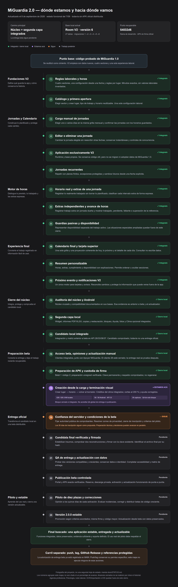

# MiGuardia 2.0 — dónde estamos y hacia dónde vamos

**Orden adoptado por Joaquín el 8/09:** MAIN debe seguir la [ruta activa de orquestación](../ORQUESTACION_MAIN.md). Este documento y su PNG conservan la fotografía original; los cambios de estado posteriores se leen en STATUS y las revisiones de orden en la ruta activa.

**Mapa visual actualizado el 8 de septiembre de 2026.** Estado funcional contrastado con STATUS del 7/09 y HEAD `54032d64dd8094f0e10be7e19ff352c30cae7711`, rama `codex/miguardia-2.0`. La imagen de referencia del 25/08 se tomó sólo como diseño: sus cifras, versiones y pendientes ya no describen el proyecto.

**Estamos en un candidato local integrado.** El núcleo, la segunda capa, los clientes de beta/actualización y la última terminación están cerrados en su alcance. Sigue confianza del servidor y condiciones del piloto; luego firma, QA de entrega, publicación beta, uso real y estable. No hay APK oficial distribuida.



Verde = integrado o cierre local acreditado. Violeta = última entrega integrada, donde estamos. Naranja = siguiente trabajo. Gris = posterior. Los 24 números son agrupaciones de este mapa, no números de tareas ni una estimación porcentual. La etapa 18 está cerrada: el violeta señala el punto alcanzado, no una implementación incompleta.

## Cómo ejecutar este mapa sin perder el foco

1. **Recuperar la base:** leer AGENTS, STATUS y las lecturas del tema; verificar ruta, rama/HEAD, cambios/staged/nuevos, worktrees y remotos. Comparar cualquier delta con esta fotografía; preservar cambios ajenos y detenerse ante divergencia inexplicable.
2. **No rehacer lo cerrado:** etapas 1–18 se conservan. Sólo una regresión demostrada justifica volver sobre su capacidad. Las evidencias previas no se convierten en pruebas nuevas ni cubren automáticamente una APK distinta.
3. **Trabajar por capacidad completa:** MAIN coordina e integra; cada especialista entrega diagnóstico, cambios, errores, regresiones y validación de punta a punta. Un escritor por archivo y un operador de build/dispositivo. Los hitos 19–22 ordenan un paquete de entrega; no obligan a abrir un chat por tarjeta. Crear tareas/ramas/worktrees requiere la autorización correspondiente.
4. **Respetar autorizaciones existentes:** MAIN ya recibió autorización de preparación, QA correspondiente, actualización con datos, firma y publicación beta. No pedir otra genérica. Este mapa no inicia esas acciones ni amplía recursos o ensayos: la QA que borra datos no puede ejecutarse sobre Samsung conservado. Push/tag permanecen separados.
5. **Cerrar por evidencia:** fijar entrada, dueño, archivos, resultado y criterio de aceptación antes de ejecutar. Separar pruebas locales, interoperabilidad, QA, Release firmada y publicación. Ante un fallo: registrar → corregir su causa → repetir sólo lo afectado; si cambian insumos de entrega, renovar candidata y su evidencia.
6. **Registrar sin duplicar estado:** STATUS es la única hoja operativa. Esta es una fotografía fechada; auditorías guardan evidencia y contratos guardan requisitos. Handoff con HEAD/delta, cambios, pruebas reales/omitidas, hashes, límites y siguiente dueño. No publicar APK, claves ni datos privados en Git.

Invariantes: cuatro sectores y una configuración; sólo datos V2, migraciones Room explícitas; pasado protegido por instantáneas; extras expresas y minutos exactos; datos laborales locales; sin sueldos, nube laboral o telemetría. Claro/oscuro y zoom interno 100/150/200, sin modificar ajustes visuales de Android. Actualización consciente desde Archivos, sin instalador propio, downgrade, desinstalación ni restauración usada para simular conservación.

## Guía de etapas alcanzadas

La columna de salida describe lo logrado en su alcance, no una nueva orden de trabajo.

| N.º | Etapa | Salida alcanzada que se conserva |
|---|---|---|
| 1 | Reglas laborales y horas | Cuatro sectores, una configuración desde una fecha y reglas por lugar. Minutos exactos, sin valores laborales inventados. |
| 2 | Catálogo y primera apertura | Elegir sector y crear lugar, tipo de trabajo y horario reutilizable. Una sola configuración laboral. |
| 3 | Carga manual de jornadas | Elegir uno o varios días en la misma grilla mensual y confirmar las jornadas con los horarios guardados. |
| 4 | Editar o eliminar una jornada | Cambiar la jornada elegida sin reescribir otras fechas; conservar instantáneas y controles de concurrencia. |
| 5 | Aplicación exclusivamente V2 | Runtime y base propios. Se conserva código útil, pero no se migran ni adoptan datos de MiGuardia 1.0. |
| 6 | Jornadas recurrentes | Repetir con planes finitos, excepciones protegidas y cambios futuros desde una fecha explícita. |
| 7 | Horario real y extras de una jornada | Registrar lo realmente trabajado sin borrar lo planificado; clasificar cada intervalo extra de forma expresa. |
| 8 | Extras independientes y avance de horas | Registrar trabajo extra sin jornada dueña y mostrar trabajado, pendiente, faltante o superación de la referencia. |
| 9 | Guardias pasivas y disponibilidad | Representar disponibilidad separada del trabajo activo. Las situaciones especiales ampliadas quedan fuera de este cierre. |
| 10 | Calendario final y tarjeta superior | Una sola grilla y una proyección coherente de hoy, lo próximo y el detalle de cada día. Consultar no escribe datos. |
| 11 | Resumen personalizable | Horas, extras, cumplimiento y disponibilidad con explicaciones. Permite ordenar u ocultar secciones. |
| 12 | Próximo evento y notificaciones V2 | Un único motor para tarjetas y avisos. Reconcilia cambios y protege la información que puede verse fuera de la app. |
| 13 | Auditoría del núcleo y Android | Núcleo cruzado y compatibilidad documentados en sus bases. Esa evidencia es anterior a beta y al actualizador. |
| 14 | Segunda capa local | Widget, informes PDF/XLSX, copias y restauración, bloqueo, Ayuda, fotos y Clima opcional integrados. |
| 15 | Candidato local integrado | Integración y matriz anterior a beta en API 26/33/36/37. Candidato comprobado; todavía no una entrega oficial. |
| 16 | Acceso beta, opiniones y actualización manual | Clientes integrados, junto con Apoyar MiGuardia. El cliente 28 está cerrado; la entrega real se prueba después. |
| 17 | Preparación de APK y custodia de firma | Beta1 / código 2; preparación unsigned verificada. Clave permanente y respaldo comprobados; no regenerar. |
| 18 | Creación desde la carga y terminación visual | Crear lugar → horario → volver al borrador. Créditos del clima integrados; cortes al 200 % y ayuda corregidos. |

Las etapas 13 y 15 tienen evidencia **anterior a beta**. La etapa 18 conserva 826 JVM locales, 56 Android en emulador API33 y 36 capturas, documentadas el 7/09: no son QA global de entrega, TalkBack, otra matriz OEM ni pruebas nuevas de este mapa. Room activo: V6, 27 tablas y migraciones 1→6. Release actual: `2.0.0-beta.1`, código `2`, sin firmar y sin autoridad pública de comprobantes configurada.

## Guía de lo que falta

### 19. Confianza del servidor y condiciones de la beta — sigue

**Dueños:** Joaquín decide condiciones; MAIN y responsable web/Android implementan el contrato existente.

- Resolver correo público de privacidad, duración/fecha de cierre de inscripción y mecanismo de eliminación. Treinta días de apertura sigue siendo propuesta. Conservar diez plazas y feedback a quince días por activación.
- Acordar antes del piloto los criterios de éxito y la audiencia. Propuesta para aceptar: cero fallos abiertos de pérdida/privacidad/instalación/actualización o bloqueo del recorrido principal; matriz cubierta o riesgos expresamente aceptados; feedback/ausencias evaluados y soporte definido.
- Estabilizar `kid` y clave pública del servidor que firma comprobantes. Separarla de la clave APK y de la identidad de cada instalación. No regenerar la clave APK ni incluir privadas en la app.
- Contrastar el checkout web y su API vigente; comprobar interoperabilidad, recibos válidos y rechazos, idempotencia, diez plazas y descargas privadas. Preparación técnica y decisiones pueden avanzar en paralelo; la apertura espera ambas.

**Termina cuando:** condiciones aprobadas, contrato interoperable y confianza real preparados. Falta de correo/fecha bloquea términos públicos, no toda preparación independiente. Fuentes: ADR0039/0040 y guía detallada, P1/P2.

### 20. Candidata final verificada y firmada

**Dueño:** MAIN y operador de entrega; contraseña bajo custodia de Joaquín. **Depende de:** 19.

- Congelar los insumos Android/web finales, versión y confianza. Comprobar que el código de versión no contradice entregas anteriores.
- Ejecutar verificación transversal/Release y dos reconstrucciones de los mismos insumos estabilizados. Inspeccionar el unsigned con la política existente: paquete, código, permisos, componentes, ABI, flags, alineación y esquemas.
- Usar la clave permanente existente. Verificar firma, certificado y alineación finales; reinspeccionar metadatos y comparar contenido con el unsigned, separando entradas propias de firma.
- Registrar tamaño y SHA-256 del **APK firmado**, distinto del unsigned. Actualizar los metadatos del servidor con esa identidad exacta. Conservar APK fuera de Git.

**Termina cuando:** el artefacto firmado tiene identidad, inspección y evidencia atribuibles. No equivale a instalación ni publicación. Fuentes: contrato29 y guía detallada, P3.

### 21. QA de entrega y actualización con datos

**Dueños:** operador único autorizado y MAIN revisor. **Depende de:** 20 y servicio controlado preparado.

- Separar negativos JVM/interoperabilidad, instrumentación QA y ensayo integrado de Release firmada. `tools/qa.py` opera sólo paquetes QA; una inyección QA no demuestra acceso productivo.
- Adaptar fixtures históricas del actualizador: aún exigen base code1/fixture code2, mientras la candidata usa code2. Definir el par de versiones del ensayo, con destino superior; no instalar mini APK de fixtures como la aplicación real.
- Probar dos versiones completas, mismo paquete/certificado y código creciente. Registrar datos V2 e identidad antes/después: configuración, jornadas, instantáneas, planes, extras, notas, fotos, preferencias, bloqueo, beta, avisos y Widget.
- Completar buscar → descargar → verificar → guardar → abrir desde Archivos → Actualizar → reabrir. No desinstalar ni borrar datos para conseguir el resultado.
- Cubrir beta/feedback, negativos del actualizador y SAF, teclado/paisaje, claro/oscuro, zoom interno, TalkBack, permisos y matriz API26/33/36/37 según contrato. Declarar casos no ejecutados y riesgos aceptados; no heredar el verde anterior a beta.

**Termina cuando:** actualización real con datos conservados demostrada, fallos corregidos y matriz de entrega resuelta por superficie. Si cambia código/candidata, volver al control afectado de 20. Fuentes: ADR0040 y guía detallada, P4/Q.

### 22. Publicación beta controlada

**Dueños:** MAIN y responsable web. **Depende de:** 19–21 aceptados.

- Publicar el portal y APK exacta mediante el proyecto web existente. Descarga inicial protegida por sesión; posteriores por prueba de posesión. No añadir una ruta pública que eluda el contrato.
- Verificar HTTPS, aceptaciones, reserva, límite de plazas, descarga permitida/denegada, activación, feedback y actualización. Comparar el archivo servido con su hash firmado.
- Abrir inscripciones sólo con condiciones y criterios aprobados. Registrar fecha, versión y resultado externo. Ante incidente, pausar nuevas ofertas/descargas sin destruir datos ni apagar el uso local instalado.

**Termina cuando:** la beta privada publicada funciona de punta a punta con el artefacto aceptado. Un despliegue exitoso, una página informativa o un push no bastan. Fuente: guía detallada, P5.

### 23. Piloto de diez plazas y correcciones

**Dueños:** Joaquín como producto, MAIN para correcciones y web para operación. **Depende de:** 22.

- Recoger incidencias seudónimas y feedback a quince días de cada activación. No pedir datos laborales para diagnosticar. Cola local no significa recepción del servidor.
- Priorizar pérdida/privacidad, recorrido principal y terminación; mantener ideas futuras fuera del cierre. Corregir capacidades completas y verificar regresiones.
- Para nuevas betas, repetir firma, QA y entrega afectadas con código superior. Evaluar el piloto contra criterios fijados en 19; ausencia de feedback no demuestra éxito.

**Termina cuando:** resultados y residuales permiten una decisión explícita de promoción. Si no, corregir y repetir el ciclo 20–23 pertinente; no redefinir retroactivamente los criterios. Fuente: guía detallada, P6/F/R.

### 24. Versión 2.0.0 estable

**Dueños:** Joaquín, MAIN y responsable de distribución. **Depende de:** promoción aceptada tras 23.

- Usar `versionName = 2.0.0`, mismo paquete/certificado y código mayor que todas las betas distribuidas. Decidir explícitamente audiencia y transición de la condición beta; no quitar puertas de acceso por inferencia.
- Verificar actualización desde beta con datos preservados y publicar el archivo exacto autorizado. Cerrar inscripciones y aplicar retención/eliminación del contrato.
- Entregar notas de versión, uso, actualización/recuperación, limitaciones, contacto y responsables de custodia/soporte.

**Termina cuando:** estable firmada, distribuida y actualizable, sin bloqueadores y con residuales aceptados. Mantenimiento posterior es otro alcance; no crear un proyecto de refactor automáticamente. Fuente: guía detallada, P7.

## Mermaid editable del mismo mapa

El bloque siguiente genera las tarjetas, áreas laterales, colores y conexiones de la imagen. Exportación comprobada con Mermaid 11.17.0 y etiquetas HTML; otros visores pueden simplificar estilos. El PNG conserva la presentación final.

```mermaid
%%{init: {"theme":"dark","flowchart":{"htmlLabels":true,"curve":"linear","rankSpacing":12,"nodeSpacing":0,"padding":0,"diagramPadding":20},"themeVariables":{"fontFamily":"Arial","fontSize":"14px","lineColor":"#55555e","background":"#18181a"}}}%%
flowchart TB
  H["<div style='font-family:Arial,sans-serif;box-sizing:border-box;width:1080px;text-align:left;padding:4px 0 10px;'><div style='font-size:27px;font-weight:700;color:rgb(244,244,246);margin-bottom:10px;'>MiGuardia 2.0 — dónde estamos y hacia dónde vamos</div><div style='font-size:14px;color:rgb(170,170,180);line-height:1.5;'>Actualizado el 8 de septiembre de 2026 · estado funcional del 7/09 · todavía sin APK oficial distribuida</div><div style='display:grid;grid-template-columns:repeat(3,1fr);gap:12px;margin:22px 0 17px;'><div style='background:rgb(36,36,38);border:1px solid rgb(48,48,52);border-radius:12px;padding:16px 18px;'><div style='font-size:13px;color:rgb(170,170,180);margin-bottom:7px;'>Camino principal</div><div style='font-size:19px;font-weight:700;color:rgb(243,243,245);line-height:1.35;'>Núcleo + segunda capa integrados</div><div style='font-size:12px;color:rgb(170,170,180);margin-top:6px;'>La entrega beta sigue pendiente</div></div><div style='background:rgb(36,36,38);border:1px solid rgb(48,48,52);border-radius:12px;padding:16px 18px;'><div style='font-size:13px;color:rgb(170,170,180);margin-bottom:7px;'>Base local actual</div><div style='font-size:19px;font-weight:700;color:rgb(243,243,245);line-height:1.35;'>Room V2 · versión 6</div><div style='font-size:12px;color:rgb(170,170,180);margin-top:6px;'>27 tablas · migraciones 1→2→3→4→5→6</div></div><div style='background:rgb(36,36,38);border:1px solid rgb(48,48,52);border-radius:12px;padding:16px 18px;'><div style='font-size:13px;color:rgb(170,170,180);margin-bottom:7px;'>Punto recuperable</div><div style='font-size:19px;font-weight:700;color:rgb(243,243,245);line-height:1.35;'>54032d6</div><div style='font-size:12px;color:rgb(170,170,180);margin-top:6px;'>Rama de desarrollo · APK sin firma oficial</div></div></div><div style='font-size:12px;color:rgb(185,185,194);'><div style='display:inline-flex;align-items:center;gap:7px;margin-right:22px;'><div style='color:rgb(73,217,153);font-size:18px;'>●</div>Integrado / cierre local</div><div style='display:inline-flex;align-items:center;gap:7px;margin-right:22px;'><div style='color:rgb(182,149,255);font-size:18px;'>●</div>Estamos acá</div><div style='display:inline-flex;align-items:center;gap:7px;margin-right:22px;'><div style='color:rgb(255,154,80);font-size:18px;'>●</div>Sigue</div><div style='display:inline-flex;align-items:center;gap:7px;margin-right:22px;'><div style='color:rgb(156,156,166);font-size:18px;'>●</div>Trabajo posterior</div></div></div>"]
  B["<div style='font-family:Arial,sans-serif;box-sizing:border-box;width:1080px;text-align:left;padding:0 152px;'><div style='background:rgb(34,42,49);border:1px solid rgb(85,113,135);border-radius:13px;padding:17px 24px;text-align:center;'><div style='color:rgb(242,242,245);font-size:18px;font-weight:700;line-height:1.45;'>Punto base: código probado de MiGuardia 1.0</div><div style='color:rgb(182,182,193);font-size:13px;line-height:1.6;margin-top:7px;'>Se reutilizó como cimiento. V2 empieza con datos nuevos, cuatro sectores y una sola experiencia laboral.</div></div></div>"]
  N01["<div style='font-family:Arial,sans-serif;box-sizing:border-box;width:1080px;text-align:left;padding-top:18px;'><div style='display:grid;grid-template-columns:212px 1fr;gap:20px;align-items:start;'><div style='padding-top:16px;'><div style='color:rgb(238,238,242);font-size:18px;font-weight:700;line-height:1.35;'>Fundaciones V2</div><div style='color:rgb(161,161,174);font-size:13px;line-height:1.5;margin-top:7px;'>Define qué guarda la app y cómo conserva la historia.</div></div><div style='position:relative;padding-left:22px;'><div style='position:absolute;left:5px;top:-12px;bottom:-12px;width:1px;background:rgb(57,57,64);'></div><div style='position:absolute;left:0;top:22px;width:11px;height:11px;border-radius:50%;background:rgb(73,217,153);'></div><div style='position:relative;background:rgb(28,44,36);border:1px solid rgb(49,93,70);border-radius:12px;padding:15px 17px;display:grid;grid-template-columns:30px 1fr;gap:13px;'><div style='width:30px;height:30px;display:flex;align-items:center;justify-content:center;border-radius:50%;background:rgb(49,93,70);color:rgb(244,244,246);font-size:13px;font-weight:700;'>1</div><div style=''><div style='display:flex;align-items:flex-start;justify-content:space-between;gap:16px;'><div style='font-size:18px;color:rgb(241,241,244);font-weight:700;line-height:1.35;'>Reglas laborales y horas</div><div style='font-size:12px;font-weight:700;line-height:1.6;color:rgb(73,217,153);white-space:nowrap;'>✓ Integrado</div></div><div style='font-size:14px;color:rgb(184,184,196);line-height:1.55;margin-top:6px;'>Cuatro sectores, una configuración desde una fecha y reglas por lugar. Minutos exactos, sin valores laborales inventados.</div></div></div></div></div></div>"]
  N02["<div style='font-family:Arial,sans-serif;box-sizing:border-box;width:1080px;text-align:left;'><div style='display:grid;grid-template-columns:212px 1fr;gap:20px;align-items:start;'><div style='padding-top:16px;'></div><div style='position:relative;padding-left:22px;'><div style='position:absolute;left:5px;top:-12px;bottom:-12px;width:1px;background:rgb(57,57,64);'></div><div style='position:absolute;left:0;top:22px;width:11px;height:11px;border-radius:50%;background:rgb(73,217,153);'></div><div style='position:relative;background:rgb(28,44,36);border:1px solid rgb(49,93,70);border-radius:12px;padding:15px 17px;display:grid;grid-template-columns:30px 1fr;gap:13px;'><div style='width:30px;height:30px;display:flex;align-items:center;justify-content:center;border-radius:50%;background:rgb(49,93,70);color:rgb(244,244,246);font-size:13px;font-weight:700;'>2</div><div style=''><div style='display:flex;align-items:flex-start;justify-content:space-between;gap:16px;'><div style='font-size:18px;color:rgb(241,241,244);font-weight:700;line-height:1.35;'>Catálogo y primera apertura</div><div style='font-size:12px;font-weight:700;line-height:1.6;color:rgb(73,217,153);white-space:nowrap;'>✓ Integrado</div></div><div style='font-size:14px;color:rgb(184,184,196);line-height:1.55;margin-top:6px;'>Elegir sector y crear lugar, tipo de trabajo y horario reutilizable. Una sola configuración laboral.</div></div></div></div></div></div>"]
  N03["<div style='font-family:Arial,sans-serif;box-sizing:border-box;width:1080px;text-align:left;padding-top:18px;'><div style='display:grid;grid-template-columns:212px 1fr;gap:20px;align-items:start;'><div style='padding-top:16px;'><div style='color:rgb(238,238,242);font-size:18px;font-weight:700;line-height:1.35;'>Jornadas y Calendario</div><div style='color:rgb(161,161,174);font-size:13px;line-height:1.5;margin-top:7px;'>Construye lo planificado y protege cada cambio.</div></div><div style='position:relative;padding-left:22px;'><div style='position:absolute;left:5px;top:-12px;bottom:-12px;width:1px;background:rgb(57,57,64);'></div><div style='position:absolute;left:0;top:22px;width:11px;height:11px;border-radius:50%;background:rgb(73,217,153);'></div><div style='position:relative;background:rgb(28,44,36);border:1px solid rgb(49,93,70);border-radius:12px;padding:15px 17px;display:grid;grid-template-columns:30px 1fr;gap:13px;'><div style='width:30px;height:30px;display:flex;align-items:center;justify-content:center;border-radius:50%;background:rgb(49,93,70);color:rgb(244,244,246);font-size:13px;font-weight:700;'>3</div><div style=''><div style='display:flex;align-items:flex-start;justify-content:space-between;gap:16px;'><div style='font-size:18px;color:rgb(241,241,244);font-weight:700;line-height:1.35;'>Carga manual de jornadas</div><div style='font-size:12px;font-weight:700;line-height:1.6;color:rgb(73,217,153);white-space:nowrap;'>✓ Integrado</div></div><div style='font-size:14px;color:rgb(184,184,196);line-height:1.55;margin-top:6px;'>Elegir uno o varios días en la misma grilla mensual y confirmar las jornadas con los horarios guardados.</div></div></div></div></div></div>"]
  N04["<div style='font-family:Arial,sans-serif;box-sizing:border-box;width:1080px;text-align:left;'><div style='display:grid;grid-template-columns:212px 1fr;gap:20px;align-items:start;'><div style='padding-top:16px;'></div><div style='position:relative;padding-left:22px;'><div style='position:absolute;left:5px;top:-12px;bottom:-12px;width:1px;background:rgb(57,57,64);'></div><div style='position:absolute;left:0;top:22px;width:11px;height:11px;border-radius:50%;background:rgb(73,217,153);'></div><div style='position:relative;background:rgb(28,44,36);border:1px solid rgb(49,93,70);border-radius:12px;padding:15px 17px;display:grid;grid-template-columns:30px 1fr;gap:13px;'><div style='width:30px;height:30px;display:flex;align-items:center;justify-content:center;border-radius:50%;background:rgb(49,93,70);color:rgb(244,244,246);font-size:13px;font-weight:700;'>4</div><div style=''><div style='display:flex;align-items:flex-start;justify-content:space-between;gap:16px;'><div style='font-size:18px;color:rgb(241,241,244);font-weight:700;line-height:1.35;'>Editar o eliminar una jornada</div><div style='font-size:12px;font-weight:700;line-height:1.6;color:rgb(73,217,153);white-space:nowrap;'>✓ Integrado</div></div><div style='font-size:14px;color:rgb(184,184,196);line-height:1.55;margin-top:6px;'>Cambiar la jornada elegida sin reescribir otras fechas; conservar instantáneas y controles de concurrencia.</div></div></div></div></div></div>"]
  N05["<div style='font-family:Arial,sans-serif;box-sizing:border-box;width:1080px;text-align:left;'><div style='display:grid;grid-template-columns:212px 1fr;gap:20px;align-items:start;'><div style='padding-top:16px;'></div><div style='position:relative;padding-left:22px;'><div style='position:absolute;left:5px;top:-12px;bottom:-12px;width:1px;background:rgb(57,57,64);'></div><div style='position:absolute;left:0;top:22px;width:11px;height:11px;border-radius:50%;background:rgb(73,217,153);'></div><div style='position:relative;background:rgb(28,44,36);border:1px solid rgb(49,93,70);border-radius:12px;padding:15px 17px;display:grid;grid-template-columns:30px 1fr;gap:13px;'><div style='width:30px;height:30px;display:flex;align-items:center;justify-content:center;border-radius:50%;background:rgb(49,93,70);color:rgb(244,244,246);font-size:13px;font-weight:700;'>5</div><div style=''><div style='display:flex;align-items:flex-start;justify-content:space-between;gap:16px;'><div style='font-size:18px;color:rgb(241,241,244);font-weight:700;line-height:1.35;'>Aplicación exclusivamente V2</div><div style='font-size:12px;font-weight:700;line-height:1.6;color:rgb(73,217,153);white-space:nowrap;'>✓ Integrado</div></div><div style='font-size:14px;color:rgb(184,184,196);line-height:1.55;margin-top:6px;'>Runtime y base propios. Se conserva código útil, pero no se migran ni adoptan datos de MiGuardia 1.0.</div></div></div></div></div></div>"]
  N06["<div style='font-family:Arial,sans-serif;box-sizing:border-box;width:1080px;text-align:left;'><div style='display:grid;grid-template-columns:212px 1fr;gap:20px;align-items:start;'><div style='padding-top:16px;'></div><div style='position:relative;padding-left:22px;'><div style='position:absolute;left:5px;top:-12px;bottom:-12px;width:1px;background:rgb(57,57,64);'></div><div style='position:absolute;left:0;top:22px;width:11px;height:11px;border-radius:50%;background:rgb(73,217,153);'></div><div style='position:relative;background:rgb(28,44,36);border:1px solid rgb(49,93,70);border-radius:12px;padding:15px 17px;display:grid;grid-template-columns:30px 1fr;gap:13px;'><div style='width:30px;height:30px;display:flex;align-items:center;justify-content:center;border-radius:50%;background:rgb(49,93,70);color:rgb(244,244,246);font-size:13px;font-weight:700;'>6</div><div style=''><div style='display:flex;align-items:flex-start;justify-content:space-between;gap:16px;'><div style='font-size:18px;color:rgb(241,241,244);font-weight:700;line-height:1.35;'>Jornadas recurrentes</div><div style='font-size:12px;font-weight:700;line-height:1.6;color:rgb(73,217,153);white-space:nowrap;'>✓ Integrado</div></div><div style='font-size:14px;color:rgb(184,184,196);line-height:1.55;margin-top:6px;'>Repetir con planes finitos, excepciones protegidas y cambios futuros desde una fecha explícita.</div></div></div></div></div></div>"]
  N07["<div style='font-family:Arial,sans-serif;box-sizing:border-box;width:1080px;text-align:left;padding-top:18px;'><div style='display:grid;grid-template-columns:212px 1fr;gap:20px;align-items:start;'><div style='padding-top:16px;'><div style='color:rgb(238,238,242);font-size:18px;font-weight:700;line-height:1.35;'>Motor de horas</div><div style='color:rgb(161,161,174);font-size:13px;line-height:1.5;margin-top:7px;'>Distingue lo previsto, lo trabajado y las extras expresas.</div></div><div style='position:relative;padding-left:22px;'><div style='position:absolute;left:5px;top:-12px;bottom:-12px;width:1px;background:rgb(57,57,64);'></div><div style='position:absolute;left:0;top:22px;width:11px;height:11px;border-radius:50%;background:rgb(73,217,153);'></div><div style='position:relative;background:rgb(28,44,36);border:1px solid rgb(49,93,70);border-radius:12px;padding:15px 17px;display:grid;grid-template-columns:30px 1fr;gap:13px;'><div style='width:30px;height:30px;display:flex;align-items:center;justify-content:center;border-radius:50%;background:rgb(49,93,70);color:rgb(244,244,246);font-size:13px;font-weight:700;'>7</div><div style=''><div style='display:flex;align-items:flex-start;justify-content:space-between;gap:16px;'><div style='font-size:18px;color:rgb(241,241,244);font-weight:700;line-height:1.35;'>Horario real y extras de una jornada</div><div style='font-size:12px;font-weight:700;line-height:1.6;color:rgb(73,217,153);white-space:nowrap;'>✓ Integrado</div></div><div style='font-size:14px;color:rgb(184,184,196);line-height:1.55;margin-top:6px;'>Registrar lo realmente trabajado sin borrar lo planificado; clasificar cada intervalo extra de forma expresa.</div></div></div></div></div></div>"]
  N08["<div style='font-family:Arial,sans-serif;box-sizing:border-box;width:1080px;text-align:left;'><div style='display:grid;grid-template-columns:212px 1fr;gap:20px;align-items:start;'><div style='padding-top:16px;'></div><div style='position:relative;padding-left:22px;'><div style='position:absolute;left:5px;top:-12px;bottom:-12px;width:1px;background:rgb(57,57,64);'></div><div style='position:absolute;left:0;top:22px;width:11px;height:11px;border-radius:50%;background:rgb(73,217,153);'></div><div style='position:relative;background:rgb(28,44,36);border:1px solid rgb(49,93,70);border-radius:12px;padding:15px 17px;display:grid;grid-template-columns:30px 1fr;gap:13px;'><div style='width:30px;height:30px;display:flex;align-items:center;justify-content:center;border-radius:50%;background:rgb(49,93,70);color:rgb(244,244,246);font-size:13px;font-weight:700;'>8</div><div style=''><div style='display:flex;align-items:flex-start;justify-content:space-between;gap:16px;'><div style='font-size:18px;color:rgb(241,241,244);font-weight:700;line-height:1.35;'>Extras independientes y avance de horas</div><div style='font-size:12px;font-weight:700;line-height:1.6;color:rgb(73,217,153);white-space:nowrap;'>✓ Integrado</div></div><div style='font-size:14px;color:rgb(184,184,196);line-height:1.55;margin-top:6px;'>Registrar trabajo extra sin jornada dueña y mostrar trabajado, pendiente, faltante o superación de la referencia.</div></div></div></div></div></div>"]
  N09["<div style='font-family:Arial,sans-serif;box-sizing:border-box;width:1080px;text-align:left;'><div style='display:grid;grid-template-columns:212px 1fr;gap:20px;align-items:start;'><div style='padding-top:16px;'></div><div style='position:relative;padding-left:22px;'><div style='position:absolute;left:5px;top:-12px;bottom:-12px;width:1px;background:rgb(57,57,64);'></div><div style='position:absolute;left:0;top:22px;width:11px;height:11px;border-radius:50%;background:rgb(73,217,153);'></div><div style='position:relative;background:rgb(28,44,36);border:1px solid rgb(49,93,70);border-radius:12px;padding:15px 17px;display:grid;grid-template-columns:30px 1fr;gap:13px;'><div style='width:30px;height:30px;display:flex;align-items:center;justify-content:center;border-radius:50%;background:rgb(49,93,70);color:rgb(244,244,246);font-size:13px;font-weight:700;'>9</div><div style=''><div style='display:flex;align-items:flex-start;justify-content:space-between;gap:16px;'><div style='font-size:18px;color:rgb(241,241,244);font-weight:700;line-height:1.35;'>Guardias pasivas y disponibilidad</div><div style='font-size:12px;font-weight:700;line-height:1.6;color:rgb(73,217,153);white-space:nowrap;'>✓ Integrado</div></div><div style='font-size:14px;color:rgb(184,184,196);line-height:1.55;margin-top:6px;'>Representar disponibilidad separada del trabajo activo. Las situaciones especiales ampliadas quedan fuera de este cierre.</div></div></div></div></div></div>"]
  N10["<div style='font-family:Arial,sans-serif;box-sizing:border-box;width:1080px;text-align:left;padding-top:18px;'><div style='display:grid;grid-template-columns:212px 1fr;gap:20px;align-items:start;'><div style='padding-top:16px;'><div style='color:rgb(238,238,242);font-size:18px;font-weight:700;line-height:1.35;'>Experiencia final</div><div style='color:rgb(161,161,174);font-size:13px;line-height:1.5;margin-top:7px;'>Convierte el trabajo registrado en información fácil de usar.</div></div><div style='position:relative;padding-left:22px;'><div style='position:absolute;left:5px;top:-12px;bottom:-12px;width:1px;background:rgb(57,57,64);'></div><div style='position:absolute;left:0;top:22px;width:11px;height:11px;border-radius:50%;background:rgb(73,217,153);'></div><div style='position:relative;background:rgb(28,44,36);border:1px solid rgb(49,93,70);border-radius:12px;padding:15px 17px;display:grid;grid-template-columns:30px 1fr;gap:13px;'><div style='width:30px;height:30px;display:flex;align-items:center;justify-content:center;border-radius:50%;background:rgb(49,93,70);color:rgb(244,244,246);font-size:13px;font-weight:700;'>10</div><div style=''><div style='display:flex;align-items:flex-start;justify-content:space-between;gap:16px;'><div style='font-size:18px;color:rgb(241,241,244);font-weight:700;line-height:1.35;'>Calendario final y tarjeta superior</div><div style='font-size:12px;font-weight:700;line-height:1.6;color:rgb(73,217,153);white-space:nowrap;'>✓ Integrado</div></div><div style='font-size:14px;color:rgb(184,184,196);line-height:1.55;margin-top:6px;'>Una sola grilla y una proyección coherente de hoy, lo próximo y el detalle de cada día. Consultar no escribe datos.</div></div></div></div></div></div>"]
  N11["<div style='font-family:Arial,sans-serif;box-sizing:border-box;width:1080px;text-align:left;'><div style='display:grid;grid-template-columns:212px 1fr;gap:20px;align-items:start;'><div style='padding-top:16px;'></div><div style='position:relative;padding-left:22px;'><div style='position:absolute;left:5px;top:-12px;bottom:-12px;width:1px;background:rgb(57,57,64);'></div><div style='position:absolute;left:0;top:22px;width:11px;height:11px;border-radius:50%;background:rgb(73,217,153);'></div><div style='position:relative;background:rgb(28,44,36);border:1px solid rgb(49,93,70);border-radius:12px;padding:15px 17px;display:grid;grid-template-columns:30px 1fr;gap:13px;'><div style='width:30px;height:30px;display:flex;align-items:center;justify-content:center;border-radius:50%;background:rgb(49,93,70);color:rgb(244,244,246);font-size:13px;font-weight:700;'>11</div><div style=''><div style='display:flex;align-items:flex-start;justify-content:space-between;gap:16px;'><div style='font-size:18px;color:rgb(241,241,244);font-weight:700;line-height:1.35;'>Resumen personalizable</div><div style='font-size:12px;font-weight:700;line-height:1.6;color:rgb(73,217,153);white-space:nowrap;'>✓ Integrado</div></div><div style='font-size:14px;color:rgb(184,184,196);line-height:1.55;margin-top:6px;'>Horas, extras, cumplimiento y disponibilidad con explicaciones. Permite ordenar u ocultar secciones.</div></div></div></div></div></div>"]
  N12["<div style='font-family:Arial,sans-serif;box-sizing:border-box;width:1080px;text-align:left;'><div style='display:grid;grid-template-columns:212px 1fr;gap:20px;align-items:start;'><div style='padding-top:16px;'></div><div style='position:relative;padding-left:22px;'><div style='position:absolute;left:5px;top:-12px;bottom:-12px;width:1px;background:rgb(57,57,64);'></div><div style='position:absolute;left:0;top:22px;width:11px;height:11px;border-radius:50%;background:rgb(73,217,153);'></div><div style='position:relative;background:rgb(28,44,36);border:1px solid rgb(49,93,70);border-radius:12px;padding:15px 17px;display:grid;grid-template-columns:30px 1fr;gap:13px;'><div style='width:30px;height:30px;display:flex;align-items:center;justify-content:center;border-radius:50%;background:rgb(49,93,70);color:rgb(244,244,246);font-size:13px;font-weight:700;'>12</div><div style=''><div style='display:flex;align-items:flex-start;justify-content:space-between;gap:16px;'><div style='font-size:18px;color:rgb(241,241,244);font-weight:700;line-height:1.35;'>Próximo evento y notificaciones V2</div><div style='font-size:12px;font-weight:700;line-height:1.6;color:rgb(73,217,153);white-space:nowrap;'>✓ Integrado</div></div><div style='font-size:14px;color:rgb(184,184,196);line-height:1.55;margin-top:6px;'>Un único motor para tarjetas y avisos. Reconcilia cambios y protege la información que puede verse fuera de la app.</div></div></div></div></div></div>"]
  N13["<div style='font-family:Arial,sans-serif;box-sizing:border-box;width:1080px;text-align:left;padding-top:18px;'><div style='display:grid;grid-template-columns:212px 1fr;gap:20px;align-items:start;'><div style='padding-top:16px;'><div style='color:rgb(238,238,242);font-size:18px;font-weight:700;line-height:1.35;'>Cierre del núcleo</div><div style='color:rgb(161,161,174);font-size:13px;line-height:1.5;margin-top:7px;'>Integra, protege y comprueba el candidato local.</div></div><div style='position:relative;padding-left:22px;'><div style='position:absolute;left:5px;top:-12px;bottom:-12px;width:1px;background:rgb(57,57,64);'></div><div style='position:absolute;left:0;top:22px;width:11px;height:11px;border-radius:50%;background:rgb(73,217,153);'></div><div style='position:relative;background:rgb(28,44,36);border:1px solid rgb(49,93,70);border-radius:12px;padding:15px 17px;display:grid;grid-template-columns:30px 1fr;gap:13px;'><div style='width:30px;height:30px;display:flex;align-items:center;justify-content:center;border-radius:50%;background:rgb(49,93,70);color:rgb(244,244,246);font-size:13px;font-weight:700;'>13</div><div style=''><div style='display:flex;align-items:flex-start;justify-content:space-between;gap:16px;'><div style='font-size:18px;color:rgb(241,241,244);font-weight:700;line-height:1.35;'>Auditoría del núcleo y Android</div><div style='font-size:12px;font-weight:700;line-height:1.6;color:rgb(73,217,153);white-space:nowrap;'>✓ Cierre local</div></div><div style='font-size:14px;color:rgb(184,184,196);line-height:1.55;margin-top:6px;'>Núcleo cruzado y compatibilidad documentados en sus bases. Esa evidencia es anterior a beta y al actualizador.</div></div></div></div></div></div>"]
  N14["<div style='font-family:Arial,sans-serif;box-sizing:border-box;width:1080px;text-align:left;'><div style='display:grid;grid-template-columns:212px 1fr;gap:20px;align-items:start;'><div style='padding-top:16px;'></div><div style='position:relative;padding-left:22px;'><div style='position:absolute;left:5px;top:-12px;bottom:-12px;width:1px;background:rgb(57,57,64);'></div><div style='position:absolute;left:0;top:22px;width:11px;height:11px;border-radius:50%;background:rgb(73,217,153);'></div><div style='position:relative;background:rgb(28,44,36);border:1px solid rgb(49,93,70);border-radius:12px;padding:15px 17px;display:grid;grid-template-columns:30px 1fr;gap:13px;'><div style='width:30px;height:30px;display:flex;align-items:center;justify-content:center;border-radius:50%;background:rgb(49,93,70);color:rgb(244,244,246);font-size:13px;font-weight:700;'>14</div><div style=''><div style='display:flex;align-items:flex-start;justify-content:space-between;gap:16px;'><div style='font-size:18px;color:rgb(241,241,244);font-weight:700;line-height:1.35;'>Segunda capa local</div><div style='font-size:12px;font-weight:700;line-height:1.6;color:rgb(73,217,153);white-space:nowrap;'>✓ Cierre local</div></div><div style='font-size:14px;color:rgb(184,184,196);line-height:1.55;margin-top:6px;'>Widget, informes PDF/XLSX, copias y restauración, bloqueo, Ayuda, fotos y Clima opcional integrados.</div></div></div></div></div></div>"]
  N15["<div style='font-family:Arial,sans-serif;box-sizing:border-box;width:1080px;text-align:left;'><div style='display:grid;grid-template-columns:212px 1fr;gap:20px;align-items:start;'><div style='padding-top:16px;'></div><div style='position:relative;padding-left:22px;'><div style='position:absolute;left:5px;top:-12px;bottom:-12px;width:1px;background:rgb(57,57,64);'></div><div style='position:absolute;left:0;top:22px;width:11px;height:11px;border-radius:50%;background:rgb(73,217,153);'></div><div style='position:relative;background:rgb(28,44,36);border:1px solid rgb(49,93,70);border-radius:12px;padding:15px 17px;display:grid;grid-template-columns:30px 1fr;gap:13px;'><div style='width:30px;height:30px;display:flex;align-items:center;justify-content:center;border-radius:50%;background:rgb(49,93,70);color:rgb(244,244,246);font-size:13px;font-weight:700;'>15</div><div style=''><div style='display:flex;align-items:flex-start;justify-content:space-between;gap:16px;'><div style='font-size:18px;color:rgb(241,241,244);font-weight:700;line-height:1.35;'>Candidato local integrado</div><div style='font-size:12px;font-weight:700;line-height:1.6;color:rgb(73,217,153);white-space:nowrap;'>✓ Cierre local</div></div><div style='font-size:14px;color:rgb(184,184,196);line-height:1.55;margin-top:6px;'>Integración y matriz anterior a beta en API 26/33/36/37. Candidato comprobado; todavía no una entrega oficial.</div></div></div></div></div></div>"]
  N16["<div style='font-family:Arial,sans-serif;box-sizing:border-box;width:1080px;text-align:left;padding-top:18px;'><div style='display:grid;grid-template-columns:212px 1fr;gap:20px;align-items:start;'><div style='padding-top:16px;'><div style='color:rgb(238,238,242);font-size:18px;font-weight:700;line-height:1.35;'>Preparación beta</div><div style='color:rgb(161,161,174);font-size:13px;line-height:1.5;margin-top:7px;'>Conecta la entrega y deja el trabajo reciente recuperable.</div></div><div style='position:relative;padding-left:22px;'><div style='position:absolute;left:5px;top:-12px;bottom:-12px;width:1px;background:rgb(57,57,64);'></div><div style='position:absolute;left:0;top:22px;width:11px;height:11px;border-radius:50%;background:rgb(73,217,153);'></div><div style='position:relative;background:rgb(28,44,36);border:1px solid rgb(49,93,70);border-radius:12px;padding:15px 17px;display:grid;grid-template-columns:30px 1fr;gap:13px;'><div style='width:30px;height:30px;display:flex;align-items:center;justify-content:center;border-radius:50%;background:rgb(49,93,70);color:rgb(244,244,246);font-size:13px;font-weight:700;'>16</div><div style=''><div style='display:flex;align-items:flex-start;justify-content:space-between;gap:16px;'><div style='font-size:18px;color:rgb(241,241,244);font-weight:700;line-height:1.35;'>Acceso beta, opiniones y actualización manual</div><div style='font-size:12px;font-weight:700;line-height:1.6;color:rgb(73,217,153);white-space:nowrap;'>✓ Cierre local</div></div><div style='font-size:14px;color:rgb(184,184,196);line-height:1.55;margin-top:6px;'>Clientes integrados, junto con Apoyar MiGuardia. El cliente 28 está cerrado; la entrega real se prueba después.</div></div></div></div></div></div>"]
  N17["<div style='font-family:Arial,sans-serif;box-sizing:border-box;width:1080px;text-align:left;'><div style='display:grid;grid-template-columns:212px 1fr;gap:20px;align-items:start;'><div style='padding-top:16px;'></div><div style='position:relative;padding-left:22px;'><div style='position:absolute;left:5px;top:-12px;bottom:-12px;width:1px;background:rgb(57,57,64);'></div><div style='position:absolute;left:0;top:22px;width:11px;height:11px;border-radius:50%;background:rgb(73,217,153);'></div><div style='position:relative;background:rgb(28,44,36);border:1px solid rgb(49,93,70);border-radius:12px;padding:15px 17px;display:grid;grid-template-columns:30px 1fr;gap:13px;'><div style='width:30px;height:30px;display:flex;align-items:center;justify-content:center;border-radius:50%;background:rgb(49,93,70);color:rgb(244,244,246);font-size:13px;font-weight:700;'>17</div><div style=''><div style='display:flex;align-items:flex-start;justify-content:space-between;gap:16px;'><div style='font-size:18px;color:rgb(241,241,244);font-weight:700;line-height:1.35;'>Preparación de APK y custodia de firma</div><div style='font-size:12px;font-weight:700;line-height:1.6;color:rgb(73,217,153);white-space:nowrap;'>✓ Cierre local</div></div><div style='font-size:14px;color:rgb(184,184,196);line-height:1.55;margin-top:6px;'>Beta1 / código 2; preparación unsigned verificada. Clave permanente y respaldo comprobados; no regenerar.</div></div></div></div></div></div>"]
  N18["<div style='font-family:Arial,sans-serif;box-sizing:border-box;width:1080px;text-align:left;'><div style='display:grid;grid-template-columns:212px 1fr;gap:20px;align-items:start;'><div style='padding-top:16px;'></div><div style='position:relative;padding-left:22px;'><div style='position:absolute;left:5px;top:-12px;bottom:-12px;width:1px;background:rgb(57,57,64);'></div><div style='position:absolute;left:0;top:22px;width:11px;height:11px;border-radius:50%;background:rgb(197,166,255);'></div><div style='position:relative;background:rgb(44,37,60);border:1px solid rgb(162,116,223);border-radius:12px;padding:15px 17px;display:grid;grid-template-columns:30px 1fr;gap:13px;'><div style='width:30px;height:30px;display:flex;align-items:center;justify-content:center;border-radius:50%;background:rgb(162,116,223);color:rgb(244,244,246);font-size:13px;font-weight:700;'>18</div><div style=''><div style='display:flex;align-items:flex-start;justify-content:space-between;gap:16px;'><div style='font-size:18px;color:rgb(241,241,244);font-weight:700;line-height:1.35;'>Creación desde la carga y terminación visual</div><div style='font-size:12px;font-weight:700;line-height:1.6;color:rgb(197,166,255);white-space:nowrap;'>● ESTAMOS ACÁ</div></div><div style='font-size:14px;color:rgb(184,184,196);line-height:1.55;margin-top:6px;'>Crear lugar → horario → volver al borrador. Créditos del clima integrados; cortes al 200 % y ayuda corregidos.</div><div style='display:grid;grid-template-columns:repeat(3,1fr);gap:8px;margin-top:12px;'><div style='background:rgb(58,48,77);border-radius:6px;padding:6px 9px;font-size:11px;color:rgb(228,217,250);line-height:1.35;'>826 / 826 JVM locales</div><div style='background:rgb(58,48,77);border-radius:6px;padding:6px 9px;font-size:11px;color:rgb(228,217,250);line-height:1.35;'>56 / 56 Android · API 33</div><div style='background:rgb(58,48,77);border-radius:6px;padding:6px 9px;font-size:11px;color:rgb(228,217,250);line-height:1.35;'>36 capturas · QA de este bloque</div></div><div style='margin-top:8px;font-size:12px;color:rgb(197,181,222);line-height:1.4;'>Bloque cerrado e integrado. No acredita QA global de entrega ni publicación.</div></div></div></div></div></div>"]
  N19["<div style='font-family:Arial,sans-serif;box-sizing:border-box;width:1080px;text-align:left;padding-top:18px;'><div style='display:grid;grid-template-columns:212px 1fr;gap:20px;align-items:start;'><div style='padding-top:16px;'><div style='color:rgb(238,238,242);font-size:18px;font-weight:700;line-height:1.35;'>Entrega oficial</div><div style='color:rgb(161,161,174);font-size:13px;line-height:1.5;margin-top:7px;'>Transforma el candidato local en una beta distribuible.</div></div><div style='position:relative;padding-left:22px;'><div style='position:absolute;left:5px;top:-12px;bottom:-12px;width:1px;background:rgb(57,57,64);'></div><div style='position:absolute;left:0;top:22px;width:11px;height:11px;border-radius:50%;background:rgb(255,163,90);'></div><div style='position:relative;background:rgb(53,37,25);border:1px solid rgb(183,107,53);border-radius:12px;padding:15px 17px;display:grid;grid-template-columns:30px 1fr;gap:13px;'><div style='width:30px;height:30px;display:flex;align-items:center;justify-content:center;border-radius:50%;background:rgb(183,107,53);color:rgb(244,244,246);font-size:13px;font-weight:700;'>19</div><div style=''><div style='display:flex;align-items:flex-start;justify-content:space-between;gap:16px;'><div style='font-size:18px;color:rgb(241,241,244);font-weight:700;line-height:1.35;'>Confianza del servidor y condiciones de la beta</div><div style='font-size:12px;font-weight:700;line-height:1.6;color:rgb(255,163,90);white-space:nowrap;'>→ SIGUE</div></div><div style='font-size:14px;color:rgb(184,184,196);line-height:1.55;margin-top:6px;'>Fijar autoridad pública de comprobantes. Resolver correo de privacidad, cierre de inscripción y criterios del piloto.</div><div style='margin-top:8px;font-size:12px;color:rgb(239,190,152);line-height:1.4;'>Los 30 días de inscripción siguen como propuesta. Preparación técnica y decisiones pueden avanzar en paralelo.</div></div></div></div></div></div>"]
  N20["<div style='font-family:Arial,sans-serif;box-sizing:border-box;width:1080px;text-align:left;'><div style='display:grid;grid-template-columns:212px 1fr;gap:20px;align-items:start;'><div style='padding-top:16px;'></div><div style='position:relative;padding-left:22px;'><div style='position:absolute;left:5px;top:-12px;bottom:-12px;width:1px;background:rgb(57,57,64);'></div><div style='position:absolute;left:0;top:22px;width:11px;height:11px;border-radius:50%;background:rgb(192,192,201);'></div><div style='position:relative;background:rgb(35,35,38);border:1px solid rgb(57,57,64);border-radius:12px;padding:15px 17px;display:grid;grid-template-columns:30px 1fr;gap:13px;'><div style='width:30px;height:30px;display:flex;align-items:center;justify-content:center;border-radius:50%;background:rgb(57,57,64);color:rgb(244,244,246);font-size:13px;font-weight:700;'>20</div><div style=''><div style='display:flex;align-items:flex-start;justify-content:space-between;gap:16px;'><div style='font-size:18px;color:rgb(241,241,244);font-weight:700;line-height:1.35;'>Candidata final verificada y firmada</div><div style='font-size:12px;font-weight:700;line-height:1.6;color:rgb(192,192,201);white-space:nowrap;'>Pendiente</div></div><div style='font-size:14px;color:rgb(184,184,196);line-height:1.55;margin-top:6px;'>Estabilizar insumos, comprobar dos reconstrucciones y firmar con la clave existente. Identificar el archivo final por su hash.</div></div></div></div></div></div>"]
  N21["<div style='font-family:Arial,sans-serif;box-sizing:border-box;width:1080px;text-align:left;'><div style='display:grid;grid-template-columns:212px 1fr;gap:20px;align-items:start;'><div style='padding-top:16px;'></div><div style='position:relative;padding-left:22px;'><div style='position:absolute;left:5px;top:-12px;bottom:-12px;width:1px;background:rgb(57,57,64);'></div><div style='position:absolute;left:0;top:22px;width:11px;height:11px;border-radius:50%;background:rgb(192,192,201);'></div><div style='position:relative;background:rgb(35,35,38);border:1px solid rgb(57,57,64);border-radius:12px;padding:15px 17px;display:grid;grid-template-columns:30px 1fr;gap:13px;'><div style='width:30px;height:30px;display:flex;align-items:center;justify-content:center;border-radius:50%;background:rgb(57,57,64);color:rgb(244,244,246);font-size:13px;font-weight:700;'>21</div><div style=''><div style='display:flex;align-items:flex-start;justify-content:space-between;gap:16px;'><div style='font-size:18px;color:rgb(241,241,244);font-weight:700;line-height:1.35;'>QA de entrega y actualización con datos</div><div style='font-size:12px;font-weight:700;line-height:1.6;color:rgb(192,192,201);white-space:nowrap;'>Pendiente</div></div><div style='font-size:14px;color:rgb(184,184,196);line-height:1.55;margin-top:6px;'>Probar dos versiones compatibles y crecientes; conservar datos e identidad. Completar accesibilidad y matriz de entrega.</div></div></div></div></div></div>"]
  N22["<div style='font-family:Arial,sans-serif;box-sizing:border-box;width:1080px;text-align:left;'><div style='display:grid;grid-template-columns:212px 1fr;gap:20px;align-items:start;'><div style='padding-top:16px;'></div><div style='position:relative;padding-left:22px;'><div style='position:absolute;left:5px;top:-12px;bottom:-12px;width:1px;background:rgb(57,57,64);'></div><div style='position:absolute;left:0;top:22px;width:11px;height:11px;border-radius:50%;background:rgb(192,192,201);'></div><div style='position:relative;background:rgb(35,35,38);border:1px solid rgb(57,57,64);border-radius:12px;padding:15px 17px;display:grid;grid-template-columns:30px 1fr;gap:13px;'><div style='width:30px;height:30px;display:flex;align-items:center;justify-content:center;border-radius:50%;background:rgb(57,57,64);color:rgb(244,244,246);font-size:13px;font-weight:700;'>22</div><div style=''><div style='display:flex;align-items:flex-start;justify-content:space-between;gap:16px;'><div style='font-size:18px;color:rgb(241,241,244);font-weight:700;line-height:1.35;'>Publicación beta controlada</div><div style='font-size:12px;font-weight:700;line-height:1.6;color:rgb(192,192,201);white-space:nowrap;'>Pendiente</div></div><div style='font-size:14px;color:rgb(184,184,196);line-height:1.55;margin-top:6px;'>Portal y APK exacta verificados. Reserva, descarga privada, activación y actualización funcionando de punta a punta.</div></div></div></div></div></div>"]
  N23["<div style='font-family:Arial,sans-serif;box-sizing:border-box;width:1080px;text-align:left;padding-top:18px;'><div style='display:grid;grid-template-columns:212px 1fr;gap:20px;align-items:start;'><div style='padding-top:16px;'><div style='color:rgb(238,238,242);font-size:18px;font-weight:700;line-height:1.35;'>Piloto y estable</div><div style='color:rgb(161,161,174);font-size:13px;line-height:1.5;margin-top:7px;'>Aprende del uso real y cierra una versión actualizable.</div></div><div style='position:relative;padding-left:22px;'><div style='position:absolute;left:5px;top:-12px;bottom:-12px;width:1px;background:rgb(57,57,64);'></div><div style='position:absolute;left:0;top:22px;width:11px;height:11px;border-radius:50%;background:rgb(192,192,201);'></div><div style='position:relative;background:rgb(35,35,38);border:1px solid rgb(57,57,64);border-radius:12px;padding:15px 17px;display:grid;grid-template-columns:30px 1fr;gap:13px;'><div style='width:30px;height:30px;display:flex;align-items:center;justify-content:center;border-radius:50%;background:rgb(57,57,64);color:rgb(244,244,246);font-size:13px;font-weight:700;'>23</div><div style=''><div style='display:flex;align-items:flex-start;justify-content:space-between;gap:16px;'><div style='font-size:18px;color:rgb(241,241,244);font-weight:700;line-height:1.35;'>Piloto de diez plazas y correcciones</div><div style='font-size:12px;font-weight:700;line-height:1.6;color:rgb(192,192,201);white-space:nowrap;'>Pendiente</div></div><div style='font-size:14px;color:rgb(184,184,196);line-height:1.55;margin-top:6px;'>Opinión a los quince días de cada activación. Evaluar incidencias, corregir y distribuir betas de código creciente.</div></div></div></div></div></div>"]
  N24["<div style='font-family:Arial,sans-serif;box-sizing:border-box;width:1080px;text-align:left;'><div style='display:grid;grid-template-columns:212px 1fr;gap:20px;align-items:start;'><div style='padding-top:16px;'></div><div style='position:relative;padding-left:22px;'><div style='position:absolute;left:5px;top:-12px;bottom:-12px;width:1px;background:rgb(57,57,64);'></div><div style='position:absolute;left:0;top:22px;width:11px;height:11px;border-radius:50%;background:rgb(192,192,201);'></div><div style='position:relative;background:rgb(35,35,38);border:1px solid rgb(57,57,64);border-radius:12px;padding:15px 17px;display:grid;grid-template-columns:30px 1fr;gap:13px;'><div style='width:30px;height:30px;display:flex;align-items:center;justify-content:center;border-radius:50%;background:rgb(57,57,64);color:rgb(244,244,246);font-size:13px;font-weight:700;'>24</div><div style=''><div style='display:flex;align-items:flex-start;justify-content:space-between;gap:16px;'><div style='font-size:18px;color:rgb(241,241,244);font-weight:700;line-height:1.35;'>Versión 2.0.0 estable</div><div style='font-size:12px;font-weight:700;line-height:1.6;color:rgb(192,192,201);white-space:nowrap;'>Pendiente</div></div><div style='font-size:14px;color:rgb(184,184,196);line-height:1.55;margin-top:6px;'>Promoción según criterios acordados; misma firma y código mayor. Actualización desde beta con datos preservados.</div></div></div></div></div></div>"]
  END["<div style='font-family:Arial,sans-serif;box-sizing:border-box;width:1080px;text-align:left;padding:0 152px;'><div style='background:rgb(29,45,36);border:1px solid rgb(67,123,87);border-radius:13px;padding:17px 24px;text-align:center;'><div style='color:rgb(242,242,245);font-size:18px;font-weight:700;line-height:1.45;'>Final buscado: una aplicación estable, entregada y actualizable</div><div style='color:rgb(182,182,193);font-size:13px;line-height:1.6;margin-top:7px;'>Funciones integradas, datos preservados, evidencia suficiente y soporte definido. El uso real del piloto debe respaldar el cierre.</div></div></div>"]
  GIT["<div style='font-family:Arial,sans-serif;box-sizing:border-box;width:1080px;text-align:left;padding:0 152px;'><div style='background:rgb(48,37,29);border:1px solid rgb(126,81,52);border-radius:13px;padding:17px 24px;text-align:center;'><div style='color:rgb(242,242,245);font-size:18px;font-weight:700;line-height:1.45;'>Carril separado: push, tag, GitHub Release y referencias protegidas</div><div style='color:rgb(182,182,193);font-size:13px;line-height:1.6;margin-top:7px;'>La autorización de entrega beta ya está registrada en MAIN. Push/tag conservan su permiso específico; este mapa no ejecuta ninguna de esas acciones.</div></div></div>"]
  FOOT["<div style='font-family:Arial,sans-serif;box-sizing:border-box;width:1080px;text-align:left;padding:12px 0 0;font-size:12px;color:rgb(153,153,166);line-height:1.6;text-align:center;'>Fotografía del proyecto, no una segunda hoja de estado: manda docs/STATUS.md.<br/>Los números agrupan este mapa; no son chats ni un porcentaje de avance. Alcances cerrados no se reabren por mirar el historial.<br/>Agenda profesional, Psicología, nube laboral, OCR/importación e iOS quedan fuera de este cierre.</div>"]
  H --- B
  B --> N01
  N01 --- N02
  N02 --> N03
  N03 --- N04
  N04 --- N05
  N05 --- N06
  N06 --> N07
  N07 --- N08
  N08 --- N09
  N09 --> N10
  N10 --- N11
  N11 --- N12
  N12 --> N13
  N13 --- N14
  N14 --- N15
  N15 --> N16
  N16 --- N17
  N17 --- N18
  N18 --> N19
  N19 --- N20
  N20 --- N21
  N21 --- N22
  N22 --> N23
  N23 --- N24
  N24 --> END
  END --> GIT
  GIT --- FOOT
  classDef canvas fill:transparent,stroke:transparent,color:#f0f0f4;
  class H,B,N01,N02,N03,N04,N05,N06,N07,N08,N09,N10,N11,N12,N13,N14,N15,N16,N17,N18,N19,N20,N21,N22,N23,N24,END,GIT,FOOT canvas;
  linkStyle 0,2,4,5,6,8,9,11,12,14,15,17,18,20,21,22,24,27 stroke:transparent;
```

## Fuentes y límites de esta actualización

- [Estado autorizado](../STATUS.md), [metodología](../WORKFLOW.md), [validación](../VALIDACION.md) y [planificación](../PLANIFICACION_MIGUARDIA_2_0.md).
- [Auditoría y guía detallada, con inventarios Git/chats](2026-09-07-auditoria-integral-y-plan-de-cierre.md): contiene la trazabilidad de las capacidades y las comprobaciones de cada puerta.
- [Creación contextual y QA final](2026-09-07-crear-desde-carga-main.md), [preparación29](2026-09-06-preparacion-apk-beta-29-main.md), [custodia](2026-09-06-custodia-clave-release-main.md).
- La auditoría anterior inventarió 133 commits, 33 registros locales de push y 505 sesiones candidatas; la lectura semántica de todos los chats no fue exhaustiva. Esta actualización visual no amplía esa cobertura ni repite pruebas Android.
- Git local y STATUS se releyeron el 8/09: mismo HEAD y sólo los dos artefactos anteriores sin rastrear como entrada. No se consultó de nuevo el remoto, producción o dispositivos. No hubo cambios funcionales, firma, commit, push ni apertura de otra dependencia.

**Comprobación de la entrega visual:** parseo Mermaid y generación de PNG; revisión visual del mapa y sus rótulos, enlaces locales y control documental. Las pruebas del proyecto citadas son evidencia anterior, no ejecutadas por esta actualización.
