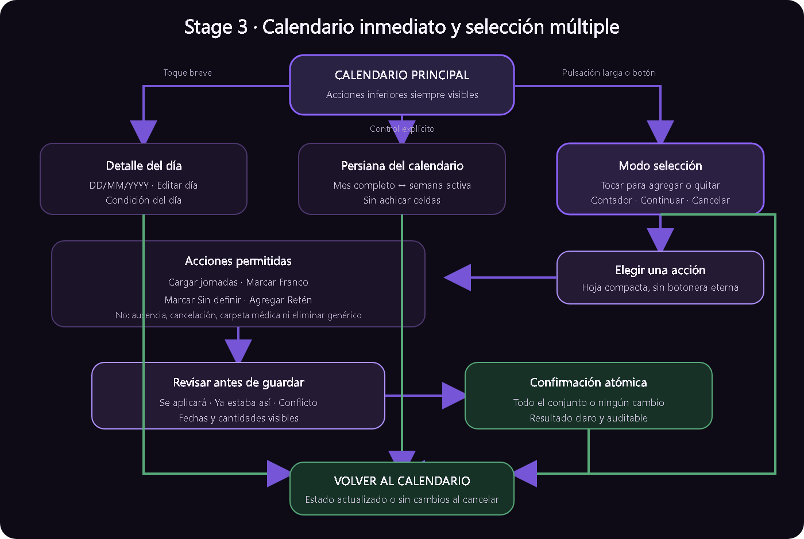

# Stage 3 — Selección múltiple y calendario plegable de MiGuardia 3.0

Fecha: 2026-09-15  
Estado: `AUTORIZADO`; Joaquín aceptó Stage 2 y autorizó la implementación el 2026-09-15.

## PERFIL DE EJECUCIÓN

- Modelo previsto por Joaquín: `GPT-5.6 Sol`, razonamiento `Medium`.
- Resolver como una única capacidad cohesiva y grande. Las fases internas de
  estado, UI, operaciones por lote, regresiones y documentación no son stages ni
  tareas independientes.
- Priorizar reutilización y economía de contexto: inspeccionar primero el flujo
  existente, modificar sólo los contratos necesarios y ejecutar pruebas según
  impacto. No reconstruir Stage 1/2 ni repetir baterías sin riesgo concreto.

## TASK

Convertir el Calendario principal en una superficie de trabajo inmediata: una
pulsación larga sobre un día inicia selección múltiple y una zona inferior fija
permite operar sobre esa selección sin desplazarse. El mes puede plegarse como
una persiana a la semana activa, sin achicar permanentemente las celdas ni perder
orientación.

Reutilizar y generalizar la selección existente de carga manual y feriados. No
crear un segundo motor de selección incompatible.

## DECISIONES DE PRODUCTO FIJADAS

- Se elige calendario plegable, no un calendario permanentemente más pequeño.
  Las celdas conservan legibilidad y superficie táctil.
- Las acciones principales viven en una zona inferior fija y permanecen
  visibles sin scroll, con el mes desplegado o plegado.
- El plegado es explícito y predecible. Seleccionar, desplazar, rotar o recrear
  no debe abrirlo o cerrarlo inesperadamente.
- Un toque breve en modo normal abre el detalle. Una pulsación larga entra en
  selección y selecciona ese día. `Seleccionar días` ofrece el mismo acceso sin
  exigir conocer el gesto.
- El detalle de día y su submenú aceptable de Stage 2 no se rediseñan aquí.
- Seleccionar no escribe. Toda mutación muestra alcance, conflictos y resultado
  antes de guardar.

## CONTEXT

- El Calendario es la pantalla principal y debe seguir siéndolo.
- `CalendarUiState` ya conserva `interactionMode`, `editSelectedDates` y la
  confirmación de selección para flujos concretos.
- `CalendarScreen` distingue selección para carga manual y feriados, pero su
  propósito se infiere desde estados externos. Stage 3 debe estabilizar un único
  contrato con propósito explícito si resulta necesario; no apilar booleanos
  ambiguos.
- Las acciones principales están dentro del contenido desplazable, debajo del
  mes, y en teléfonos o zooms grandes requieren demasiado scroll.
- Stage 1 estabilizó jornada, Franco, Retén, notas y edición del día.
- Stage 2 estabilizó `?`, carpeta médica, ausencia y cancelación.
- El detalle aceptable usa `DD/MM/YYYY`, un único botón `Editar día` y una tarjeta
  `Condición del día`. El submenú usa fecha humana completa, tres altas
  principales y correcciones sólo para datos existentes; Atrás vuelve al
  Calendario. No volver a dispersar botones ni plantillas vacías en ese detalle.
- La interfaz debe ser sobria, predecible y comprensible sin manual.

## INPUTS

- Repositorio: `MiGuardia-3.0/`.
- Rama esperada: `codex/miguardia-3.0`.
- Base: commit de aceptación de Stage 2, todavía no creado.
- Leer `AGENTS.md`, `docs/STATUS.md`, `docs/LECTURAS_POR_TAREA.md`, este contrato,
  los contratos/handoffs aceptados de Stage 1/2 y las secciones pertinentes de
  `docs/VALIDACION.md`.
- Código principal: `CalendarScreen.kt`, `CalendarDayDetail.kt`,
  `CalendarUiState.kt`, `CalendarViewModel.kt`, `MiGuardiaApp.kt` y repositorios
  de jornada, Franco, `?` y disponibilidad.
- Mapa visual: `docs/diagrams/stage-3-flujo.png`; fuente vectorial editable en
  `docs/diagrams/stage-3-flujo.svg`.

## OUTPUT

### Modo de selección

- Una pulsación larga sobre una celda habilitada inicia selección con ese día.
- Mientras está activo, un toque breve agrega o quita un día.
- Mostrar `1 día seleccionado`, `2 días seleccionados`, etc.
- Ofrecer `Seleccionar días` como alternativa visible y accesible.
- `Cancelar` abandona el modo sin escribir datos.
- Plegar o desplegar conserva la selección.
- Cambiar de mes con selección activa pide confirmar el descarte. No se requiere
  selección simultánea entre meses.
- Atrás cierra primero un diálogo, luego cancela selección y sólo después sale de
  la pantalla.
- Combinar superficie o contorno, check y semántica; no depender sólo de color o
  del gesto largo.
- Días fuera del mes visible no son seleccionables y una fecha no puede contarse
  dos veces.
- Rotación y recreación conservan propósito, mes, selección y plegado mientras
  el flujo siga abierto; al finalizar, una entrada nueva comienza limpia.

### Acciones sobre la selección

La zona inferior fija muestra contador, `Continuar` y `Cancelar`. Al continuar,
una hoja compacta ofrece:

- `Cargar jornadas`: entrega las fechas al flujo vigente de carga manual.
- `Marcar Franco`: reutiliza la operación por lote vigente y anticipa conflictos.
- `Marcar Sin definir`: sólo en fechas compatibles, sin borrar otras fuentes.
- `Agregar Retén`: pide una franja horaria y etiqueta comunes, muestra que se
  aplicarán a todos los días y conserva registros independientes.

No mostrar las cuatro acciones permanentemente en una hilera ni convertir la
pantalla en otro bloque de botones. La acción elegida reutiliza su formulario y
vuelve al Calendario con un resultado breve.

No ofrecer ausencia ni cancelación —pertenecen a una jornada—, carpeta médica
—es un rango continuo— ni `Eliminar`, que sería ambiguo.

Antes de escribir, clasificar fechas en `se aplicará`, `ya estaba así` y
`conflicto`; mostrar cantidades y permitir revisar fechas. No omitir días
incompatibles. La operación debe ser atómica: o se aplica a todo el conjunto
confirmado o no cambia ninguna fecha. Si los repositorios actuales no lo
garantizan, estabilizar en este Stage un contrato transaccional con CAS; Compose
no debe encadenar escrituras individuales.

### Calendario plegable

- El control dice `Plegar calendario` / `Ver mes completo` y anuncia su estado.
- Expandido conserva el mes completo y la navegación vigente.
- Plegado conserva encabezado, días de semana y la semana activa.
- La semana activa contiene primero una fecha seleccionada; sin selección, el
  último día abierto si pertenece al mes; luego hoy; finalmente, la primera
  semana del mes.
- Entrar o salir de selección conserva el plegado elegido; no hacerlo automático.
- No reducir permanentemente alto táctil, tipografía, indicadores ni el marcador
  verde/check de completado.
- La transición es breve y respeta la reducción de movimiento del sistema.
- El plegado es presentación: no agregarlo a Room ni a Copias.

### Acciones siempre visibles

- Mover las acciones primarias a una zona inferior fija y segura para barras del
  sistema, gestos, teclado y paisaje.
- Fuera de selección, `Cargar jornadas o francos` sigue como acción principal y
  `Seleccionar días` como secundaria visible.
- Dentro de selección, mostrar contador, `Continuar` y `Cancelar`; las demás
  acciones aparecen después, en una hoja compacta.
- Reservar espacio para que ninguna celda, mensaje o acción quede tapada.

## RUTA INTERNA DE IMPLEMENTACIÓN

Son fases del mismo Stage, no dependencias separadas:

1. **Contrato de interacción:** inventariar consumidores de `EDIT`, definir el
   propósito único de selección, plegado y prioridad de Atrás; agregar pruebas
   puras de estado antes de cambiar la composición.
2. **Superficie de Calendario:** incorporar pulsación larga y alternativa
   visible, semana plegada, indicadores accesibles y zona inferior fija sin
   alterar el detalle del día.
3. **Acciones completas:** reutilizar carga manual y estabilizar operaciones
   atómicas para Franco, `?` y Retén, con preview, confirmación, conflicto
   concurrente y resultado.
4. **Integración y auditoría:** comprobar feriados, carga manual, recreación,
   meses, zoom, temas y navegación; revisar el diff y entregar un handoff único.

## CONTRATOS COMPARTIDOS Y ESCRITURA

- Productor: estado/ViewModel del Calendario. Consumidores: grilla, zona fija,
  carga manual y selección de feriados.
- Productores de mutación: repositorios de jornadas/Franco, estado explícito y
  disponibilidad. Consumidor: orquestador de lote; Compose no escribe filas.
- `CalendarScreen.kt`, `MiGuardiaApp.kt`, `CalendarUiState.kt` y
  `CalendarViewModel.kt` forman una frontera compartida y deben tener un solo
  escritor durante la integración.
- Repositorios/DAO sólo pueden delegarse después de fijar expectativa, resultado
  y atomicidad del lote, sin compartir archivos con el escritor UI.
- Pruebas de accesibilidad o revisión pueden ser frentes de sólo lectura; no
  habilitan otro rediseño paralelo.

## SCOPE

- Estado, ViewModel y Compose del Calendario.
- Reutilización de carga manual, Franco, `?` y Retén.
- Operaciones por lote mínimas si son necesarias para atomicidad/CAS.
- Pruebas JVM, Compose e instrumentadas directamente afectadas.
- Documentación de Stage 3 y `docs/STATUS.md` al registrar resultados reales.

No incluye rediseño global de Resumen, menú, informes o configuración. Tampoco
incluye edición masiva de jornadas existentes, arrastrar fechas, selección entre
meses, calendario infinito ni nuevos tipos de condición laboral.

## DEPENDENCIES

- Stage 1 aceptado.
- Stage 2 aceptado e integrado como base estable.
- Este contrato aceptado por Joaquín antes de implementar.

## DO NOT

- No achicar celdas por debajo del área táctil accesible.
- No depender sólo de color, gesto largo o animación.
- No duplicar el estado de selección existente.
- No llenar otra vez el detalle ni introducir fechas ISO visibles.
- No aplicar ausencia/cancelación a fechas ambiguas ni carpeta médica a una
  selección discontinua.
- No borrar fuentes incompatibles para completar parcialmente una acción.
- No hacer que la pulsación larga abra también el detalle ni dispare vibración
  repetida; como máximo una confirmación háptica breve al entrar en selección.
- No mostrar un panel fijo con todas las acciones ni ocultar `Cancelar`.
- No cambiar Room, Copias o dependencias sin beneficio probado.
- No tocar versión, `applicationId`, firma, distribución, website ni app pública.
- No usar dispositivo, commit, push, tag, AAB ni publicación sin autorización
  posterior aplicable.

## VALIDATION

- Pulsación larga, alternativa visible, agregar/quitar y cancelar selección.
- Una y varias fechas; fecha ocupada; selección mixta y conflicto concurrente.
- Cada acción masiva con preview, confirmación, resultado y rollback verificables.
- Plegado/expandido con hoy, otra semana y selección activa.
- Cambio de mes, Atrás, rotación y recreación sin escrituras fantasma.
- Claro/oscuro, zoom 100/150/200, TalkBack, teléfono pequeño/grande, retrato y
  paisaje.
- Zona inferior sin tapar contenido ni navegación del sistema.
- Regresión de carga manual y feriados: propósito, confirmación y salida no se
  contaminan entre sí.
- Unit tests para semana activa, estado y compatibilidad; Compose para
  gesto/semántica/layout; Room instrumentado sólo si cambia atomicidad.
- Perfiles `local` y `build` de `docs/VALIDACION.md` según el delta real.
- `python tools/docs_check.py`, catálogo QA y `git diff --check` verdes.
- Preparar QA física; ejecutarla sólo con autorización específica vigente.

## DONE WHEN

- La selección se comprende sin instrucciones externas.
- Fechas y efectos son inequívocos antes de guardar.
- Las acciones principales permanecen visibles sin scroll.
- El calendario conserva legibilidad expandido y plegado.
- No hay pérdidas parciales, escrituras silenciosas ni regresiones de Stage 1/2.
- El diff no contiene cambios oportunistas ni dependencias sin beneficio probado.
- MAIN recibe evidencia, riesgos, límites y un handoff auditable.
